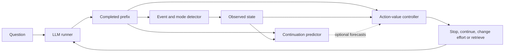

# Modeling LLM Reasoning Dynamics with Structural Representations

**English** · [Русская версия](README_RU.md)

This repository implements the methods in the manuscript revised on 2 November 2026: observing the structure of an LLM's reasoning, predicting how that structure will develop, and using these signals to choose the next action. It includes training, inference, calibration and evaluation code, configurations, small baseline weights and synthetic examples.

This page is the documentation entry point. Start with the [quick start](#quick-start) for a working CPU example, then choose a component from the [package map](#packages). Full training and generation require separately supplied data and model assets; see [available assets](#assets).

## Contents

- [Architecture](#architecture) and [entities, events and reasoning modes](#entities)
- [Installation](#installation) and [quick start: CLI and Python](#quick-start)
- [Packages and their responsibilities](#packages)
- [Observation: lexical and neural detectors](#observation)
- [Prediction: models, input variants and auxiliary tasks](#prediction)
- [Structural process models and rollouts](#process-models)
- [Control: actions, forecasts, effort and retrieval](#control)
- [Transfer and loop detection](#evaluation)
- [Data contracts and output artifacts](#data)
- [Execution modes, checkpoints and recovery](#execution)
- [Checks, troubleshooting and further documentation](#checks)

<a id="architecture"></a>
## Architecture

The implementation separates three responsibilities:

1. **Observation:** infer events and reasoning modes from the completed prefix. A detector describes the state available at the current decision point.
2. **Prediction:** estimate what follows that state: continuation within the current mode, a mode change, termination, future events or remaining structure.
3. **Control:** estimate the quality and cost of allowed actions and choose one. A generation runner executes that action and provides the next prefix.



Training is a separate path: traces and annotations are grouped by question, converted into model-specific packs, and used to fit detectors, predictors or action-value models. Validation or calibration data select checkpoints, thresholds and policy parameters according to each experiment's configuration. Evaluation consumes the frozen models and policies.

The packages expose different interfaces for these stages. The standalone `reasoning-gate` returns a decision; it does not call an LLM. Live branch generation is implemented separately by `effort_control.generate` and `retrieval_control.branch_worker`. Connecting a detector to a predictor or controller requires matching the vocabulary, feature order, coordinates and availability times of their input contracts.

<a id="entities"></a>
## Entities, events and reasoning modes

| Entity | Meaning in the implementation |
| --- | --- |
| Question | The unit used to group related traces and keep training and evaluation separate. |
| Trace | One solver run for a question. Repeated seeds and alternative continuations are distinct traces. |
| Prefix | The part of a trace available at a decision point. |
| Segment | A completed piece of reasoning text. Its text, boundaries and availability must be supplied consistently. |
| Event, **E** | A local occurrence such as checking a result or abandoning an attempt. Several event types may occur in one segment. |
| Mode | The activity associated with a segment, such as deriving or verifying. |
| Span, **S** | A consecutive interval associated with a reasoning mode. The neural detector builds spans from adjacent predicted mode labels. |
| Text, **T** | Textual input or its frozen representation; the representation depends on the experiment. |
| Common features, **C** | Shared counters and context features, such as position and expenditure. The exact columns are defined by each model's contract. |
| Annotation namespace | A versioned vocabulary and its label-availability masks. Different annotators' label indices are not interchangeable. |
| Observation | The detector outputs and other features available at the decision point. |
| Forecast | A prediction about structure after the observed prefix. It is distinct from a label of the current segment. |
| Action / policy | An allowed continuation operation / a rule for choosing that operation from the available state. |
| Calibration | Fitting thresholds, probability temperatures or cost/quality trade-offs on a separate, designated subset. |
| Seed, `seed` | An integer controlling reproducible initialization and sampling; recovery also saves the evolving RNG state. |
| Pack | Arrays, membership and manifests prepared for a particular model interface. |
| Checkpoint / bundle | Saved model state / a verified inference package containing weights, code, tokenizers, calibration and contracts. |

### Event vocabulary

The six-event interface used by the prefix detector and baseline gate is:

| Identifier | Meaning |
| --- | --- |
| `backtrack` | Return from or undo an earlier reasoning step. |
| `verify` | Check an intermediate result or proposed answer. |
| `branch` | Open an alternative approach. |
| `subgoal_done` | Complete an intermediate subgoal. |
| `failed_attempt` | Mark an attempt as unsuccessful. |
| `commit` | Settle on a candidate or direction. |

These are annotation categories, not guarantees of mathematical correctness. Native predictor namespaces can have different event vocabularies; their dimensions and masks travel with the pack.

### Reasoning-mode vocabulary

| Identifier | Meaning |
| --- | --- |
| `SETUP` | Interpret the task and establish the initial setup. |
| `DERIVING` | Develop a solution through deductions or calculations. |
| `EXPLORING` | Examine alternatives or possible approaches. |
| `VERIFYING` | Check the solution or an intermediate result. |
| `REVISING` | Modify the current solution or approach. |
| `CONCLUDING` | Formulate the conclusion or answer. |
| `GROUNDING` | Refer to supporting facts or context in interfaces that include this seventh class. |

The neural prefix API has **six** modes, ending at `CONCLUDING`. The baseline gate and some process-predictor interfaces retain a seventh `GROUNDING` index. Native namespaces may differ again. Read the relevant schema rather than assuming that all mode vectors have the same width.

<a id="installation"></a>
## Installation

Use Python 3.12 for the documented setup. The package declares Python 3.10–3.12 compatibility. Git LFS is needed to retrieve the included baseline weights.

```bash
git clone https://github.com/karpovilia/reasoning.git
cd reasoning
python3.12 -m venv .venv
source .venv/bin/activate
python -m pip install -e '.[neural,retrieval,test]'
git lfs install --local
git lfs pull
make check
make weights
```

| Install option | Purpose |
| --- | --- |
| `pip install -e .` | Core arrays, PyTorch models, lexical detector and gate. |
| `.[neural]` | Transformers, LoRA adapters and neural-detector/predictor support. |
| `.[retrieval]` | HTTP clients and utilities for retrieval generation. |
| `.[data]` | JSON Schema validation and Zstandard input support. |
| `.[test]` | CPU test dependencies. |
| `.[tokenization]` | Explicit tokenizer-library dependency. |

The small examples below run on CPU. Full Qwen training requires suitable CUDA hardware and the pinned base-model assets. The gpt-oss generation runner additionally requires a separate, compatible vLLM environment; vLLM is not installed by these extras.

<a id="quick-start"></a>
## Quick start: CLI and Python

All shell commands run from the repository root. Output files in these examples must be new: inference commands use exclusive creation to avoid silently replacing an earlier result.

### 1. Observe reasoning segments

```bash
mkdir -p outputs
reasoning-detector predict \
  --checkpoint models/detector/lexical-event-span-v1.pkl \
  --input examples/detector_segments.jsonl \
  --output outputs/detected.jsonl
```

Each input row contains `segments`, a list of strings. Each output segment has six event probabilities, a mode name and its index. This uses the included lexical detector.

### 2. Choose an action from the observed prefix

```bash
reasoning-gate --config configs/gate/matched_gru_joint.json \
  --detector models/detector/lexical-event-span-v1.pkl \
  --input examples/pipeline.jsonl \
  --output outputs/decisions.jsonl
```

This command first labels the completed segments, then returns an action with predicted success probabilities, costs, utility and a `fallback` flag. It does not execute the action. Without `--detector`, the input must already contain event probabilities and mode indices, as in [examples/gate_observation.jsonl](examples/gate_observation.jsonl).

The same operation is available in Python:

```python
import json
from pathlib import Path
from reasoning_control.detector import Detector
from reasoning_control.gate import load, detect_and_decide

detector = Detector("models/detector/lexical-event-span-v1.pkl")
policy = load("configs/gate/matched_gru_joint.json")
observation = json.loads(Path("examples/pipeline.jsonl").read_text())
result = detect_and_decide(detector, policy, observation)
print(result["decision"]["action"])
print(result["decision"]["fallback"])
```

The example's token coordinates are illustrative. A real caller supplies native token positions and the time at which each annotation became available. `prompt_tokens` counts the prompt; `now` counts the reasoning tokens already spent.

### 3. Train and evaluate a small predictor

```bash
python examples/train_predictor.py --out outputs/synthetic_predictor
```

This creates synthetic data, trains a small segment Transformer, saves checkpoints and produces DEV predictions. Results include `fit/best.pt`, `fit/COMPLETE.json` and `fit/predictions_dev/METRICS.json` beneath the chosen output directory. It exercises the same training and prediction implementation as the larger model, with a small architecture and one pass. No model download or benchmark data is needed.

<a id="packages"></a>
## Packages and their responsibilities

| Package | Responsibility | Main interfaces |
| --- | --- | --- |
| [reasoning_control](src/reasoning_control) | Lexical observation, saved-action baselines, calibrated gate inference and basic trace schemas. | `reasoning-detector`, `reasoning-gate`, `reasoning-data`; `gate.load`, `detect_and_decide`. |
| [clean_detectors](src/clean_detectors) | Qwen prefix detector, own-history state, jointly trained structural prior, calibration and delayed revisions. | `train`, `history_inference.HistoryOnlineDetector`. |
| [prefix_api](src/prefix_api) | Verified neural-detector inference interface and resumable sessions. | `DetectorV1`. |
| [ptrain](src/ptrain) | Native-namespace data packs, segment/Qwen predictors, auxiliary tasks, training and DEV prediction. | `build_pack`, `attach_retro_es`, `embed`, `tokenize`, `runner`, `predict`. |
| [tes_process](src/tes_process) | Explicit and neural structural process models, state readouts and sampled continuations. | `fit_explicit`, `experiment`, `rollout_process`, `structure_diagnostics`. |
| [gate_rebuild](src/gate_rebuild) | Matched recurrent action-value networks and policy evaluation. | `training.fit_one`, `calibrate`, `predict`; `policy`, `evaluation`. |
| [matched_forecast](src/matched_forecast) | Matched text-only and text-plus-structure predictors for forecast-augmented control. | `matched`, `matched_reference`, `pes_reference`. |
| [pfgate](src/pfgate) | Bridge from detector output to 29 forecast features; controller fitting and paired evaluation. | `build_pes_records`, `pes_forward`, `matched_forward`, `worker`, `evaluate_matched`. |
| [effort_control](src/effort_control) | Difficulty/cycle/event heads; gpt-oss effort selection, switching and stopping. | `fit_v3`, `calibrate_v3`, `generate`, `gate_analyze_v3`. |
| [reasoning_event_detector](src/reasoning_event_detector) | Text-stream event rules, optional learned scoring, candidate-answer anchors and spend interface. | `detect`, `score_stream`, `candidate`, `spend_forecast`; scorer/spend weights are separate assets. |
| [retrieval_control](src/retrieval_control) | Paired answer/retrieve branches, features, ridge policies and answer/cost evaluation. | `branch_worker`, `extract_features`, `fit_evaluate`, `grade`. |
| [qwen_runner](src/qwen_runner) | Chat client, benchmark runner, tool execution and output writing used by retrieval generation. | `client`, `runner`, `tools`, `writer`, `cli`. |
| [structural_transfer](src/structural_transfer) | Prepared structural inputs and question-separated solver-family/benchmark holdouts. | `prepare_ablation`, `build_regimes`, `holdout`, `holdout_eval`, `holdout_summary_v3`. |
| [loop_control](src/loop_control) | Repetition heuristics and learned loop confirmation using a supplied predictor. | `audit_baseline`, `run`, `losses`. |

<a id="observation"></a>
## Observation: lexical and neural detectors

There are two distinct ready-to-integrate observation interfaces:

| Interface | Inputs and state | Assets |
| --- | --- | --- |
| `reasoning_control.detector.Detector` | Current and previous segment text; hashed lexical features and linear classifiers. | Included lexical checkpoint. |
| `prefix_api.detector_api_v1.DetectorV1` | Question, current completed segment and bounded own-history state; Qwen LoRA, recurrent memory and a causal structural prior. | Separately supplied checkpoint, base Qwen model, two tokenizers and calibration. |

Retrospective annotations are another source of structural observations for offline experiments. They are marked `retrospective_annotation`; they must not be presented as prefix-only detector output. The alternative manifest source kind is `causal_detector`.

### Neural training and bundle assembly

```bash
python -m clean_detectors.train \
  --config configs/detector/detector_config.json \
  --frozen data/local/detector/frozen \
  --runtime data/local/detector/runtime.json \
  --output outputs/detector

python tools/release/build_prefix_bundle.py \
  --checkpoint outputs/detector/checkpoint \
  --tokenizers models/base/detector_tokenizers \
  --calibration outputs/detector/calibration \
  --output outputs/prefix_bundle
```

These paths denote supplied or generated assets, not bundled datasets. The frozen directory contains `manifest.json` and `samples.sqlite`. Runtime JSON must contain a future Unix timestamp in `runtime_deadline_epoch`. Use the actual saved checkpoint directory; thresholds must have been calibrated for that checkpoint. The builder assembles and verifies the package; it does not train or calibrate it.

The supplied neural configuration uses Qwen3-4B-Instruct-2507 with rank-32 LoRA and own-history capacity 16. The text input must fit the 2,048-token limit of both frozen tokenizers. Oversized segments produce an ineligible result and reset own-history state; they do not produce a fabricated prediction.

### Stateful inference

With an assembled bundle and the base-model assets available, use a fresh process:

```python
from prefix_api.detector_api_v1 import DetectorV1

detector = DetectorV1("outputs/prefix_bundle/manifest.json", device="cuda")
detector.reset(trace_id="example-1", question="Compute 12 times 13.")
step = detector.observe("12 times 13 equals 12 times 10 plus 12 times 3.")
print(step["status"], step["primary"])
detector.save_session("outputs/detector_session")
```

Call `observe(segment_text)` once for each newly completed segment, in order. `primary` is its immutable immediate prediction. `revisions` are later estimates for earlier segments, with explicit target/as-of indices and lag. `view()` returns the latest span view; it is not a saved session. Use `save_session()` and `restore_session()` for recovery. One detector instance handles one trace at a time.

See [API contract](configs/detector/API_CONTRACT.json), [output schema](configs/detector/schema.json), [limitations](configs/detector/LIMITATIONS.json) and [bundle builder](tools/release/build_prefix_bundle.py).

<a id="prediction"></a>
## Prediction: models, input variants and auxiliary tasks

### Predictor architectures

| Model | Representation and architecture | Configuration |
| --- | --- | --- |
| A: segment Transformer | Frozen MiniLM vectors of the question and segment plus structural/common features; 12 layers, width 512, 8 attention heads, context 256 segments. | [A CTES](configs/predictor/A_CTES_RETRO_seed42.json). |
| B: Qwen predictor | Qwen3-4B-Instruct-2507 with rank-32 LoRA and structural heads; token context 8,192, up to 256 segments, bounded left context. | [B CTES](configs/predictor/B_CTES_RETRO_seed42.json), [B CTES G4](configs/predictor/B_CTES_G4_seed42.json). |

The main targets are `STAY` / `SWITCH` / `END`, destination mode at a known switch, and events of the next segment. Native namespaces retain their own heads and masks. Training aggregates eligible losses across namespaces, positions, traces and questions according to the configuration. A generation cap is not a positive natural-END label.

Input-set names identify the enabled feature groups: `C`, `CT`, `CE`, `CS`, `CES`, `CTE`, `CTS`, `CTES`. The release contains the concrete architecture/seed combinations in [configs/predictor](configs/predictor); it does not imply that every combination was fitted. `RETRO` marks retrospective structural input. The matched-forecast package separately uses `T` and `TES`, and structural-transfer comparisons use `E`, `S`, `ES`.

| Auxiliary task | Meaning | Pack preparation |
| --- | --- | --- |
| G2 | Predict the first next span and events inside it. | `ptrain.attach_group1`; the internal `group1` name corresponds to G2 configurations. |
| G3 | Reconstruct masked current annotations. | `ptrain.attach_group3`. |
| G4 | Locate deliberately injected annotation errors and classify their type. | `ptrain.attach_group4`; [corruption recipe](configs/observations/corruption.json). |

Auxiliary tasks require their prepared targets; selecting a G2/G3/G4 configuration alone does not create them. G4 concerns synthetic annotation corruption, not verified reasoning mistakes.

### Prepare, train and predict

The preparation path is:

```text
question roster + producer units
  -> build_pack
  -> attach_retro_es / attach_group1 / attach_group3 / attach_group4 as required
  -> embed (A) or tokenize (B)
  -> runner
  -> predict
```

Text is stored in SQLite as `texts(sha, text)`, keyed by SHA-256. Pack builders check membership and source hashes. [Detailed commands and input requirements](docs/usage.md#predictor-inputs-and-training) describe the roster, producer units and encoder binding.

For a prepared pack and a GPU UUID assigned to your run:

```bash
CUDA_VISIBLE_DEVICES="$GPU_UUID" python -m ptrain.runner \
  --config configs/predictor/A_CTES_RETRO_seed42.json \
  --pack data/local/pack_retro --out outputs/predictor_A_CTES_42 \
  --seed 42 --device cuda --max-seconds 3600 --purpose reproduce

CUDA_VISIBLE_DEVICES="$GPU_UUID" python -m ptrain.predict \
  --run outputs/predictor_A_CTES_42 --device cuda
```

Set `GPU_UUID` before running these commands; the training runner requires exactly one visible GPU. Select a B configuration and its tokenized pack for Qwen training. `predict` reads the completed run's bound checkpoint and writes DEV predictions; it is not a live text-generation CLI. For custom inference, use the corresponding model and data-adapter interfaces.

<a id="process-models"></a>
## Structural process models and rollouts

`tes_process` models sequences of modes, events and segment lengths. Its continuation samples are **structural trajectories**, not newly generated natural-language answers.

Supported process families include `poisson`, `markov`, `semimarkov`, `semimarkov_events`, `hawkes_binned`, `signed_hawkes_binned`, `ingarch`, `gru` and `neural_hawkes_observed`. The `_text` variants additionally use lexical sketches. Explicit-memory variants include `explicit_full_text`, `explicit_additive_text`, `explicit_reset_text` and `explicit_erasure_text`. See [Process](src/tes_process/models.py) and [EventMemory](src/tes_process/event_memory.py) for their state updates.

Prepare `prepared/ns9.json` and `prepared/ns9.npz` in the working directory described in [usage](docs/usage.md#structural-process-models), then run:

```bash
mkdir -p outputs/process
cp configs/process/readout.json outputs/process/RUN.json
export TES_COMPARISON_ROOT=outputs/process
python -m tes_process.fit_explicit 9 explicit_erasure_text 42
python -m tes_process.fit_explicit 9 gru_text 42
python -m tes_process.experiment 42
```

`fit_explicit` fits a selected process family and evaluates one-step forecasts and rollouts. `experiment` fits matched output heads on frozen process states, comparing conditional/marginal outputs and memory ablations. The configuration lists seeds and conditions. Fit/tuning/DEV sequence memberships are separate; `source_root` locates the process checkpoints used by the readout experiment.

<a id="control"></a>
## Control: actions, forecasts, effort and retrieval

### Action-value policies

Action-value models estimate success and additional cost for each allowed action. The policy chooses according to the calibrated quality/cost trade-off. The baseline gate returns both the predicted additional tokens and the cost converted into seconds by its configuration; this conversion is a fitted model, not a measurement of service latency.

| Controller | Action set | Execution |
| --- | --- | --- |
| Standalone baseline gate | `stop`, `continue_512`, `continue_2048`, `verify_512`, `neutral_512`; `__a3` configurations restrict the set to the first three. | Returns a decision for an external runner. |
| Forecast-augmented gate | `stop`, `continue_512`, `continue_2048`. | Fits and evaluates decisions using saved paired continuations. |
| Effort controller | Initial effort choice, standard-to-low effort switch, stopping. | `effort_control.generate` executes solver continuations. |
| Retrieval controller | `answer`, `continue` retrieval. | `retrieval_control.branch_worker` generates each branch from the shared prefix. |

Baseline feature variants are `time`, `confidence`, `counts`, `event_sequence`, `joint`; ablations include `joint_no_confidence`, `joint_no_timing`, `joint_no_age`, `counts_spans`, `spans_only`, `timeline`, `event_sequence_shuffled` and `counts_narrow`. Their channel masks are defined in [features.py](src/reasoning_control/gate_runtime/features.py). GRU/MLP comparisons use the configurations in [configs/gate](configs/gate). Missing required observations trigger the configured fallback and an explicit reason.

### Forecast-augmented control

The `pfgate` pipeline joins detector observations, text features and **29 forecasts** from a separately trained process predictor:

- next-step transition, destination-mode and event probabilities;
- next-segment length;
- next-boundary type and survival probabilities at three character horizons;
- point estimates of remaining segments, spans and characters.

These are different quantities: a probability of reaching the next span boundary is not a probability of finishing the entire answer. The [feature contract](src/pfgate/pes_forward.py) fixes the units and ordering.

Prepare bridge records with `build_pes_records`, export forecasts with `pes_forward` or `matched_forward`, and join them with `build_gate_table` / `build_gate_table_variant`. Then:

```bash
python -m pfgate.worker init data/local/forecast_gate/config.json outputs/forecast_gate
python -m pfgate.worker run data/local/forecast_gate/config.json outputs/forecast_gate
```

The worker configuration binds feature tables, paired outcomes, question folds, recipe and time cap. `evaluate`, `evaluate_matched` and `evaluate_matched_sensitivity` perform the paired comparisons. These modules use positional arguments documented at the top of their source files.

In this experiment, row **A** uses text/common features, **B** adds current structural observations, and **C** adds forecasts. These row names are distinct from predictor architectures A/B and the common-feature abbreviation C. The [matched forecast interface](src/matched_forecast/matched_reference.py) supplies the `T` / `TES` comparison.

### Effort control

Use `fit_v3` to fit the difficulty/cycle/event models and `calibrate_v3` to set their policy parameters. Their command-line interfaces list the required streams, fitted packs and diagnostics:

```bash
python -m effort_control.fit_v3 --help
python -m effort_control.calibrate_v3 --help
python -m effort_control.generate --help
```

Live generation requires supplied model assets and a vLLM environment. The generator accepts `--questions`, `--pack-dir`, `--fc-dir`, `--student-ckpt`, `--prereg` and `--out-dir`. Controls include `--budgets`, `--qs`, `--policy-versions`, `--conditions` and `--limit`. The default budget grid is 200, 287, 411, 589, 845, 1211, 1736 and 2489 tokens.

Evaluate saved runs with:

```bash
python -m effort_control.gate_analyze_v3 \
  --dump data/local/effort/dump.jsonl \
  --decisions data/local/effort/decisions.jsonl \
  --out outputs/effort_analysis
```

### Retrieval control

The retrieval path generates an immediate-answer branch and a further-search branch from the same saved prefix, extracts counters/text/structure, then calibrates matched ridge controllers.

```bash
python -m retrieval_control.branch_worker \
  --task data/local/retrieval/task.json \
  --config data/local/retrieval/runner.json \
  --output outputs/retrieval_branch.json

python -m retrieval_control.extract_features \
  --cases data/local/retrieval/cases.jsonl \
  --bundle outputs/prefix_bundle \
  --output outputs/retrieval_features --device cuda

python -m retrieval_control.fit_evaluate \
  --cases data/local/retrieval/cases.jsonl --tasks data/local/retrieval/tasks.jsonl \
  --features outputs/retrieval_features --responses data/local/retrieval/responses \
  --gold data/local/retrieval/cal_gold.jsonl --gold-eval data/local/retrieval/eval_gold.jsonl \
  --output outputs/retrieval_policy --mode all
```

The runner configuration supplies the solver and tool endpoints. Calibration uses 25 HotpotQA and 25 MuSiQue questions. The evaluation membership is explicit in `cases.jsonl`; the manuscript uses its frozen 65-question HotpotQA subset. `--mode fit` freezes a policy without reading EVAL outcomes, `evaluate` requires that freeze, and `all` performs both stages. `RESULT.json` records F1, exact match, token/tool costs and paired intervals. Missing branches block completion; unknown generation costs are retained in the cost-coverage result.

<a id="evaluation"></a>
## Transfer and loop detection

### Held-out solver families and benchmarks

`structural_transfer.prepare_ablation` prepares structural arrays. `build_regimes` constructs question-separated memberships for the full-data and held-out conditions:

```bash
python -m structural_transfer.build_regimes \
  data/local/transfer/corpus data/local/transfer/status.csv outputs/transfer_regimes
python -m structural_transfer.holdout --help
python -m structural_transfer.holdout_eval --help
```

`holdout --mode check` validates the training setup; `--mode train` fits the requested regimes/seeds. `holdout_eval` requires a checkpoint hash and the expected selection objective. `holdout_summary_v3` scores forecasts on common observed positions and separates natural endings, confirmed truncation and unknown endings. Its evaluation distinguishes held-out questions from held-out solver traces of questions seen through another solver.

### Repetition and learned confirmation

```bash
python -m loop_control.audit_baseline \
  --input data/local/loops.jsonl --output outputs/loop_audit --workers 1
```

The heuristic audit consumes traces and produces repetition measurements. `loop_control.run` trains/evaluates a learned confirmation head using a supplied predictor, pack, task specification and loop labels. Its paths are selected with `REASONING_LOOP_RUN`, `REASONING_LOOP_WEIGHTS`, `REASONING_LOOP_PACK` and `REASONING_QWEN_BASE`. A detected textual repetition is a different claim from a proven semantic reasoning loop.

<a id="data"></a>
## Data contracts and output artifacts

| Artifact | Contents / consumer |
| --- | --- |
| [Trace schema](data/schemas/trace.schema.json), [annotation schema](data/schemas/annotation.schema.json) | Basic exchange records; annotations are separate layers linked to traces. |
| Roster + producer units | Question groups, roles, trace identities, segment text and native labels; consumed by `ptrain.build_pack`. |
| `PACK_MANIFEST.json`, `units.json`, `arrays.npz` | Pack hashes, membership, arrays, vocabularies, masks and source kinds. Namespace definitions are carried in the pack manifest. |
| `embeddings.npy` / tokenized arrays | Prepared text input for architecture A / B, bound to the pack. |
| `RUN_BINDING.json` | The training configuration, code hashes, pack identity, seed and execution purpose. |
| `best.pt`, `final.pt`, `COMPLETE.json` | Selected/final predictor checkpoints and verified completion metadata. |
| `predictions_dev/predictions.npz`, `METRICS.json` | Per-position DEV predictions and metrics by namespace and evaluation groups. |
| Detector bundle `manifest.json` | Hashes of model, runtime, tokenizers, calibration and API contracts. |
| Retrieval cases / tasks / responses | Membership, paired `answer`/`continue` task identities and measured branch outcomes. |
| `POLICY_FREEZE.json`, `HEADS.npz` | CAL-only policy selection and fitted ridge weights. |
| `RESULT.json`, `COMPLETE.json` | Evaluation outputs and coverage/completion receipts for the relevant module. |

Unknown event labels remain masked; unknown modes do not become a valid class. Natural completion, confirmed truncation and unknown termination are separate states. Character counts, native solver tokens and wall-clock seconds are separate units. Converting one to another requires the explicit conversion model used by that experiment.

The three installed console commands are:

| Command | Operations |
| --- | --- |
| `reasoning-detector` | `train`, `predict`. |
| `reasoning-gate` | Inference from a supplied gate configuration, optionally preceded by lexical detection. |
| `reasoning-data` | `init --catalog ... --out ...` creates the layout for a supplied catalog; `validate --traces ... --annotations ...` checks record links. It does not download the experimental corpus. |

<a id="execution"></a>
## Execution modes, checkpoints and recovery

| Component / switch | Modes and behavior |
| --- | --- |
| `ptrain.runner --purpose` | `reproduce`: real admissible pack and declared E/S source kind; `production`: additionally requires a checksum-bound PASS record and accepted E/S admission; `profile`, `smoke`, `test`: development runs, including synthetic packs. |
| `ptrain.runner --max-updates` | Finite update cap for short runs. A capped checkpoint is not automatically a completed experiment. |
| `ptrain.predict --which` | Defaults to `best.pt`; the checkpoint must be bound by the completed run. |
| `matched_forecast.matched --mode` | `cpucheck`: data/model checks; `probe`: short GPU run and recovery/timing checks; `train`: matched fits. |
| `pfgate.worker` | `init` freezes the plan; `run` completes unfinished members within the cumulative cap. |
| `retrieval_control.fit_evaluate --mode` | `fit`, `evaluate`, `all`; evaluation requires frozen policies and unchanged inputs. |
| `structural_transfer.holdout --mode` | `check`, `train`; prediction and summary are separate commands. |
| `DetectorV1` | `reset`, sequential `observe`, observational `view`, durable `save_session` / `restore_session`. |

For predictor recovery, repeat the same command with the same output directory, configuration, code, pack and seed. The runner validates `RUN_BINDING.json`, preserves RNG/optimizer state and accounts for previous fit time. A completed, verified run returns without training again. A different experiment needs a new directory.

Predictor exit codes distinguish `0` (completed/already completed), `3` (directory locked), `75` (checkpointed interruption or execution cap; resumable), and `76` (cumulative fit budget exhausted). `--max-seconds` limits the current invocation; configuration `fit_budget_seconds` limits accumulated fit time. Repeated launches do not create a new cumulative budget.

<a id="assets"></a>
## Available assets

| Included | Supplied separately |
| --- | --- |
| Source code, model/experiment configurations, schemas and synthetic examples. | Raw questions, reasoning traces, annotation payloads, frozen memberships and per-question alternative continuations. |
| Small lexical-observer and GRU/MLP gate weights pinned in [models/MANIFEST.json](models/MANIFEST.json). | Causal Qwen observer weights, large predictor and process-model checkpoints, base pretrained language models. |
| CPU tests and an offline training/prediction example. | Full numerical reproduction of the paper's training and generation runs. |

Model revisions and numerical recipes are specified in [configs](configs). The source and distributed-file checksums are recorded in [CODE_ORIGINS.json](CODE_ORIGINS.json). The included baseline weights are not substitutes for the neural detector or large predictor checkpoints.

<a id="checks"></a>
## Checks, troubleshooting and further documentation

```bash
make check      # source/configuration integrity and publication checks
make weights    # materialized Git LFS weight hashes
make test       # CPU tests on synthetic inputs
```

The publication checker can also compare text against locally supplied benchmark references. Without those references, their content checks are reported as unavailable; this does not download private datasets.

| Symptom | Check |
| --- | --- |
| Weight file is a small LFS pointer | Run `git lfs pull`, then `make weights`. |
| Output file already exists | Choose a new inference output; resume only through the component's explicit recovery mechanism. |
| `fallback: true` | Read `reason`; check confidence, event/mode dimensions, token coordinates and availability times. |
| `RUN_BINDING_MISMATCH` | A frozen input changed. Use the original inputs to resume or a new directory for a new run. |
| `EXACTLY_ONE_VISIBLE_GPU_REQUIRED` | Set `CUDA_VISIBLE_DEVICES` to the GPU assigned to this run. |
| Pack/source-kind or hash error | Rebuild the correct pack/interface; do not mix retrospective labels, causal observations or vocabularies. |
| Retrieval evaluation will not complete | Check the two tasks per case, terminal branch status, policy freeze and recorded costs. |

Further reading:

- [Detailed execution recipes and paper-to-code map](docs/usage.md)
- [Synthetic example formats](examples/README.md)
- [Included model assets](models/README.md)
- [Contribution guidelines](CONTRIBUTING.md)
- [Русская стартовая страница](README_RU.md)
