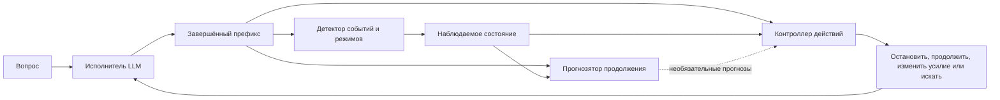

# Моделирование динамики рассуждений LLM через структурные представления

[English version](README.md) · **Русская версия**

Репозиторий содержит код методов статьи *Modeling LLM Reasoning Dynamics with Structural Representations*, редакция от 2 ноября 2026 года. Методы решают три задачи: определяют структуру уже полученного рассуждения, прогнозируют её развитие и используют эти сигналы для выбора следующего действия. В состав входят обучение, применение моделей, калибровка, оценка, конфигурации, небольшие веса базовых моделей и синтетические примеры.

Это стартовая страница документации. Начните с [быстрого старта](#quick-start), который работает на CPU, затем выберите компонент по [карте пакетов](#packages). Для полного обучения и генерации отдельно нужны данные и файлы моделей; их состав описан в разделе [доступных материалов](#assets).

## Содержание

- [Архитектура](#architecture) и [сущности, события и режимы рассуждения](#entities)
- [Установка](#installation) и [быстрый старт: CLI и Python](#quick-start)
- [Пакеты и их назначение](#packages)
- [Наблюдение: лексический и нейронный детекторы](#observation)
- [Прогноз: модели, варианты входов и вспомогательные задачи](#prediction)
- [Модели структурного процесса и продолжения](#process-models)
- [Управление: действия, прогнозы, усилие и поиск](#control)
- [Перенос между моделями и обнаружение повторений](#evaluation)
- [Форматы данных и выходные файлы](#data)
- [Режимы запуска, контрольные точки и восстановление](#execution)
- [Проверки, типичные ошибки и дальнейшая документация](#checks)

<a id="architecture"></a>
## Архитектура

В реализации разделены три задачи:

1. **Наблюдение:** определить события и режимы рассуждения по завершённому префиксу. Детектор описывает состояние, доступное в текущей точке принятия решения.
2. **Прогноз:** оценить, что последует за этим состоянием: продолжение текущего режима, смена режима, завершение, будущие события или оставшаяся структура.
3. **Управление:** оценить качество и стоимость допустимых действий и выбрать одно из них. Исполнитель генерации применяет действие и получает следующий префикс.



Обучение проходит отдельно: трассы и разметка группируются по вопросам, преобразуются в наборы для конкретных моделей и используются для обучения детекторов, прогнозяторов или моделей оценки действий. На валидационной или калибровочной части выбираются контрольные точки, пороги и параметры политики по правилам соответствующего эксперимента. Оценка использует уже зафиксированные модели и политики.

Для этих стадий предусмотрены разные интерфейсы. Команда `reasoning-gate` возвращает решение и сама не вызывает LLM. Реальная генерация ветвей реализована отдельно в `effort_control.generate` и `retrieval_control.branch_worker`. При соединении детектора с прогнозятором или контроллером должны совпадать словари, порядок признаков, координаты и время доступности входных данных.

<a id="entities"></a>
## Сущности, события и режимы рассуждения

| Сущность | Значение в реализации |
| --- | --- |
| Вопрос | Единица группировки связанных трасс и разделения обучения и оценки. |
| Трасса | Один запуск решателя на вопросе. Повторные запуски и альтернативные продолжения образуют отдельные трассы. |
| Префикс | Часть трассы, доступная в точке принятия решения. |
| Сегмент | Завершённый фрагмент текста рассуждения. Его текст, границы и момент доступности должны быть согласованы. |
| Событие, **E** | Локальное действие, например проверка результата или отказ от попытки. В одном сегменте могут происходить события нескольких типов. |
| Режим | Вид деятельности в сегменте, например вывод или проверка. |
| Спан, **S** | Последовательный интервал одного режима рассуждения. Нейронный детектор объединяет в спаны соседние предсказанные метки режима. |
| Текст, **T** | Текстовый вход или его замороженное представление; конкретное представление зависит от эксперимента. |
| Общие признаки, **C** | Счётчики и признаки контекста, например позиция и уже понесённые затраты. Точные столбцы задаёт интерфейс конкретной модели. |
| Пространство разметки, namespace | Версия словаря меток и маски их доступности. Индексы разных разметчиков нельзя считать взаимозаменяемыми. |
| Наблюдение | Выходы детектора и другие признаки, доступные в точке принятия решения. |
| Прогноз | Предсказание структуры после наблюдаемого префикса. Это отдельная задача по отношению к разметке текущего сегмента. |
| Действие / политика | Допустимая операция продолжения / правило её выбора по доступному состоянию. |
| Калибровка | Настройка порогов, температур вероятностей или соотношения качества и стоимости на выделенной части данных. |
| `seed` | Число, задающее воспроизводимую инициализацию и случайную выборку; для восстановления также сохраняется текущее состояние генератора. |
| Pack | Массивы, состав выборки и манифесты, подготовленные для определённого интерфейса модели. |
| Контрольная точка / bundle | Сохранённое состояние модели / проверяемый комплект для применения: веса, код, токенизаторы, калибровка и описание интерфейсов. |

### Словарь событий

Детектор префикса и базовый контроллер используют интерфейс из шести событий:

| Идентификатор | Значение |
| --- | --- |
| `backtrack` | Возврат к предыдущему шагу или отмена сделанного шага. |
| `verify` | Проверка промежуточного результата или предполагаемого ответа. |
| `branch` | Открытие альтернативного подхода. |
| `subgoal_done` | Завершение промежуточной подзадачи. |
| `failed_attempt` | Признание попытки неуспешной. |
| `commit` | Фиксация выбранного кандидата или направления решения. |

Это категории разметки, а не гарантии математической правильности. Исходные пространства разметки прогнозяторов могут иметь другие словари событий; их размерности и маски сохраняются в наборе данных.

### Словарь режимов рассуждения

| Идентификатор | Значение |
| --- | --- |
| `SETUP` | Интерпретация задачи и постановка решения. |
| `DERIVING` | Развитие решения через выводы или вычисления. |
| `EXPLORING` | Рассмотрение альтернатив и возможных подходов. |
| `VERIFYING` | Проверка решения или промежуточного результата. |
| `REVISING` | Изменение текущего решения или подхода. |
| `CONCLUDING` | Формулировка вывода или ответа. |
| `GROUNDING` | Обращение к опорным фактам или контексту в интерфейсах, где предусмотрен этот седьмой класс. |

Нейронный API префикса имеет **шесть** режимов, последний — `CONCLUDING`. Базовый контроллер и некоторые интерфейсы прогнозяторов сохраняют седьмой индекс `GROUNDING`. Исходные пространства разметки могут отличаться и от них. Размер вектора режима следует брать из соответствующей схемы.

<a id="installation"></a>
## Установка

Для описанного ниже окружения используйте Python 3.12. Пакет декларирует совместимость с Python 3.10–3.12. Для загрузки включённых базовых весов нужен Git LFS.

```bash
git clone https://github.com/karpovilia/reasoning.git
cd reasoning
python3.12 -m venv .venv
source .venv/bin/activate
python -m pip install -e '.[neural,retrieval,test]'
git lfs install --local
git lfs pull
make check
make weights
```

| Вариант установки | Назначение |
| --- | --- |
| `pip install -e .` | Работа с массивами, модели PyTorch, лексический детектор и контроллер. |
| `.[neural]` | Transformers, адаптеры LoRA, нейронные детекторы и прогнозяторы. |
| `.[retrieval]` | HTTP-клиенты и средства для генерации с поиском. |
| `.[data]` | Проверка JSON Schema и чтение Zstandard. |
| `.[test]` | Зависимости CPU-тестов. |
| `.[tokenization]` | Явная зависимость от библиотеки токенизации. |

Небольшие примеры ниже работают на CPU. Полное обучение Qwen требует подходящей CUDA-карты и файлов зафиксированной базовой модели. Исполнителю генерации gpt-oss также нужно отдельное совместимое окружение vLLM; перечисленные дополнения его не устанавливают.

<a id="quick-start"></a>
## Быстрый старт: CLI и Python

Все команды выполняются из корня репозитория. Выходные файлы в этих примерах должны быть новыми: команды применения моделей отказываются молча заменять предыдущий результат.

### 1. Получить события и режимы сегментов

```bash
mkdir -p outputs
reasoning-detector predict \
  --checkpoint models/detector/lexical-event-span-v1.pkl \
  --input examples/detector_segments.jsonl \
  --output outputs/detected.jsonl
```

Каждая входная строка содержит `segments` — список строк с текстом. Для каждого выходного сегмента возвращаются шесть вероятностей событий, имя режима и его индекс. Здесь используется лексический детектор из комплекта весов.

### 2. Выбрать действие по наблюдаемому префиксу

```bash
reasoning-gate --config configs/gate/matched_gru_joint.json \
  --detector models/detector/lexical-event-span-v1.pkl \
  --input examples/pipeline.jsonl \
  --output outputs/decisions.jsonl
```

Команда сначала размечает завершённые сегменты, затем возвращает действие, предсказанные вероятности успеха, затраты, полезность и флаг `fallback`. Само действие она не выполняет. Без `--detector` вход уже должен содержать вероятности событий и индексы режимов, как в [examples/gate_observation.jsonl](examples/gate_observation.jsonl).

Та же операция доступна из Python:

```python
import json
from pathlib import Path
from reasoning_control.detector import Detector
from reasoning_control.gate import load, detect_and_decide

detector = Detector("models/detector/lexical-event-span-v1.pkl")
policy = load("configs/gate/matched_gru_joint.json")
observation = json.loads(Path("examples/pipeline.jsonl").read_text())
result = detect_and_decide(detector, policy, observation)
print(result["decision"]["action"])
print(result["decision"]["fallback"])
```

Координаты токенов в примере иллюстративные. При реальном применении вызывающий код передаёт позиции в токенизации решателя и момент доступности каждой метки. `prompt_tokens` — число токенов запроса; `now` — число уже потраченных токенов рассуждения.

### 3. Обучить и проверить небольшой прогнозятор

```bash
python examples/train_predictor.py --out outputs/synthetic_predictor
```

Пример создаёт синтетические данные, обучает небольшой сегментный Transformer, сохраняет контрольные точки и получает прогнозы на DEV. В выбранном выходном каталоге появляются, в частности, `fit/best.pt`, `fit/COMPLETE.json` и `fit/predictions_dev/METRICS.json`. Используется тот же код обучения и предсказания, что у большой модели, но с небольшой архитектурой и одним проходом. Загрузка модели или данных бенчмарков не нужна.

<a id="packages"></a>
## Пакеты и их назначение

| Пакет | Назначение | Основные интерфейсы |
| --- | --- | --- |
| [reasoning_control](src/reasoning_control) | Лексическое наблюдение, базовые модели для сохранённых действий, применение калиброванного контроллера и общие схемы трасс. | `reasoning-detector`, `reasoning-gate`, `reasoning-data`; `gate.load`, `detect_and_decide`. |
| [clean_detectors](src/clean_detectors) | Детектор префикса на Qwen, состояние по собственным предсказаниям, совместно обучаемый структурный прогноз, калибровка и отложенные уточнения. | `train`, `history_inference.HistoryOnlineDetector`. |
| [prefix_api](src/prefix_api) | Проверяемый интерфейс нейронного детектора и сохраняемые сессии. | `DetectorV1`. |
| [ptrain](src/ptrain) | Наборы с исходными словарями разметки, сегментный и Qwen-прогнозяторы, вспомогательные задачи, обучение и прогнозы на DEV. | `build_pack`, `attach_retro_es`, `embed`, `tokenize`, `runner`, `predict`. |
| [tes_process](src/tes_process) | Явные и нейронные модели структурного процесса, предсказания по их состояниям и выборка продолжений. | `fit_explicit`, `experiment`, `rollout_process`, `structure_diagnostics`. |
| [gate_rebuild](src/gate_rebuild) | Сопоставимые рекуррентные модели оценки действий и оценка политик. | `training.fit_one`, `calibrate`, `predict`; `policy`, `evaluation`. |
| [matched_forecast](src/matched_forecast) | Сопоставимые прогнозяторы по тексту и по тексту со структурой для управления с прогнозами. | `matched`, `matched_reference`, `pes_reference`. |
| [pfgate](src/pfgate) | Преобразование выходов детектора в 29 признаков прогноза; обучение контроллера и парная оценка. | `build_pes_records`, `pes_forward`, `matched_forward`, `worker`, `evaluate_matched`. |
| [effort_control](src/effort_control) | Модели сложности, стоимости цикла и событий; выбор усилия gpt-oss, переключение и остановка. | `fit_v3`, `calibrate_v3`, `generate`, `gate_analyze_v3`. |
| [reasoning_event_detector](src/reasoning_event_detector) | Правила событий в потоке текста, необязательная обученная оценка, поиск первого кандидата ответа и интерфейс прогноза затрат. | `detect`, `score_stream`, `candidate`, `spend_forecast`; веса оценщика и прогноза затрат предоставляются отдельно. |
| [retrieval_control](src/retrieval_control) | Парные ветви ответа и поиска, признаки, линейные политики и оценка ответа и затрат. | `branch_worker`, `extract_features`, `fit_evaluate`, `grade`. |
| [qwen_runner](src/qwen_runner) | Клиент чат-модели, исполнитель заданий, вызов инструментов и запись результатов для генерации с поиском. | `client`, `runner`, `tools`, `writer`, `cli`. |
| [structural_transfer](src/structural_transfer) | Подготовка структурных входов и исключение семейств решателей или бенчмарков из обучения с разделением по вопросам. | `prepare_ablation`, `build_regimes`, `holdout`, `holdout_eval`, `holdout_summary_v3`. |
| [loop_control](src/loop_control) | Эвристики повторений и обучаемое подтверждение зацикливания на основе заданного прогнозятора. | `audit_baseline`, `run`, `losses`. |

<a id="observation"></a>
## Наблюдение: лексический и нейронный детекторы

Для включения в приложение предусмотрены два разных интерфейса наблюдения:

| Интерфейс | Входы и состояние | Необходимые файлы |
| --- | --- | --- |
| `reasoning_control.detector.Detector` | Текст текущего и предыдущего сегмента; хешированные лексические признаки и линейные классификаторы. | Лексическая контрольная точка входит в репозиторий. |
| `prefix_api.detector_api_v1.DetectorV1` | Вопрос, текущий завершённый сегмент и ограниченная история собственных выходов; Qwen LoRA, рекуррентная память и причинный структурный прогноз. | Отдельно предоставленные контрольная точка, базовая Qwen, два токенизатора и калибровка. |

Ретроспективная разметка — ещё один источник структурных наблюдений для офлайн-экспериментов. Она помечается `retrospective_annotation`; её нельзя выдавать за результат детектора, которому был доступен только префикс. Другой тип источника в манифесте — `causal_detector`.

### Обучение нейронного детектора и сборка комплекта

```bash
python -m clean_detectors.train \
  --config configs/detector/detector_config.json \
  --frozen data/local/detector/frozen \
  --runtime data/local/detector/runtime.json \
  --output outputs/detector

python tools/release/build_prefix_bundle.py \
  --checkpoint outputs/detector/checkpoint \
  --tokenizers models/base/detector_tokenizers \
  --calibration outputs/detector/calibration \
  --output outputs/prefix_bundle
```

Эти пути обозначают предоставленные или полученные при запуске файлы, а не наборы данных из репозитория. Зафиксированный каталог данных содержит `manifest.json` и `samples.sqlite`. В runtime JSON поле `runtime_deadline_epoch` должно задавать будущий момент времени в Unix-секундах. Укажите фактический каталог сохранённой контрольной точки; пороги должны быть откалиброваны для неё. Сборщик комплектует и проверяет файлы, но не обучает и не калибрует модель.

Предоставленная нейронная конфигурация использует Qwen3-4B-Instruct-2507, LoRA ранга 32 и историю собственных выходов до 16 сегментов. Текстовый вход должен помещаться в лимит 2048 токенов обоих замороженных токенизаторов. У слишком большого сегмента `status` отличается от `eligible`: история сбрасывается, предсказание `primary` отсутствует.

### Применение с сохранением состояния

Когда комплект собран и файлы базовой модели доступны, используйте новый процесс:

```python
from prefix_api.detector_api_v1 import DetectorV1

detector = DetectorV1("outputs/prefix_bundle/manifest.json", device="cuda")
detector.reset(trace_id="example-1", question="Compute 12 times 13.")
step = detector.observe("12 times 13 equals 12 times 10 plus 12 times 3.")
print(step["status"], step["primary"])
detector.save_session("outputs/detector_session")
```

Вызывайте `observe(segment_text)` один раз для каждого нового завершённого сегмента, по порядку. `primary` — неизменяемое предсказание, выданное сразу для этого сегмента. `revisions` — более поздние оценки предыдущих сегментов с явными индексами цели, момента оценки и задержкой. `view()` возвращает текущий вид спанов; это не сохранённая сессия. Для восстановления служат `save_session()` и `restore_session()`. Один экземпляр детектора одновременно обслуживает одну трассу.

См. [описание API](configs/detector/API_CONTRACT.json), [схему выходов](configs/detector/schema.json), [ограничения](configs/detector/LIMITATIONS.json) и [сборщик комплекта](tools/release/build_prefix_bundle.py).

<a id="prediction"></a>
## Прогноз: модели, варианты входов и вспомогательные задачи

### Архитектуры прогнозяторов

| Модель | Представление и архитектура | Конфигурация |
| --- | --- | --- |
| A: сегментный Transformer | Замороженные векторы MiniLM для вопроса и сегмента плюс структурные и общие признаки; 12 слоёв, ширина 512, 8 голов внимания, контекст 256 сегментов. | [A CTES](configs/predictor/A_CTES_RETRO_seed42.json). |
| B: прогнозятор на Qwen | Qwen3-4B-Instruct-2507 с LoRA ранга 32 и структурными выходными слоями; токенный контекст 8192, до 256 сегментов, ограниченный левый контекст. | [B CTES](configs/predictor/B_CTES_RETRO_seed42.json), [B CTES G4](configs/predictor/B_CTES_G4_seed42.json). |

Основные цели — `STAY` / `SWITCH` / `END`, режим назначения при известной смене режима и события следующего сегмента. Исходные пространства разметки сохраняют собственные выходные слои и маски. Обучение усредняет доступные ошибки по пространствам разметки, позициям, трассам и вопросам согласно конфигурации. Обрыв по лимиту генерации не превращается в положительную метку естественного `END`.

Названия вариантов обозначают включённые группы признаков: `C`, `CT`, `CE`, `CS`, `CES`, `CTE`, `CTS`, `CTES`. Конкретные сочетания архитектуры и `seed` находятся в [configs/predictor](configs/predictor); наличие схемы именования не означает, что обучена каждая комбинация. `RETRO` обозначает ретроспективный структурный вход. Отдельный пакет сопоставимых прогнозяторов использует `T` и `TES`, а проверки структурного переноса — `E`, `S`, `ES`.

| Вспомогательная задача | Смысл | Подготовка набора |
| --- | --- | --- |
| G2 | Предсказание первого следующего спана и событий внутри него. | `ptrain.attach_group1`; внутреннее имя `group1` соответствует конфигурациям G2. |
| G3 | Восстановление замаскированных текущих меток. | `ptrain.attach_group3`. |
| G4 | Локализация специально внесённых ошибок разметки и определение их типа. | `ptrain.attach_group4`; [рецепт искажения](configs/observations/corruption.json). |

Вспомогательным задачам нужны подготовленные целевые метки; один лишь выбор конфигурации G2/G3/G4 их не создаёт. G4 относится к синтетическим искажениям разметки, а не к подтверждённым ошибкам рассуждения.

### Подготовка, обучение и прогноз

Последовательность подготовки:

```text
question roster + producer units
  -> build_pack
  -> attach_retro_es / attach_group1 / attach_group3 / attach_group4 as required
  -> embed (A) or tokenize (B)
  -> runner
  -> predict
```

Здесь roster — список вопросов и связанных трасс с ролями выборки; producer units — исходные подготовленные единицы данных. Текст хранится в SQLite как `texts(sha, text)`, с ключом SHA-256. Сборщики проверяют состав выборки и хеши источников. [Подробная инструкция](docs/usage.md#predictor-inputs-and-training) описывает команды подготовки, исходные единицы и привязку текстового энкодера.

Для готового набора и UUID карты, выделенной под запуск:

```bash
CUDA_VISIBLE_DEVICES="$GPU_UUID" python -m ptrain.runner \
  --config configs/predictor/A_CTES_RETRO_seed42.json \
  --pack data/local/pack_retro --out outputs/predictor_A_CTES_42 \
  --seed 42 --device cuda --max-seconds 3600 --purpose reproduce

CUDA_VISIBLE_DEVICES="$GPU_UUID" python -m ptrain.predict \
  --run outputs/predictor_A_CTES_42 --device cuda
```

Перед вызовом задайте `GPU_UUID`: исполнитель обучения требует ровно одну видимую GPU. Для обучения Qwen выберите конфигурацию B и соответствующий токенизированный набор. `predict` читает связанную с завершённым запуском контрольную точку и записывает прогнозы на DEV; это не CLI генерации текста. Для применения к собственным входам используйте интерфейсы модели и адаптера данных.

<a id="process-models"></a>
## Модели структурного процесса и продолжения

`tes_process` моделирует последовательности режимов, событий и длин сегментов. Выборка продолжений здесь даёт **структурные траектории**, а не новые ответы на естественном языке.

Поддерживаются семейства `poisson`, `markov`, `semimarkov`, `semimarkov_events`, `hawkes_binned`, `signed_hawkes_binned`, `ingarch`, `gru` и `neural_hawkes_observed`. Варианты `_text` дополнительно используют лексические векторы. Варианты явной памяти включают `explicit_full_text`, `explicit_additive_text`, `explicit_reset_text` и `explicit_erasure_text`. Правила обновления состояния заданы в [Process](src/tes_process/models.py) и [EventMemory](src/tes_process/event_memory.py).

Подготовьте `prepared/ns9.json` и `prepared/ns9.npz` в рабочем каталоге по [инструкции](docs/usage.md#structural-process-models), затем выполните:

```bash
mkdir -p outputs/process
cp configs/process/readout.json outputs/process/RUN.json
export TES_COMPARISON_ROOT=outputs/process
python -m tes_process.fit_explicit 9 explicit_erasure_text 42
python -m tes_process.fit_explicit 9 gru_text 42
python -m tes_process.experiment 42
```

`fit_explicit` обучает выбранное семейство и оценивает прогнозы одного шага и продолжения. `experiment` обучает сопоставимые выходные слои на замороженных состояниях процесса, сравнивая условные и усреднённые выходы и варианты памяти. Список значений `seed` и условий задаёт конфигурация. Обучающая, настроечная и DEV-части разделены; `source_root` указывает, где находятся контрольные точки процессов для сравнения выходных слоёв.

<a id="control"></a>
## Управление: действия, прогнозы, усилие и поиск

### Политики на основе оценок действий

Модель оценки действий предсказывает вероятность успеха и дополнительные затраты для каждого допустимого действия. Политика выбирает действие по откалиброванному соотношению качества и стоимости. Базовый контроллер возвращает как предсказанные дополнительные токены, так и стоимость, переведённую в секунды по конфигурации. Это обученное преобразование, а не измерение задержки сервиса.

| Контроллер | Набор действий | Исполнение |
| --- | --- | --- |
| Самостоятельный базовый контроллер | `stop`, `continue_512`, `continue_2048`, `verify_512`, `neutral_512`; конфигурации `__a3` ограничивают набор первыми тремя. | Возвращает решение внешнему исполнителю. |
| Контроллер с прогнозами | `stop`, `continue_512`, `continue_2048`. | Обучает и оценивает решения по сохранённым парным продолжениям. |
| Контроллер усилия | Начальный выбор усилия, переключение со стандартного на низкое, остановка. | `effort_control.generate` выполняет продолжения решателя. |
| Контроллер поиска | `answer` — ответить; `continue` — продолжить поиск. | `retrieval_control.branch_worker` генерирует каждую ветвь из общего префикса. |

Основные варианты признаков базового контроллера: `time`, `confidence`, `counts`, `event_sequence`, `joint`. Проверки отдельных групп признаков включают `joint_no_confidence`, `joint_no_timing`, `joint_no_age`, `counts_spans`, `spans_only`, `timeline`, `event_sequence_shuffled` и `counts_narrow`. Маски входных каналов определены в [features.py](src/reasoning_control/gate_runtime/features.py). Конфигурации сравнений GRU и MLP находятся в [configs/gate](configs/gate). При отсутствии обязательного наблюдения возвращается заданное резервное действие с явной причиной.

### Управление с прогнозами продолжения

Последовательность `pfgate` соединяет наблюдения детектора, текстовые признаки и **29 прогнозов** отдельно обученной модели процесса:

- вероятности перехода следующего шага, режима назначения и событий;
- длину следующего сегмента;
- тип следующей границы и вероятности отсутствия границы на трёх горизонтах в символах;
- точечные оценки оставшихся сегментов, спанов и символов.

Это разные величины: вероятность достижения следующей границы спана не равна вероятности завершения всего ответа. [Описание признаков](src/pfgate/pes_forward.py) фиксирует единицы и порядок столбцов.

Подготовьте структурные записи через `build_pes_records`, выгрузите прогнозы через `pes_forward` или `matched_forward`, затем соедините признаки через `build_gate_table` / `build_gate_table_variant`. После этого:

```bash
python -m pfgate.worker init data/local/forecast_gate/config.json outputs/forecast_gate
python -m pfgate.worker run data/local/forecast_gate/config.json outputs/forecast_gate
```

Конфигурация исполнителя связывает таблицы признаков, парные исходы действий, разбиение вопросов, рецепт обучения и лимит времени. `evaluate`, `evaluate_matched` и `evaluate_matched_sensitivity` выполняют парные сравнения. Эти модули принимают позиционные аргументы, описанные в начале их исходных файлов.

В этом эксперименте строка **A** использует текст и общие признаки, **B** добавляет текущие структурные наблюдения, **C** — прогнозы. Эти обозначения строк отличаются от архитектур прогнозяторов A/B и сокращения C для общих признаков. [Интерфейс сопоставимых прогнозяторов](src/matched_forecast/matched_reference.py) обеспечивает сравнение `T` и `TES`.

### Управление усилием

`fit_v3` обучает модели сложности, стоимости цикла и событий, а `calibrate_v3` настраивает параметры политики. Справка CLI перечисляет необходимые потоки, подготовленные модели и диагностические данные:

```bash
python -m effort_control.fit_v3 --help
python -m effort_control.calibrate_v3 --help
python -m effort_control.generate --help
```

Для реальной генерации нужны файлы моделей и окружение vLLM. Генератор принимает `--questions`, `--pack-dir`, `--fc-dir`, `--student-ckpt`, `--prereg` и `--out-dir`. Запуск настраивается через `--budgets`, `--qs`, `--policy-versions`, `--conditions` и `--limit`. Бюджеты по умолчанию: 200, 287, 411, 589, 845, 1211, 1736 и 2489 токенов.

Сохранённые запуски оцениваются так:

```bash
python -m effort_control.gate_analyze_v3 \
  --dump data/local/effort/dump.jsonl \
  --decisions data/local/effort/decisions.jsonl \
  --out outputs/effort_analysis
```

### Управление поиском

Для общего сохранённого префикса создаются две ветви: немедленный ответ и продолжение поиска. Затем извлекаются счётчики, текстовые и структурные признаки и калибруются сопоставимые линейные контроллеры.

```bash
python -m retrieval_control.branch_worker \
  --task data/local/retrieval/task.json \
  --config data/local/retrieval/runner.json \
  --output outputs/retrieval_branch.json

python -m retrieval_control.extract_features \
  --cases data/local/retrieval/cases.jsonl \
  --bundle outputs/prefix_bundle \
  --output outputs/retrieval_features --device cuda

python -m retrieval_control.fit_evaluate \
  --cases data/local/retrieval/cases.jsonl --tasks data/local/retrieval/tasks.jsonl \
  --features outputs/retrieval_features --responses data/local/retrieval/responses \
  --gold data/local/retrieval/cal_gold.jsonl --gold-eval data/local/retrieval/eval_gold.jsonl \
  --output outputs/retrieval_policy --mode all
```

Конфигурация исполнителя задаёт адреса решателя и инструментов. Для калибровки используются 25 вопросов HotpotQA и 25 MuSiQue. Состав оценки явно задан в `cases.jsonl`; в статье используется зафиксированная выборка из 65 вопросов HotpotQA. Режим `--mode fit` фиксирует политику без чтения исходов EVAL; `evaluate` требует уже зафиксированную политику; `all` выполняет обе стадии. `RESULT.json` содержит F1, точное совпадение, затраты токенов и вызовов инструментов, парные интервалы. Отсутствие ветви останавливает завершение оценки; неизвестные расходы генерации отражаются в результате проверки полноты затрат.

<a id="evaluation"></a>
## Перенос между моделями и обнаружение повторений

### Отложенные семейства решателей и бенчмарки

`structural_transfer.prepare_ablation` готовит структурные массивы. `build_regimes` строит составы выборок с разделением вопросов для обучения на всех допустимых группах и условий с исключёнными группами:

```bash
python -m structural_transfer.build_regimes \
  data/local/transfer/corpus data/local/transfer/status.csv outputs/transfer_regimes
python -m structural_transfer.holdout --help
python -m structural_transfer.holdout_eval --help
```

`holdout --mode check` проверяет подготовку запуска; `--mode train` обучает заданные условия с указанными значениями `seed`. `holdout_eval` требует хеш контрольной точки и ожидаемое значение критерия выбора. `holdout_summary_v3` оценивает прогнозы на общих наблюдаемых позициях и различает естественное завершение, подтверждённый обрыв и неизвестное завершение. Оценка также различает полностью отложенные вопросы и отложенные трассы решателя для вопросов, встречавшихся у другого решателя.

### Повторения и обучаемое подтверждение

```bash
python -m loop_control.audit_baseline \
  --input data/local/loops.jsonl --output outputs/loop_audit --workers 1
```

Эвристический анализ принимает трассы и вычисляет показатели повторяемости. `loop_control.run` обучает и оценивает выходной слой подтверждения, используя заданный прогнозятор, набор данных, спецификацию задачи и метки зацикливания. Пути задаются переменными `REASONING_LOOP_RUN`, `REASONING_LOOP_WEIGHTS`, `REASONING_LOOP_PACK` и `REASONING_QWEN_BASE`. Обнаруженный повтор текста и доказанное смысловое зацикливание рассуждения — разные утверждения.

<a id="data"></a>
## Форматы данных и выходные файлы

| Файл или набор | Содержимое и потребитель |
| --- | --- |
| [Схема трассы](data/schemas/trace.schema.json), [схема разметки](data/schemas/annotation.schema.json) | Общие записи обмена; разметка хранится отдельными слоями, связанными с трассами. |
| Roster + producer units | Группы вопросов, роли выборок, идентификаторы трасс, тексты сегментов и исходные метки; вход `ptrain.build_pack`. |
| `PACK_MANIFEST.json`, `units.json`, `arrays.npz` | Хеши набора, состав, массивы, словари, маски и виды источников. Описание пространств разметки находится в манифесте набора. |
| `embeddings.npy` / токенизированные массивы | Подготовленный текстовый вход архитектуры A / B, связанный с набором. |
| `RUN_BINDING.json` | Конфигурация обучения, хеши кода, идентичность набора, `seed` и назначение запуска. |
| `best.pt`, `final.pt`, `COMPLETE.json` | Выбранная и финальная контрольные точки прогнозятора и проверяемая запись о завершении. |
| `predictions_dev/predictions.npz`, `METRICS.json` | Прогнозы на позициях DEV и метрики по пространствам разметки и группам оценки. |
| `manifest.json` комплекта детектора | Хеши модели, исполняемого кода, токенизаторов, калибровки и описаний API. |
| Cases / tasks / responses поиска | Состав выборки, идентификаторы парных задач `answer`/`continue` и измеренные исходы ветвей. |
| `POLICY_FREEZE.json`, `HEADS.npz` | Выбор политики только на CAL и обученные веса линейных моделей. |
| `RESULT.json`, `COMPLETE.json` | Выходы оценки и записи о полноте и завершении для соответствующего модуля. |

Неизвестные метки событий остаются под маской; неизвестный режим не становится допустимым классом. Естественное завершение, подтверждённый обрыв и неизвестное завершение — отдельные состояния. Символы, токены решателя и секунды по настенным часам — отдельные единицы. Для перевода между ними требуется явная модель преобразования соответствующего эксперимента.

При установке доступны три консольные команды:

| Команда | Операции |
| --- | --- |
| `reasoning-detector` | `train`, `predict`. |
| `reasoning-gate` | Применение заданной конфигурации контроллера, при необходимости с предварительным лексическим детектором. |
| `reasoning-data` | `init --catalog ... --out ...` создаёт структуру по заданному каталогу; `validate --traces ... --annotations ...` проверяет связи записей. Команда не загружает экспериментальный корпус. |

<a id="execution"></a>
## Режимы запуска, контрольные точки и восстановление

| Компонент / параметр | Режимы и поведение |
| --- | --- |
| `ptrain.runner --purpose` | `reproduce`: реальный допущенный набор и объявленный вид источника E/S; `production`: дополнительно требует запись PASS, связанную с хешами, и подтверждение допуска входов E/S; `profile`, `smoke`, `test`: разработка и проверка, в том числе на синтетических наборах. |
| `ptrain.runner --max-updates` | Ограничение числа обновлений для короткого запуска. Контрольная точка после такого ограничения не означает завершённого эксперимента. |
| `ptrain.predict --which` | По умолчанию `best.pt`; контрольная точка должна быть связана с завершённым запуском. |
| `matched_forecast.matched --mode` | `cpucheck`: проверки данных и модели; `probe`: короткий GPU-прогон, проверка восстановления и времени; `train`: сопоставимые обучения. |
| `pfgate.worker` | `init` фиксирует план; `run` выполняет незавершённые элементы в пределах общего лимита. |
| `retrieval_control.fit_evaluate --mode` | `fit`, `evaluate`, `all`; оценка требует фиксированных политик и неизменных входов. |
| `structural_transfer.holdout --mode` | `check`, `train`; предсказание и сводная оценка вызываются отдельно. |
| `DetectorV1` | `reset`, последовательный `observe`, наблюдаемый вид `view`, сохранение и восстановление через `save_session` / `restore_session`. |

Для восстановления обучения прогнозятора повторите ту же команду с теми же выходным каталогом, конфигурацией, кодом, набором и `seed`. Исполнитель проверяет `RUN_BINDING.json`, сохраняет состояние генераторов и оптимизатора, учитывает уже потраченное время. Завершённый и проверенный запуск возвращается без повторного обучения. Для другого эксперимента нужен новый каталог.

Коды выхода прогнозятора: `0` — завершено или уже было завершено; `3` — каталог занят; `75` — прерывание или ограничение текущего запуска с сохранением, можно продолжить; `76` — исчерпан суммарный бюджет обучения. `--max-seconds` ограничивает текущий вызов; `fit_budget_seconds` в конфигурации — накопленное время обучения. Повторный запуск не обнуляет суммарный бюджет.

<a id="assets"></a>
## Доступные материалы

| Включено в репозиторий | Предоставляется отдельно |
| --- | --- |
| Исходники, конфигурации моделей и экспериментов, схемы и синтетические примеры. | Исходные вопросы, трассы рассуждений, полная разметка, фиксированные составы выборок и альтернативные продолжения по вопросам. |
| Небольшие веса лексического детектора и GRU/MLP-контроллеров, зафиксированные в [models/MANIFEST.json](models/MANIFEST.json). | Веса причинного детектора Qwen, больших прогнозяторов и моделей процесса, базовые предобученные языковые модели. |
| CPU-тесты и офлайн-пример обучения и предсказания. | Полное численное воспроизведение обучений и генераций из статьи. |

Версии моделей и численные рецепты указаны в [configs](configs). Контрольные суммы исходников и публикуемых файлов находятся в [CODE_ORIGINS.json](CODE_ORIGINS.json). Включённые базовые веса не заменяют контрольные точки нейронного детектора и больших прогнозяторов.

<a id="checks"></a>
## Проверки, типичные ошибки и дальнейшая документация

```bash
make check      # source/configuration integrity and publication checks
make weights    # materialized Git LFS weight hashes
make test       # CPU tests on synthetic inputs
```

`make check` проверяет целостность кода и конфигураций и состав публикации; `make weights` — хеши загруженных весов LFS; `make test` — CPU-тесты на синтетических входах. Проверка публикации также может сравнивать тексты с локально предоставленными эталонами бенчмарков. Без эталонов соответствующие проверки отмечаются как недоступные; закрытые наборы при этом не загружаются.

| Симптом | Что проверить |
| --- | --- |
| Вместо весов маленький LFS-указатель | Выполните `git lfs pull`, затем `make weights`. |
| Выходной файл уже существует | Выберите новый файл для применения модели; восстанавливайте работу только через предусмотренный механизм компонента. |
| `fallback: true` | Прочитайте `reason`; проверьте уверенность, размерности событий и режимов, координаты токенов и моменты доступности. |
| `RUN_BINDING_MISMATCH` | Изменился зафиксированный вход. Для продолжения верните исходные входы; для нового запуска используйте новый каталог. |
| `EXACTLY_ONE_VISIBLE_GPU_REQUIRED` | Укажите в `CUDA_VISIBLE_DEVICES` карту, выделенную этому запуску. |
| Ошибка вида источника, набора или хеша | Соберите корректный набор для нужного интерфейса; не смешивайте ретроспективные метки, причинные наблюдения и словари. |
| Оценка поиска не завершается | Проверьте наличие двух задач на вопрос, конечные статусы ветвей, зафиксированную политику и учёт затрат. |

Дальнейшая документация:

- [Подробные команды и соответствие методов статьи коду](docs/usage.md), на английском
- [Форматы синтетических примеров](examples/README.md)
- [Включённые файлы моделей](models/README.md)
- [Правила внесения изменений](CONTRIBUTING.md)
- [English documentation home](README.md)
