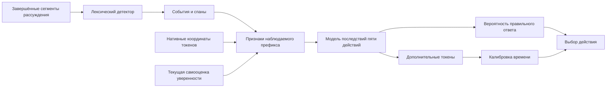

# Архитектура детектора и гейта

Дата: 2026-10-02

Детектор переводит завершённые сегменты рассуждения в вероятности событий и типы спанов. Гейт оценивает последствия возможных действий по уже наблюдаемой структуре. Веса, масштабирование признаков и конфигурация выбора действия зафиксированы раздельно.

## Детектор

[Код](../../src/reasoning_control/detector.py) использует текущий сегмент и предыдущий: последние 1 600 и 800 символов соответственно, с префиксами `CURRENT` и `PREVIOUS`. Разбиение текста задаёт [канонический сегментатор](../../src/reasoning_control/segmentation.py): переводы строк и границы предложений; исходный текст сохраняется, каждому сегменту соответствуют символьные координаты.

`HashingVectorizer` строит признаки по униграммам и биграммам слов, размерность 65 536, нормализация L2, `alternate_sign=False`. Шесть независимых `SGDClassifier` с логистической потерей возвращают вероятности событий в порядке:

1. `backtrack` — возврат к ранее выбранному решению;
2. `verify` — проверка;
3. `branch` — рассмотрение альтернативы;
4. `subgoal_done` — завершение подзадачи;
5. `failed_attempt` — распознанная неудачная попытка;
6. `commit` — фиксация решения или вывода.

Седьмой классификатор выбирает тип спана: `SETUP`, `DERIVING`, `EXPLORING`, `VERIFYING`, `REVISING`, `CONCLUDING`, `GROUNDING`. У каждого сегмента может быть несколько событий и один тип спана. Вероятности событий поступают в гейт без порога. Это обученные классификаторы; ключевые слова вручную не задаются.

Модель получает только текущий и прошлый текст. Разметчик, использовавший правый контекст или всю трассу, создаёт отдельный ретроспективный слой; его метки нельзя выдавать за наблюдения, доступные онлайн.

## Гейт

[Контракт признаков](../../src/reasoning_control/gate_runtime/features.py) имеет 40 каналов. В него входят расход токенов, координаты сегментов, задержка разметки, вероятности и накопленные количества событий, последний тип спана, наблюдённая длительность спанов и текущая самооценка уверенности. Текст вопроса, ответ, эталон, бенчмарк, будущая длина и правильность решения не входят в признаки.

В основном варианте `counts_spans` активны 28 каналов. Он суммирует вероятности событий и длительности спанов в одну запись. Замороженные веса используют проекцию 40 → 64, GELU, GRU с шириной 64 и две головы по пять выходов. Всего 28 234 обучаемых параметра. GRU здесь получает одну агрегированную запись; этот вариант не моделирует порядок событий. Вариант `joint` получает последовательность записей по сегментам и завершающую запись запроса.

Первая голова оценивает вероятность правильного итогового ответа после каждого действия. Вторая прогнозирует дополнительные токены; `softplus` обеспечивает неотрицательность. Пять действий: `stop`, `continue_512`, `continue_2048`, `verify_512`, `neutral_512`. Прогноз для `stop` относится к ответу, полученному при завершении текущего рассуждения, и не является оценкой правильности отдельного шага.

Средние и масштабы признаков оцениваются только на обучающей части и сохранены в весах. Обучение использует бинарную кросс-энтропию для правильности и Smooth L1 для стоимости с коэффициентом 0.1. Цель стоимости масштабируется на 1 024 токена. Неизвестные исходы маскируются отдельно от неизвестной стоимости. Вес каждого вопроса не зависит от числа его префиксов.

## Выбор действия

Гейт выбирает действие с максимальным значением

`P(правильный ответ | наблюдение, действие) − λ × ожидаемые дополнительные секунды`.

В [основной конфигурации](../../configs/gate/counts_spans.json) `λ = 0.005011872336272725`, а ожидаемое время равно `0.02394798261259963 × прогноз дополнительных токенов`. Свободный член и коэффициент длины промпта равны нулю. Голова стоимости в весах по-прежнему прогнозирует токены. Коэффициент перевода во время получен на измерениях конкретной площадки; для другой модели или оборудования нужна новая калибровка на валидации.

При отсутствующей обязательной самооценке или некорректном наблюдении политика возвращает `continue_2048`, `fallback=true` и причину. Отсутствующие метки не превращаются в уверенное решение остановиться.

## Область проверки

Замороженный гейт обучался на Qwen3-4B-Thinking-2507 с контрольной точкой после 1 024 токенов. Интерфейс принимает другие префиксы, но это само по себе не подтверждает качество на других длинах, моделях или доменах. Перенос на большие модели требует отдельного эксперимента.

LoRA-разметчик — отдельная модель: база Qwen3.6-35B-A3B и адаптер ранга 32. Он выдаёт JSON событий и спанов; его ответы использовались как обучающие метки. Запуск большого разметчика для инференса опубликованного лексического детектора не нужен.
