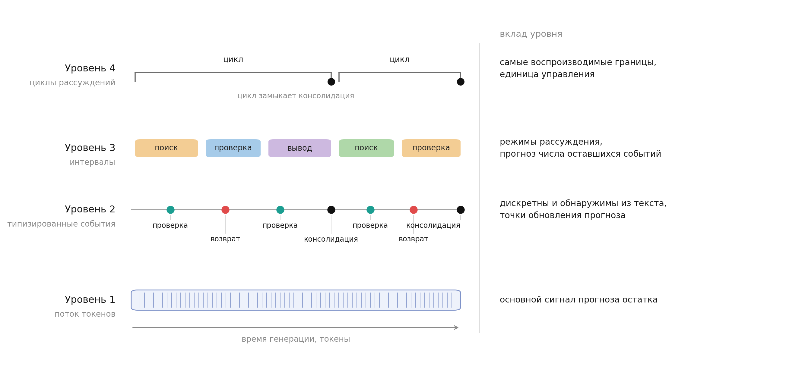
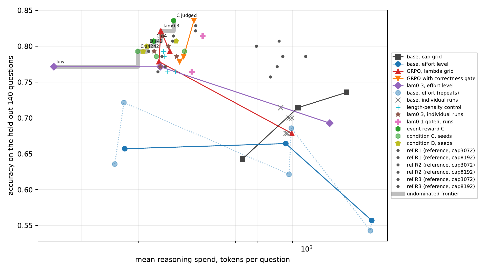

# Прогнозирование и сокращение расхода токенов рассуждающих языковых моделей

Дата: 2026-08-13. Источник: Overleaf-проект, ревизия 7b9259e. Текст перенесён из исходника вёрстки без изменения формулировок: менялась только разметка. Исходник вёрстки docs/assets/report_2026_08_13_tokens_RU.tex, его сборка docs/assets/report_2026_08_13_tokens_RU.pdf.

## Аннотация

Рассуждающая модель тратит на один вопрос от нескольких сотен до нескольких тысяч токенов, и это число становится известно только после завершения ответа. Мы выясняем, что помогает прогнозировать и что помогает сокращать этот расход, на $6{,}151$ трассе трёх моделей на пяти бенчмарках. Прогноз держится на токенном уровне, и его надёжная часть порядковая: прогноз по уже написанной части трассы ранжирует запросы по будущей стоимости с ранговой корреляцией $0.78$-$0.82$ и предупреждает о превышении порога с площадью под кривой точность-полнота $0.84$, тогда как снижение средней абсолютной ошибки на $35$-$37\%$ держится только против постоянной точки отсчёта и не переживает условную. Структура выше токенного уровня добавляет измеримо к голому прогрессу и ничего сверх полного набора позиционных признаков. Сокращение дают простые рычаги на gpt-oss-20b: значение low поля уровня усилий сокращает расход замороженной базы в $3.5$ раза без потери доли правильных ответов, а при обучении вклады разделяются: обучение правильности повышает долю правильных ответов, добавленный штраф за длину сохраняет этот прирост и примерно вдвое сжимает расход, и это разделение воспроизводится на независимой выборке из $510$ вопросов. Сложные альтернативы эти простые основы не превзошли: в офлайн-переигровке четыре семейства правил остановки не превосходят постоянные ограничения даже при оракульном подборе порогов, живой контур остановки на границах шагов рассуждения выходит в лучшем случае на паритет с ними, а событийная добавка к награде не даёт прироста, пережившего три начальных значения генератора случайных чисел. Оба провала согласуются с одной причиной: разметки событий рассуждения не воспроизводятся между независимыми источниками, два судьи согласны по счётчикам событий на трассу с ранговой корреляцией $0.745$.

## Введение

Перед финальным ответом рассуждающая модель выдаёт цепочку размышлений [wei2022cot], которую мы называем трассой, и тратит на неё от нескольких сотен до нескольких тысяч токенов на вопрос; это число становится известно только после завершения ответа. Тот, кто обслуживает поток запросов, вынужден распределять вычисления заранее, а длина трассы меняется вплоть до порядка в пределах одного корпуса. Для сокращения расхода достаточно трёх дешёвых рычагов: постоянного ограничения на число токенов, уровня усилий в запросе и обучения с наградой за правильный и короткий ответ. Для планирования очереди остаток расхода выполняющегося запроса прогнозируем по уже написанной части трассы признаками, не требующими разбора текста. Всё более сложное, что мы проверили, правила остановки по прогнозам, значениям уверенности и событийным триггерам, а также событийная добавка к награде, эти рычаги не превзошло, и событийные провалы согласуются с одной причиной: разметка событий рассуждения не воспроизводится между независимыми источниками.

Одну и ту же трассу можно описывать с разной степенью подробности: как поток токенов; как типизированные события, например проверку промежуточного результата или возврат к более раннему шагу; и как протяжённые участки одного занятия, которые мы называем смысловыми режимами и восстанавливаем моделью скрытых фаз над потоком событий, единицу, близкую к словарям участков в недавних работах. Для проверенных нами моделей, наград и бенчмарков полезный сигнал сидел на токенном уровне: структура над ним добавляет измеримо к голому прогрессу и к одному лишь тексту трассы, но ничего сверх полного набора позиционных признаков; см. рис. 1.

Рисунок 1. Три единицы описания трассы и вклад каждой. В прогнозе основной сигнал несёт поток токенов, а типизированные события и смысловые режимы добавляют к голому прогрессу и ничего сверх полного набора позиционных признаков; в управлении ни один структурный уровень воспроизводимого выигрыша не дал.

##### Полученные результаты.

1.  Карта простых мер управления расходом токенов: значение low уровня усилий сокращает расход замороженной базы gpt-oss-20b в $3.5$ раза без потери доли правильных ответов, награда за правильный и короткий ответ повышает долю правильных ответов с $0.729$ до $0.814$ при расходе почти втрое меньше, причём точность несёт обучение правильности, а сжатие несёт штраф за длину, и это разделение воспроизводится на независимой выборке из $510$ вопросов, где полная награда добавляет $6.7$ процентного пункта при $0.48$ расхода замороженной базы; раздел 5.

2.  Механизм этой экономии: она локализована, $60$-$83\%$ её приходится на хвост, который база дописывает после первого кандидата ответа, и докандидатная часть тоже сжимается; раздел 5.4.

3.  Прогноз по префиксу на дешёвых признаках, измеренный против честных точек отсчёта: он ранжирует запросы по будущей стоимости с ранговой корреляцией $0.78$-$0.82$ и предупреждает о превышении порога с площадью под кривой точность-полнота $0.84$, тогда как его снижение средней абсолютной ошибки на $35$-$37\%$ условную точку отсчёта не переживает, а величины из распределения следующего токена не превосходят значимо голое время ни на одной из трёх моделей; монитор переносится между архитектурами как процедура с пер-модельной калибровкой, а не как замороженные веса, и выбросом остаётся семейство gpt-oss; раздел 4.

4.  Систематическая проверка сложных альтернатив, все отрицательные: в офлайн-переигровке четыре семейства правил остановки не превосходят постоянные ограничения даже при оракульном подборе порогов, событийная добавка к награде воспроизводимого выигрыша не даёт, а временные модели событий не превращают своё преимущество по правдоподобию в прогноз; всё согласуется с одной причиной, поскольку разметка событий не воспроизводится между источниками; раздел 6.

## Связанные работы

##### Контроль длины обучением.

LCPO обучает модели, в запросе которых задаётся точное число токенов рассуждения или верхний предел [aggarwal2025l1]; s1 обрывает генерацию после заданного числа токенов или продлевает её словом "Wait" [muennighoff2025s1]; SelfBudgeter учит модель заранее объявлять свой бюджет [li2025selfbudgeter], а TALE вписывает оценённый бюджет прямо в запрос [han2024tale]. Штраф за длину в награде сжимает рассуждение с сохранением доли правильных ответов [arora2025efficient, yang2025thinkingoptimal, xiang2025alp, lyu2025hbpo], O1-Pruner и ThinkPrune дообучают с постепенно снижаемыми ограничениями длины [luo2025o1pruner, hou2025thinkprune], а Coconut и TokenSkip сжимают само представление цепочки [hao2024coconut, xia2025tokenskip], тогда как мы сокращаем обычную текстовую цепочку. Мы добавляем сравнение обученной остановки с заранее заданным пределом, разбор по трудности и проверку отставания генератора.

##### Остановка по значению уверенности.

Второе семейство обрывает генерацию, как только некоторая величина текущего шага пересекает порог: уверенность в уже сформулированном ответе [jurayj2025final], откалиброванный классификатор правильности по скрытому состоянию [zhang2025knowwhenright] или уверенность в пробном ответе, запрашиваемом при сменах хода рассуждения, метод DEER [yang2025deer]. Такие правила не учитывают предшествующее рассуждение, тогда как наши используют весь сгенерированный префикс.

##### Структурные разметки рассуждения.

Недавние работы описывают трассу структурой, а не наградой: ReasonOps без учителя кластеризует короткие повторяющиеся выражения, открывающие однотипные ходы рассуждения [lee2026reasonops], ReasoningFlow строит граф смысловых связей между шагами [lee2026reasoningflow], TRACE разбирает цепочку на элементы аргументации [kim2026trace], а Thought Anchors ищет предложения, от которых сильнее всего зависит итоговый ответ [bogdan2025thoughtanchors]. Эти словари различаются крупностью, но ни один не проверен на воспроизводимость между независимыми источниками и на вклад в прогноз и управление расходом; мы отвечаем на оба вопроса на событийном слое в разделах 4, 5.2 и 6.1.

##### Модели, оценивающие процесс решения.

Модель оценки процесса, process reward model или PRM, оценивает промежуточные шаги, а не только итоговый ответ. Первый корпус PRM прекращает человеческую разметку после первой ошибки [lightman2024verify], и его ошибочные шаги не несут текстовых признаков, которые мог бы найти распознаватель; ReasonFlux-PRM оценивает все шаги длинных трасс [zou2025reasonflux], а VersaPRM расширяет пошаговые метки за пределы математики [zeng2025versaprm]. Как награда пошаговые оценки провоцируют накрутку: PURE заменяет их сумму минимумом [cheng2025pure], DeepSeek-R1 пошаговыми наградами не пользовался [deepseekr1], а PRIME обновляет оценщика по ходу обучения [cui2025prime]; в наших опытах эта линия улучшения не дала; раздел 6.1.

##### Точечные процессы.

События трассы образуют последовательность позиций и типов с готовым аппаратом: процессы Хоукса задают интенсивность события как сумму вкладов всех предыдущих [hawkes1971, hawkes1974cluster], нейронные варианты считают её рекуррентной сетью или вниманием [du2016rmtpp, mei2017neuralhawkes, zuo2020thp]; в нашей постановке их преимущество по правдоподобию на расход не переносится. Смежные линии: прогноз длины для планировщиков обслуживания [zheng2023response], спекулятивное рассуждение [pan2025specreason], распределение попыток между запросами [fu2024certaindex] и адаптивный поиск [jeong2024adaptiverag].

## Корпус, расход и протокол оценки

Корпус собран на пяти бенчмарках MATH500 [hendrycks2021math], GPQA-diamond [rein2024gpqa], HLE [phan2025hle], HotpotQA [yang2018hotpotqa] и MuSiQue [trivedi2022musique] и содержит $6{,}151$ трассу трёх моделей gpt-oss-20b, Qwen3.6-35B-A3B и Gemma-4-26B; $20\%$ трасс каждой пары $\langle$модель$\times$бенчмарк$\rangle$ не участвуют ни в каком обучении и служат для проверки. Расходом запроса считается число токенов рассуждения, выданных до финального блока ответа; правильность проверяется автоматически, на MATH500 по нормализованному ответу, на GPQA-diamond по выбранному варианту. Жадная пакетная генерация в vLLM [kwon2023vllm] версии $0.24.0$ не воспроизводится между запусками, поэтому числа сравниваются только внутри одного прогона на одном типе карты, а все числа vLLM пересчитаны по сохранённым дампам уточнённым разбором финальных блоков. Побайтово воспроизводима только эталонная обвязка, которая генерирует по одному ответу через библиотеку transformers на одном типе карты, и только внутри одного календарного дня: шаблон gpt-oss вписывает текущую дату в системный запрос, поэтому пакет, переваливший за полночь, порождает два варианта запроса. Учёт зафиксирован: ответ без валидного разобранного финального блока считается неправильным; трасса, оборванная на ограничении, входит в средний расход с выданными токенами, поэтому ни один прогон не оценивается по подмножеству завершившихся; токены финального блока считаются отдельно и в расход рассуждения не входят, поэтому награда раздела 5.2 отдельно штрафует финальный блок длиннее $256$ токенов. Табл. 1 фиксирует, на какой выборке стоит каждый результат.

| выборка               | размер              | для чего            |
|:----------------------|:--------------------|:--------------------|
| корпус трасс          | $6{,}151$ трасса    | прогноз, разметки   |
| канонический поднабор | $616$ трасс         | внутренние сигналы  |
| его тестовая половина | $1{,}114$ префиксов | контрасты входов    |
| отложенная выборка    | $140$ вопросов      | числа управления    |
| независимая выборка   | $510$ вопросов      | внешняя проверка    |
| обучающий пул         | $558$ вопросов      | обучение политик    |
| банк переигровки      | $244$ вопроса       | правила остановки   |
| общий набор           | $200$ трасс         | согласие источников |

Таблица 1. Происхождение выборок. Корпус покрывает три модели и пять бенчмарков; канонический поднабор состоит только из трасс gpt-oss-20b и разбит по вопросам на $305$ обучающих и $311$ тестовых. Отложенная выборка состоит из $100$ вопросов MATH500 и $40$ GPQA-diamond и не пересекается с обучающим пулом, который делится на $446$ обучающих и $112$ настроечных вопросов. Независимая выборка состоит из $90$ вопросов AIME, $260$ MMLU-Pro и $160$ BBH и не участвует ни в каком обучении. Банк переигровки держит $788$ принудительных финалов, $192$ завершившихся вопроса и $96$ из них в тестовой половине.

Часть анализа размечает трассы типизированными событиями, местами рассуждения, где совершается опознаваемый ход. Математическая таксономия содержит шесть типов: возврат к более раннему шагу, проверку промежуточного результата, ветвление по возможным продолжениям, завершение ранее поставленной подзадачи, признание неудачной попытки и фиксацию окончательного ответа; поисковый домен сохраняет три из них и добавляет семь для работы с источниками. Используются четыре источника разметки: текстовые шаблоны на регулярных выражениях, судья DeepSeek на $6{,}106$ трассах, Claude Opus на $427$ и Qwen3.5 на $2{,}702$ математических трассах; распознаватель, обученный на судейской разметке, поставляет счётчики событий для признаков и наград.

## Прогноз расхода по префиксу

##### Постановка и точность прогноза.

Прогноз поставлен как регрессия: в каждой трассе случайно выбирается позиция, прогнозист видит только префикс до неё, и на корпусе раздела 3 сравниваются восемь методов: постоянное среднее обучающего корпуса, гребневая регрессия и бустинг по позиционным признакам и счётчикам событий, поглощающая марковская цепь по типам событий, рекуррентная и временная графовая сеть по последовательности событий, а также процессы Пуассона и Хоукса через общий гребневой декодер. Разбиения идут по вопросам, а доля объяснённой дисперсии $R^2$ считается против среднего остатка проверочной части. Одна модель на всех трассах, с признаками исходной модели и бенчмарка, даёт среднюю абсолютную ошибку на $35$-$37\%$ ниже этой константы, на остаточных событиях и токенах одинаково, при $R^2$ до $0.55$, тогда как отдельная модель на каждую пару $\langle$модель$\times$бенчмарк$\rangle$ оставляет $R^2$ около нуля. Условная точка отсчёта забирает почти весь этот запас: против медианного остатка своего бенчмарка и своей позиционной корзины, на $1{,}114$ отложенных префиксах, шесть из семи входов оказываются на уровне точки отсчёта или выше по нормированной ошибке, от $1.000$ до $1.091$, и лишь объединение текста префикса с событиями остаётся ниже, $0.962$, с запасом $90.8$ токена при парном кластерном интервале от $-191.0$ до $+8.6$, накрывающем ноль. Заглавное снижение ошибки отражает, стало быть, главным образом условное распределение длин по бенчмарку и позиции, а не динамику трассы. Две производные величины его переживают: запросы ранжируются по будущей стоимости с ранговой корреляцией $0.78$-$0.82$, а предупреждение о том, что расход превысит порог, достигает площади под кривой точность-полнота около $0.84$ против $0.30$ у случайного прогноза. Точный момент остановки прогнозировать труднее, потому что редкие очень длинные трассы дают особенно большие ошибки. Перестановка меток типов событий с сохранением их позиций объединённый прогноз не ухудшает, значит сигнал в том, сколько накоплено, а не в том, какие это были события. Более строгое сравнение двух обученных прогнозистов, на одних и тех же префиксах $311$ вопросов gpt-oss со статистиками, замороженными до тестового прогона, добавляет нюанс: события и смысловые режимы добавляют измеримо к голому прогрессу и к одному лишь тексту трассы, но ни один вход не приближается к полному набору позиционных признаков, а две структурные шкалы дублируют друг друга. Против условной точки отсчёта лучший вход держит нормированную ошибку $0.94$-$0.98$ на срезах от $256$ до $2048$ токенов и теряет преимущество на $3072$, где остаются лишь $110$ самых длинных трасс.

##### Внутренние сигналы.

Величины, вычисляемые на каждом шаге генерации по распределению следующего токена, среди них энтропия, неожиданность выбранного токена и отрыв двух верхних кандидатов, читает однослойная рекуррентная сеть, предобученная на разметке фаз рассуждения. В раннем урезанном прогоне такой монитор поднимал долю объяснённой дисперсии полного расхода с $0.703$ у лучшего оценщика по счётчикам событий до $0.776$ на подвыборке из $616$ трасс gpt-oss-20b; канонический прогон с полным расписанием обучения даёт $0.768$ при средней ошибке $696$ токенов, то есть на уровне счётчикового оценщика с его $697$, а скрытые состояния и малая языковая модель по тексту трассы дают то же в пределах шума. Сверх того у этой метрики есть подарок расписания: контрольные точки замера заданы долями предсказываемой длины, поэтому прогноз, знающий только позицию точки и ни одного признака, даёт $0.577$ у gpt-oss-20b, $0.536$ у Qwen3.6-35B и $0.388$ у Gemma-4-26B. Честной точкой отсчёта служит голое время: линейная модель на времени и корне из времени даёт $0.821$, $0.799$ и $0.793$ на трёх моделях, и ни внутренние сигналы, ни счётчики событий её значимо не превосходят ни на одной. Сам счётчиковый оценщик планкой не является: сверх голого времени он значимо прибавляет только у Gemma, $+0.068$, у gpt-oss он значимо хуже голого времени, $-0.043$, у Qwen неотличим от него, поэтому знак сравнения монитора со счётчиками определяется выбором модели, а не свойством монитора. Перенос монитора между архитектурами измерен на уровне обученных весов: без единого числа с целевой модели перенос проваливается во всех шести направленных парах, одна аффинная поправка масштаба по обучающей половине цели возвращает пары Qwen и Gemma на уровень их собственных мониторов, $0.63$-$0.79$ при диагонали $0.75$-$0.80$, а gpt-oss как источник остаётся резко отрицательным даже с поправкой. На решётке из шести моделей трёх семейств по текстовым признакам выбросом оказывается всё семейство gpt-oss, худший источник даёт в среднем $0.545$ против $0.698$-$0.766$ у остальных. Переносится, стало быть, процедура с пер-модельной калибровкой, а не замороженные веса. Длина трассы плохо прогнозирует трудность вопроса: трудность, оценённая по числу решивших вопрос других моделей, коррелирует с длиной на уровне $-0.42$ там, где длина вообще следует за трудностью, и практически не коррелирует на HLE, ранговая корреляция $-0.017$; этот бенчмарк модель почти не решает, её трассы упираются в ограничение независимо от вопроса, усечение $92\%$ при ограничении $256$ токенов и всё ещё $38\%$ при $4096$.

## Что управляет расходом

Расход можно сокращать, не трогая весов, ограничением или полем запроса, либо обучением с наградой; рис. 2 помещает каждую измеренную точку этого раздела на одну плоскость точности против расхода, а раздел 6 собирает меры, которые не сработали.

Рисунок 2. Доля правильных ответов против среднего расхода, $61$ точка на одних и тех же $140$ отложенных вопросах: ограничения, уровни усилий, варианты награды и событийные и режимные политики. Недоминируемых точек шесть, все обученные политики, от $\lambda{=}0.3$ при уровне low со $164$ токенами и $0.771$ до политики с событийным гейтом с $385$ и $0.836$; ни одна точка замороженной базы до фронта не доходит. Оговорки: контроль $\lambda=0$ отсутствует; сетка ограничений снята эталонным режимом, а почти все остальные точки скрининговым режимом vLLM, поэтому точки разных линий сопоставимы лишь по порядку величины; база между прогонами колеблется от $0.621$ до $0.721$ при почти равном расходе.

### Постоянные ограничения

Остановка после заранее заданного числа токенов есть точка отсчёта, которую обязано превзойти любое другое правило. На $244$ отложенных вопросах gpt-oss-20b из MATH500, GPQA-diamond и HLE, при ограничениях, применённых к одним и тем же исходным трассам, и одном механизме принудительного финального ответа, одно из постоянных ограничений сохранило долю правильных ответов прогона без ограничения и примерно вдвое сократило среднее число токенов. Второй рычаг без обучения, поле уровня усилий рассуждения в шаблоне запроса gpt-oss, сокращает расход замороженной базы в $3.5$ раза на значении low и сочетается с обучением; полную матрицу даёт раздел 5.3. Третий, инструкция отвечать кратко, самый слабый: на $140$ отложенных вопросах он оставляет средний расход на уровне $0.811$ обычного запроса, интервал от $0.731$ до $0.891$, при разности долей правильных ответов $-0.007$ с интервалом от $-0.093$ до $+0.079$. Экономия $19\%$ без прироста проигрывает и полю усилий с его множителем $3.5$, и обучению, которое сокращает расход на $52\%$ и добавляет $6.7$ пункта; раздел 5.5. Три числа этого абзаца сняты в разных постановках, скрининговой и эталонной, поэтому сравниваются по порядку величины, а не пунктом к пункту.

### Награда за краткость при правильном ответе

##### Функция награды и цель.

Политикой называем распределение модели $\pi_\theta(y_t\mid x,y_{<t})$ над следующим токеном, а один сгенерированный ответ называем роллаутом. Пусть $v(y)$ обозначает наличие непустого разобранного финального ответа, $c(y)$ его правильность, а $\ell(y)=\min\{\max(L(y),16)/L_{\max},1\}$, где $L(y)$ есть длина рассуждения в токенах и $L_{\max}=3072$. Основная награда есть $$R_{\mathrm{all}}(x,y)=\mathbf{1}[v(y)\wedge c(y)]-\lambda\,d(y)+q(y),
$$ где $d(y)$ равен $1$ для невалидного ответа и $\ell(y)$ иначе, а $q(y)$ равен $-1$ при отсутствии валидного финального блока, $-1/2$ при блоке длиннее $256$ токенов и нулю иначе. При $\lambda=0.3$ эта форма штрафует длину каждого валидного ответа и назначает невалидному максимальную стоимость длины; гейтовая форма $R_{\mathrm{gate}}$, использованная при $\lambda=0.1$, начисляет премию за краткость только правильному валидному ответу. Награда превращается в групповое относительное преимущество по образцу GRPO [shao2024deepseekmath, deepseekr1], а цель обучения использует базовое правило градиента политики с оценкой расхождения с замороженной базой. При синхронном обучении, когда роллауты порождает та же версия весов, по которой считается градиент, клипованный объектив GRPO вырождается в это правило: на рабочем чекпоинте градиенты двух форм совпали побитово. Настоящая развилка семейства лежит в агрегации: нормировка вклада ответа на его длину поворачивает градиент до косинуса $0.772$ и сама действует как скрытое давление на управляемую величину, поэтому мы нормируем на число токенов партии.

##### Результат на отложенной выборке.

На $140$ невиданных вопросах, в одном жадном протоколе из одного процесса vLLM на одной карте с уточнённым разбором, штраф за длину каждого ответа повышает долю правильных ответов с $0.729$ до $0.814$, парная разность $0.086$ с $95\%$ бутстреп-интервалом от $0.029$ до $0.150$ и критерием Макнемара $p=0.012$, а средний расход падает с $879$ до $355$ токенов, парная разность $-524$ с интервалом от $-671$ до $-386$. Гейтовый вариант тоже достигает $0.814$, интервал прироста от $0.036$ до $0.143$ и $p=0.0042$, при $474$ токенах с интервалом от $-547$ до $-273$; на MATH500 и GPQA-diamond знаки обеих разностей совпадают. Если сделать единицей ресэмплинга реплику, каждый интервал расширяется без смены вердикта: двухуровневый бутстреп даёт точке $\lambda=0.3$ прирост $+0.116$ с интервалом от $+0.060$ до $+0.176$ против одноуровневого от $+0.074$ до $+0.160$, а по девяти контрастам расширение составляет от $6$ до $35\%$ по точности и до двух с половиной раз по расходу. Верхний уровень этого бутстрепа есть прогон оценки, а не начальное значение обучения.

##### Разбиение и разделение вкладов.

Обучающая часть содержит $558$ вопросов, отложенная $140$, пересечений нет; число итераций задано заранее, поэтому состояние модели по отложенной выборке не выбиралось. Контроль с $\lambda=0$, по три реплики на награду на трёх разбиениях вопросов, разделяет вклады: рост точности даёт обучение правильности, штраф сверх него не добавляет, $+0.024$ с интервалом от $-0.019$ до $+0.067$, а сжатие даёт штраф, расход падает до $0.468$ варианта $\lambda=0$ с интервалом от $0.410$ до $0.532$. На отложенном срезе MATH500 прирост сосредоточен в трудных группах обеих шкал трудности, доля правильных ответов выше базы на $0.10$-$0.36$ при расходе ниже на $300$-$1055$ токенов, а в лёгкой группе, где база уже даёт $0.92$, меняется главным образом расход.

Для воспроизведения: низкоранговые адаптеры LoRA ранга $16$ на матрицах внимания q, k, v и o, $8$ роллаутов на вопрос, партия $128$, $100$ итераций, коэффициент $0.04$ на оценке расхождения с замороженной базой, роллауты из отдельного процесса vLLM $0.24.0$, эталонные оценки на A100; отставание генератора до восьми обновлений оставило результат на отложенной выборке внутри межрепликного разброса. Валидность и формат финального блока контролирует сама награда, и в наблюдаемом пробном прогоне доля пустых рассуждений и переростков финала осталась нулевой; единственная форма, в которой процессный член можно было накрутить, есть форма, от которой мы отказались.

### Уровень усилий рассуждения

Шаблон запроса gpt-oss содержит поле уровня усилий рассуждения с тремя значениями, и это сильнейший рычаг после награды. Табл. 2 скрещивает уровень, на котором политика обучалась, с уровнем, на котором она оценивается, на тех же $140$ отложенных вопросах в одном жадном прогоне при ограничении $3072$. На замороженной базе значение low стоит в $3.5$ раза меньше токенов, чем умолчание medium, $253$ против $879$, при той же доле правильных ответов, $0.636$ против $0.621$, а high и тратит больше, и отвечает хуже, $0.543$ при $1572$ токенах, потому что трассы упираются в ограничение и теряют финальный блок. Политика, обученная на одном уровне, переносится вниз по шкале, но не вверх: обученная на low держит $0.743$ и $0.757$ на low и medium и падает до $0.557$ на high, не лучше базы, тогда как обученная на high держит там $0.721$. Случайный выбор уровня на вопрос при обучении отвечает, нужна ли каждому уровню своя политика: одна такая политика держится между $0.750$ и $0.786$ на всех трёх, значит не нужна. Два рычага складываются на low и medium, и самая дешёвая точка раздела есть эта политика на low, $162$ токена при $0.750$, меньше токенов, чем у базы на low, и больше правильных ответов, чем у любой замороженной точки. На high рычаги тянут в разные стороны, и просторное ограничение этого не чинит: при ограничении $8192$ доля оборванных трасс на high остаётся между $0.150$ и $0.257$, и high по-прежнему стоит точности, $-0.071$ с интервалом от $-0.150$ до $+0.007$ на замороженной базе и $-0.093$ и $-0.107$ на двух обученных политиках, значимо для политик и незначимо для базы. Внешняя инструкция думать дольше работает против обучения краткости, а не в дополнение к нему.

Восьмимодельное сравнение ставит эту ручку на место среди рычагов. Градуированный уровень усилий есть только у семейства gpt-oss, и только он снимает сетку ограничений целиком: на нормированной оси, где расход измеряется в долях медианы корпуса своей модели, ручка усилий достигает среднего расхода в одну медиану без потери точности, тогда как сетки постоянных ограничений у всех восьми проверенных моделей четырёх семейств насыщаются и этой цели не достигают, теряя от $0.031$ до $0.114$ точности. У Qwen3 родная ручка двоичная, выключение размышления роняет долю правильных ответов примерно на $36$ пунктов; у трёх дистиллятов R1 и у Qwen3.5-122B родной ручки нет вовсе, а инструкция краткости работает разнонаправленно: Qwen3.5-122B она даёт лучшую точку корпуса, одновременно точнее и дешевле сетки ограничений, а R1-Distill-Llama-70B значимо вредит, $-0.050$ с интервалом от $-0.092$ до $-0.008$.

|                                |   low   |       | medium  |       |  high   |        |
|:-------------------------------|:-------:|:-----:|:-------:|:-----:|:-------:|:------:|
| 2-3(lr)4-5(lr)6-7 обучение при |  доля   | ток.  |  доля   | ток.  |  доля   |  ток.  |
| база                           | $0.636$ | $253$ | $0.621$ | $879$ | $0.543$ | $1572$ |
| low                            | $0.743$ | $169$ | $0.757$ | $716$ | $0.557$ | $1564$ |
| medium                         | $0.736$ | $169$ | $0.786$ | $394$ | $0.636$ | $1241$ |
| high                           | $0.764$ | $233$ | $0.779$ | $478$ | $0.721$ | $782$  |
| случайный                      | $0.750$ | $162$ | $0.786$ | $332$ | $0.764$ | $784$  |

Таблица 2. Уровень усилий при обучении против уровня при оценке, $140$ отложенных вопросов, один жадный прогон при ограничении $3072$; доля означает долю правильных ответов, ток. средние токены рассуждения. Строки задают уровень, на котором политика обучалась при $\lambda=0.3$; случайный означает выбор уровня на каждый обучающий запрос, база означает замороженную модель. Все ячейки из одного прогона.

### Механизм: послекандидатный хвост

У обеих политик большинство выигранных вопросов приходится на те, где замороженная модель не дала проверяемого финального ответа, а на завершённых обеими вопросах остаточный прирост не значим, точный критерий даёт $p=0.344$ и $p=0.219$ на $119$ парах. На HLE прирост целиком состоит в завершении: среди $53$ обучающих вопросов с восемью роллаутами у $43$ нет ни одного правильного ответа, поэтому $81\%$ групп даёт нулевое групповое относительное преимущество, а на текстовом срезе из $2{,}157$ вопросов обученные варианты поднимают долю проверяемых финалов примерно с половины до $0.923$-$0.979$ и точность на один-два пункта при трети расхода, без улучшения на завершённых парах; на GPQA замороженная модель тратит на ошибки больше, чем на правильные ответы, и политика сокращает оба расхода.

##### Послекандидатный хвост.

Чтобы локализовать экономию, мы находим первого кандидата ответа и разрезаем каждую трассу в этом месте. Кандидат есть первое срабатывание внутри рассуждения из списка шаблонов, зафиксированного до всякого подбора порогов: ответ в рамке, объявление вида \<\<ответ равен\>\>, терминальное равенство с числом и ответ буквой варианта; он срабатывает в $94.3\%$ вопросов банка переигровки. Определение приближённое: терминальное равенство может зацепиться за промежуточный результат, который рассуждение потом отбросит, а против человеческой разметки детектор не проверялся. В двух независимых прогонах на тех же $140$ отложенных вопросах замороженная база произносит кандидата в $0.91$-$0.93$ трасс и продолжает ещё $434$-$547$ токенов, это задокументированное для рассуждающих моделей избыточное размышление [chen2024donot], с $1.8$-$2.4$ события распознавателя после него, почти половина из которых проверки и возвраты; обученные политики произносят кандидата в $0.81$-$0.87$ трасс и пишут после него $211$-$263$ токена с $0.3$-$0.4$ события. Этот хвост даёт $60$-$83\%$ всей средней экономии обучения. Докандидатная часть тоже сжимается, её медиана падает примерно на треть, с $98$-$105$ до $58$-$76$ токенов, а среди немногих оставшихся послекандидатных событий доля проверок и возвратов растёт с $0.44$-$0.46$ до $0.51$-$0.61$. Хвост не есть особенность нашей модели или нашего обучения: на восьми моделях четырёх семейств, отвечавших на один набор вопросов, доля трассы после первого кандидата составляет $0.36$-$0.58$, а у рычагов, которые сжимают рассуждение, не обрезая его ограничением, на послекандидатную часть приходится $0.63$-$1.01$ всей экономии. Интервенционная проверка сходится с этим разрезом: принудительный стоп сразу после первого кандидата экономит $16\%$ расхода при изменении точности $-0.012$, тогда как доставленное усиление промежуточных возвратов расход не двигает; раздел 6.1.

|  |  |  | прирост по стратам |  |  |
|:---|:--:|:--:|:--:|:--:|:--:|
| 4-6 плечо | доля | ток. | AIME | BBH | MMLU-Pro |
| ограничение $3072$ |  |  |  |  |  |
| база | $0.616$ | $992$ |  |  |  |
| $\lambda=0$ | $0.649$-$0.669$ | $858$-$959$ | $+0.022$ | $+0.027$ | $+0.059$ |
| $\lambda=0.3$ | $0.680$-$0.686$ | $444$-$512$ | $-0.015$ | $+0.063$ | $+0.099$ |
| ограничение $8192$ |  |  |  |  |  |
| база | $0.669$ | $1492$ |  |  |  |
| $\lambda=0.3$ | $0.680$-$0.694$ | $506$-$572$ | $-0.233$ | $+0.075$ | $+0.068$ |

Таблица 3. Независимая выборка из $510$ вопросов; доля означает долю правильных ответов, ток. средние токены рассуждения, для обученных плеч диапазон по трём начальным значениям обучения. Столбцы страт дают прирост среднего по начальным значениям над базой при том же ограничении. Все одиннадцать плеч получены эталонной обвязкой на одном типе карты, на одних и тех же вопросах.

### Подтверждение на независимой выборке

Числа выше стоят на $140$ вопросах двух бенчмарков. Чтобы проверить разделение вкладов за их пределами, мы оценили обе награды и замороженную базу на независимой выборке из $510$ вопросов, которой не касалось ни одно обучение: $90$ из AIME, $260$ из MMLU-Pro и $160$ из BBH, в эталонной обвязке раздела 3, по три начальных значения на награду и два ограничения, всего одиннадцать плеч; табл. 3. Интервалы получены из $10{,}000$ бутстреп-выборок с кластеризацией по вопросам, начальные значения усредняются внутри вопроса до контраста; двухуровневый вариант ресэмплирует сначала начальные значения, затем вопросы.

Разделение воспроизводится. Против базы при том же ограничении $3072$, которая даёт $0.616$ при $992$ токенах, обучение только правильности повышает долю правильных ответов на $+0.0425$ с интервалом от $+0.0137$ до $+0.0712$ при $0.900$ расхода. Добавление штрафа за длину повышает её на $+0.0673$ с интервалом от $+0.0327$ до $+0.1020$, двухуровневым от $+0.0307$ до $+0.1052$, и сокращает расход до $0.481$ базы с интервалом от $0.446$ до $0.516$; из четырёх сравнений это единственное, которое точный критерий Макнемара удерживает после поправки Холма, $p=2.1\times 10^{-3}$. Прямой контраст двух наград равен $+0.0248$ с интервалом от $-0.0007$ до $+0.0503$ при $0.534$ расхода, на грани значимости, и это то, что член длины добавляет к точности. Он же стабилизирует обучение: разброс точности по начальным значениям с ним втрое меньше, $0.003$ против $0.010$.

Против базы, которая почти не обрывается, преимущество в точности исчезает, и остаётся паритет при трети расхода. При ограничении $8192$ база достигает $0.669$ при $1492$ токенах; сжатая политика даёт $+0.0144$ с интервалом от $-0.0222$ до $+0.0497$ при $0.319$ этого расхода под ограничением $3072$ и $+0.0170$ с интервалом от $-0.0209$ до $+0.0529$ при $0.365$ под ограничением $8192$. Просторное ограничение покупает базе завершённые ответы, а не лучшее рассуждение: весь её прирост $0.053$ от $3072$ к $8192$ приходит с $61$ вопроса, оборванного на $3072$, где точность растёт с нуля до $0.393$, тогда как на остальных $449$ он равен $0.0067$.

Тот же механизм несёт большую часть прироста политики, но не весь. При ограничении $3072$ штраф за длину поднимает долю ответов с разобранным финальным блоком на $+0.119$, больше, чем прирост точности $+0.067$, то есть выигранные вопросы это в основном те, которые база не успела завершить. Но на $443$ парах, где ни одно плечо не обрывалось ни на одном начальном значении, прирост всё равно стоит на $+0.0572$ с интервалом от $+0.0188$ до $+0.0948$; при ограничении $8192$ он действительно сводится к обрывам, падая на $479$ завершённых парах до $+0.0139$ с интервалом, накрывающим ноль.

Страты очерчивают границу метода. Прирост сидит на MMLU-Pro, $+0.0987$ с интервалом от $+0.0461$ до $+0.1513$, и на BBH, $+0.0625$ с интервалом от $+0.0104$ до $+0.1146$, тогда как на AIME он равен $-0.0148$ с интервалом от $-0.1000$ до $+0.0667$ под ограничением $3072$. При просторном ограничении контрпример становится жёстким: на $8192$ сжатая политика отстаёт от базы на AIME на $0.2333$ с интервалом от $-0.3185$ до $-0.1481$, база тратит там $4307$ токенов против $1435$-$2020$ у политики. Вопросы, чей ответ требует длинного вывода, есть граница метода.

## Что не превзошло простые рычаги

Восемь альтернатив проверены на том же корпусе и протоколе, и ни одна не превзошла настроенное постоянное ограничение или простой штраф за длину; табл. 4 даёт лучшую точку каждой и причину провала. Четыре стоповые строки есть офлайн-прокси, переигранные по сохранённым трассам, поэтому сами по себе они показывают, что эти реализации не превосходят настроенное ограничение, а не что адаптивная остановка бесполезна во время декодирования. Эту оговорку закрывает живой опыт: служба, которая во время декодирования gpt-oss-20b решает на границах шагов рассуждения, дать ли модели ещё один отрезок до следующей фиксации промежуточного итога или заставить отвечать, проверена на тех же $140$ вопросах при подобранном равном среднем расходе. Первая версия проигрывает фиксированному ограничению в среднем $0.021$ доли правильных ответов, интервал от $-0.039$ до $-0.003$, и вся потеря приходится на правило немедленного стопа после проверенного кандидата; версия без этого правила выходит на паритет, $-0.013$ при интервале от $-0.026$ до $+0.001$, а прогноз стоимости следующего отрезка меняет выбранное действие лишь в $2$-$4\%$ точек решения. Даже во время декодирования адаптивная остановка в этом классе политик настроенное ограничение не превзошла. Итог таблицы не конфликтует с опубликованными результатами раннего выхода: те меряются против полной генерации, где любой своевременный стоп экономит токены, тогда как наша точка отсчёта есть настроенное ограничение [yang2025deer, jurayj2025final].

| альтернатива | лучшая точка | вердикт | почему не работает |
|:---|:---|:---|:---|
| стоп по прогнозу остатка | $0.495$ при $2849$ | ниже фронта ограничений | истинный остаток не помогает |
| стоп по уверенности финала | $0.406$ при $1146$ | ниже фронта ограничений | уверенность не есть готовность |
| каскад событийных триггеров | $0.490$ при $576$ | ниже фронта ограничений | равен позиционному контролю |
| якорь первого кандидата | $0.406$ при $431$ | на десять пунктов ниже | кандидат предшествует ответу |
| событийная награда, три сида | $0.786$-$0.793$ при $298$-$416$ | не бьёт ни один контроль | разметка не воспроизводится |
| режимная награда, три сида | $0.793$-$0.807$ | не значимо | $+2.5$ пункта, от $-1.2$ до $+6.3$ |
| временные модели событий | ошибка $652$ против $659$-$676$ | нет выигрыша над бустингом | правдоподобие не конвертируется |
| живой гейт границ циклов | $-0.013$ при равном расходе | паритет в лучшем случае | решает признак, а не прогноз |
| эталон, ограничение $2048$ | $0.459$-$0.510$ при $928$-$1034$ | точка отсчёта |  |
| эталон, оракульный срез | $0.547$ при $438$ | недостижимый потолок | сигнала готовности к нему нет |

Таблица 4. Каждая проверенная альтернатива против работающих рычагов, лучшая точка как точность при средних токенах рассуждения. Строки наград используют $140$ отложенных вопросов против двух контролей; стоповые строки переигрывают банк из $244$ отложенных вопросов, $192$ завершившихся, через один актуатор принудительного ответа с оракульно настроенными порогами, а строка прогноза использует истинный остаток, так что обе есть верхние границы; оракульный срез останавливается на самой ранней позиции, где принудительный ответ правилен. Строки стоят на разных подмножествах, $788$ принудительных финалов у правила уверенности и $96$ тестовых вопросов у каскадного и якорного правил, каждая читается против своей строки ограничения; распознаватель событийной награды видит собственные ранние срабатывания, а допустимость режимов насыщается на $86\%$ трасс. Событийная награда выиграла один прогон, $0.836$ против $0.764$, внутри межрепликного разброса, пул сидов против пула контролей даёт $-0.010$ с интервалом от $-0.050$ до $+0.031$; якорная строка несёт $-0.104$ с интервалом от $-0.167$ до $-0.052$. Строка живого гейта получена настоящей генерацией во время декодирования при подобранном равном среднем расходе, а не переигровкой; её число есть усреднённая по сетке бюджетов разность точности с фиксированным ограничением.

### Почему проваливаются событийные строки

Каждая структурная строка таблицы стоит на разметке событий рассуждения, и это слабое звено. Два судьи с одной инструкцией согласны по счётчикам на трассу с ранговой корреляцией $0.745$ на $1652$ общих трассах, шаблоны с судьёй DeepSeek лишь на $0.513$ на $887$, а на длинных плотных трассах даже судьи падают до $0.121$ на $215$. На общем наборе из $200$ плотных трасс, размеченном каждым источником, лучшая судейская пара достигает типизированного F1 $0.387$ при допуске $24$ токена против $0.513$ по одним границам, а Opus размечает в $3$-$4$ раза плотнее: согласие ограничивает плотность, а не позиции. Согласие по границам растёт в $1.17$-$2.00$ раза при расширении допуска с $8$ до $48$ токенов, без плато и со стабильным порядком пар. Обученный одинаково на каждом источнике распознаватель воспроизводит собственные счётчики на $0.99$ и $0.78$, а на чужую разметку переносится на $0.05$ и $-0.08$. Прогноз к этому нечувствителен, счётчики событий ничего не добавляют к позиционным признакам, а управление чувствительно, поэтому любое утверждение о процессе рассуждения несёт погрешность того, кто размечал; слабы здесь и модели пошаговых оценок, их минимум проигрывает их среднему.

Вмешательство закрывает и наблюдательную дыру. Впрыск маркеров возврата в поток рассуждения gpt-oss-20b доставленно поднимает интенсивность возвратов, множитель $1.33$ по двум независимым измерителям, а расход не отзывается: упругость расхода по интенсивности возвратов равна $0.086$-$0.288$ в двух реализациях опыта против полосы $0.97$-$1.78$, которую предсказывает дескриптивная событийная модель, а плацебо той же длины в тех же позициях съедает наивный семнадцатипроцентный эффект почти целиком. Зеркальная ветвь при этом работает: принудительный перевод в финальный ответ сразу после первого кандидата экономит $16\%$ расхода при изменении точности $-0.012$. В наблюдаемой связи счётчиков событий с бюджетом ведущей является длина, а не плотность событий, и теперь это показано вмешательством, а не корреляцией.

Два уточнения очерчивают, что именно не воспроизводится. Во-первых, счёт тиражируется, определение нет: лёгкий распознаватель, дистиллированный из судьи на четырнадцати условиях генерации восьми моделей, согласуется с судьёй по счётчикам на трассу на уровне $0.834$, то есть не хуже, чем два судьи между собой, стоит на два порядка дешевле судьи и переносится на невиданную модель или уровень усилий без потери ранга; честная оговорка в том, что одна длина трассы даёт $0.798$, и содержательный запас лежит в разложении по типам событий. Во-вторых, слои разметки расходятся не только в позициях, но и в уровне: на восьми моделях регулярочный слой даёт разброс суммарной плотности событий между моделями в $3.9$ раза, судейский в $2.2$ раза, а порядок моделей у двух слоёв слабо противоположен, ранговая корреляция $-0.29$; кажущаяся молчаливость семейства gpt-oss по поверхностным маркерам есть свойство шаблонного детектора, а не модели.

Установлены два утверждения: счётчики событий ничего не добавляют к прогнозу сверх полного набора позиционных признаков, и эта таксономия с реализованными здесь источниками, распознавателями и формами награды не дала преимущества, переживающего репликацию. Двух утверждений мы не делаем: что смысловая структура бесполезна как таковая, поскольку режимная награда устойчива по знаку, $+2.5$ пункта с интервалом от $-1.2$ до $+6.3$, который $140$ вопросов разрешить не могут, и что процессный надзор проваливается вообще, поскольку одна таксономия без человеческого якоря, на одной модели и одном банке, за всю практику говорить не может.

## Обсуждение

##### Асимметрия уровней описания.

Прогнозу помогает медленно меняющееся состояние: режим обладает инерцией, и модель скрытых фаз хорошо прогнозирует оставшиеся события на собственном разбиении, но расход токенов хуже бустинга по позиционным признакам. Управлению нужны дискретные и локализуемые действия: токенный уровень вырождается в уже имеющийся штраф длины, режимный уровень размазывает награду по сотням токенов, события лежат посередине, и даже событийная награда не пережила репликацию. Уровень, полезный для прогноза, не обязан быть полезным для управления.

##### Рецепт практику.

Для замороженной модели поставьте полю усилий значение low и добавьте постоянное ограничение, настроенное на отложенном срезе: это покрывает большую часть экономии, доступной без обучения. Для планирования очереди ранжируйте запросы прогнозом по префиксу и предпочитайте предупреждение о превышении порога точечной оценке. Если обучение доступно, награда за правильный и короткий ответ сжимает расход в $2.1$-$2.4$ раза и повышает точность, кроме мест, где ответ требует длинного вывода, как на олимпиадной математике: там штраф за длину есть неверный рычаг, и обученная с ним политика отстаёт от базы с просторным ограничением. В наших пределах событийная разметка, событийная остановка и процессные награды поддержки не нашли.

## Заключение

Расход токенов рассуждающей модели управляется простыми мерами: награда за правильный и короткий ответ повышает долю правильных ответов с $0.729$ до $0.814$, сокращая средний расход в $1.9$-$2.5$ раза, большую часть на хвосте после первого кандидата ответа, а уровень усилий low сокращает расход базы в $3.5$ раза без обучения. На независимой выборке из $510$ вопросов та же награда добавляет $6.7$ пункта при $0.48$ расхода под равным ограничением и держит паритет при трети токенов с базой, которая почти не обрывается. Префикс прогнозирует остаток расхода достаточно хорошо, чтобы ранжировать очередь, но не достаточно, чтобы превзойти условную точку отсчёта по абсолютной ошибке. Тонкая структура рассуждения эти точки отсчёта не превзошла ни в переигровке, ни в живом контуре остановки, доставленное усиление промежуточных возвратов расхода не сдвинуло, а разметки событий не воспроизводятся между источниками.

## Ограничения

\(i\) Стоимость измеряется только токенами; денежные затраты, расход энергии и время ответа напрямую не измеряются, а для поискового домена задержку вызова поиска надо моделировать отдельно. (ii) Обученная политика оценена на одной модели с $20$ миллиардами параметров и двух бенчмарках с автоматической проверкой правильности; механизм послекандидатного хвоста и иерархия рычагов без обучения дополнительно проверены на восьми моделях четырёх семейств. (iii) Контроль с $\lambda=0$ разделил вклады, точность от обучения правильности и сжатие от штрафа за длину; против базы, чьё ограничение достаточно велико, чтобы она почти не обрывалась, преимущество в точности исчезает, и остаётся паритет при примерно трети расхода; раздел 5.5. (iv) Разбор финальных блоков уточнён после основных прогонов, и все числа vLLM пересчитаны по сохранённым дампам; срез HLE не сохранил полных генераций, поэтому его результаты сформулированы в формах, устойчивых к обоим исходам уточнения. (v) Главный контраст наград реплицирован на трёх начальных значениях и трёх разбиениях, а разброс между репликами при одинаковой награде достигает $4$-$5$ процентных пунктов, поэтому одиночные обучения не сравниваются без репликаций. (vi) Временная структура событий приводится только как описательные факты; ни одна событийно-процессная модель не используется для прогноза или управления, и её преимущество по правдоподобию не превратилось в прогноз расхода. (vii) В самой трудной группе MATH500 всего четыре вопроса, поэтому разбор по трудности не заменяет более крупную подтверждающую выборку. (viii) Даже при нулевой температуре смена типа карты меняет отдельные ответы и длины, поэтому сравнения между запусками требуют зафиксированного типа карты, а эталонная обвязка побайтово воспроизводима только внутри одного календарного дня, потому что шаблон gpt-oss вписывает текущую дату в системный запрос, и пакет длиннее суток порождает два варианта каждого вопроса. (ix) Контроллеры остановки проверены только на gpt-oss-20b, одном разбиении и регулярной сетке позиций; каскадное и кандидатное правила проверены в офлайн-переигровке, живой гейт границ циклов одним прогоном на $140$ вопросах, а правила на более богатом состоянии трассы требуют отдельного опыта. (x) Правило остановки может чаще обрывать запросы, которым действительно нужны длинные трассы; все трассы получены как ответы моделей на публичных бенчмарках без человеческих и персональных данных, поэтому риск не проверен на группах реальных пользователей, а практическое распределение общего бюджета требует гарантированного минимума токенов на запрос и отдельной оценки длинных трасс.

## Литература

Список собран из исходника библиографии docs/assets/references.bib по
ключам, которые встречаются в тексте.

- aggarwal2025l1 — Aggarwal, Pranjal; Welleck, Sean. L1: Controlling How Long a Reasoning Model Thinks with Reinforcement Learning. 2025.
- arora2025efficient — Arora, Daman; Zanette, Andrea. Training Language Models to Reason Efficiently. Advances in Neural Information Processing Systems (NeurIPS). 2025.
- bogdan2025thoughtanchors — Bogdan, Paul C.; Macar, Uzay; Nanda, Neel; Conmy, Arthur. Thought Anchors: Which {LLM} Reasoning Steps Matter?. arXiv preprint arXiv:2506.19143. 2025.
- chen2024donot — Chen, Xingyu; Xu, Jiahao; Liang, Tian; He, Zhiwei; Pang, Jianhui; others. Do NOT Think That Much for 2+3=? On the Overthinking of o1-Like LLMs. 2024.
- cheng2025pure — Cheng, Jie; Qiao, Ruixi; Li, Lijun; Guo, Chao; Wang, Junle; Xiong, Gang; Lv, Yisheng; Wang, Fei-Yue. Stop Summation: Min-Form Credit Assignment Is All Process Reward Model Needs for Reasoning. arXiv preprint arXiv:2504.15275. 2025.
- cui2025prime — Cui, Ganqu; Yuan, Lifan; Wang, Zefan; Wang, Hanbin; Li, Wendi; He, Bingxiang; Fan, Yuchen; Yu, Tianyu; Xu, Qixin; Chen, Weize; others. Process Reinforcement through Implicit Rewards. arXiv preprint arXiv:2502.01456. 2025.
- deepseekr1 — {DeepSeek-AI}. DeepSeek-R1: Incentivizing Reasoning Capability in LLMs via Reinforcement Learning. 2025.
- du2016rmtpp — Du, Nan; Dai, Hanjun; Trivedi, Rakshit; Upadhyay, Utkarsh; Gomez-Rodriguez, Manuel; Song, Le. Recurrent Marked Temporal Point Processes: Embedding Event History to Vector. Proceedings of the ACM SIGKDD International Conference on Knowledge Discovery and Data Mining (KDD). 2016.
- fu2024certaindex — Fu, Yichao; Chen, Junda; Zhu, Siqi; Fu, Zheyu; Dai, Zhongdongming; Zhuang, Yonghao; Ma, Yian; Qiao, Aurick; Rosing, Tajana; Stoica, Ion; Zhang, Hao. Efficiently Scaling {LLM} Reasoning with Certaindex. arXiv preprint arXiv:2412.20993. 2024.
- han2024tale — Han, Tingxu; Wang, Zhenting; Fang, Chunrong; Zhao, Shiyu; Ma, Shiqing; Chen, Zhenyu. Token-Budget-Aware {LLM} Reasoning. arXiv preprint arXiv:2412.18547. 2024.
- hao2024coconut — Hao, Shibo; Sukhbaatar, Sainbayar; Su, DiJia; Li, Xian; Hu, Zhiting; Weston, Jason; Tian, Yuandong. Training Large Language Models to Reason in a Continuous Latent Space. arXiv preprint arXiv:2412.06769. 2024.
- hawkes1971 — Hawkes, Alan G. Spectra of Some Self-Exciting and Mutually Exciting Point Processes. Biometrika. 1971.
- hawkes1974cluster — Hawkes, Alan G.; Oakes, David. A cluster process representation of a self-exciting process. Journal of Applied Probability. 1974.
- hendrycks2021math — Hendrycks, Dan; Burns, Collin; Kadavath, Saurav; Arora, Akul; Basart, Steven; Tang, Eric; Song, Dawn; Steinhardt, Jacob. Measuring Mathematical Problem Solving with the MATH Dataset. Advances in Neural Information Processing Systems (NeurIPS), Datasets and Benchmarks Track. 2021.
- hou2025thinkprune — Hou, Bairu; Zhang, Yang; Ji, Jiabao; Liu, Yujian; Qian, Kaizhi; Andreas, Jacob; Chang, Shiyu. ThinkPrune: Pruning Long Chain-of-Thought of {LLM}s via Reinforcement Learning. arXiv preprint arXiv:2504.01296. 2025.
- jeong2024adaptiverag — Jeong, Soyeong; Baek, Jinheon; Cho, Sukmin; Hwang, Sung Ju; Park, Jong C. Adaptive-RAG: Learning to Adapt Retrieval-Augmented Large Language Models through Question Complexity. Proceedings of the Conference of the North American Chapter of the Association for Computational Linguistics (NAACL). 2024.
- jurayj2025final — Jurayj, William; Cheng, Jeffrey; Van Durme, Benjamin. Is That Your Final Answer? Test-Time Scaling Improves Selective Question Answering. Proceedings of the Annual Meeting of the Association for Computational Linguistics (ACL). 2025.
- kim2026trace — Kim, Yundong; Yang, Heyoung. {TRACE}: Toulmin-based Reasoning Assessment through Constructive Elements for {LLM} {CoT} Evaluation. arXiv preprint arXiv:2605.29656. 2026.
- kwon2023vllm — Kwon, Woosuk; Li, Zhuohan; Zhuang, Siyuan; Sheng, Ying; Zheng, Lianmin; Yu, Cody Hao; Gonzalez, Joseph E.; Zhang, Hao; Stoica, Ion. Efficient Memory Management for Large Language Model Serving with {PagedAttention}. Proceedings of the 29th Symposium on Operating Systems Principles (SOSP). 2023.
- lee2026reasoningflow — Lee, Jinu; Agarwal, Shivam; Parulekar, Amruta; Madala, Siddarth; Hakkani-Tur, Dilek; Hockenmaier, Julia. ReasoningFlow: Discourse Structures for Understanding {LLM} Reasoning Traces. arXiv preprint arXiv:2606.05402. 2026.
- lee2026reasonops — Lee, Daniel; Queen, Owen; Zou, James. ReasonOps: Operator Segmentation for {LLM} Reasoning Traces. arXiv preprint arXiv:2605.29192. 2026.
- li2025selfbudgeter — Li, Zheng; Dong, Qingxiu; Ma, Jingyuan; others. SelfBudgeter: Adaptive Token Allocation for Efficient LLM Reasoning. 2025.
- lightman2024verify — Lightman, Hunter; Kosaraju, Vineet; Burda, Yura; Edwards, Harri; Baker, Bowen; Lee, Teddy; Leike, Jan; Schulman, John; Sutskever, Ilya; Cobbe, Karl. Let's Verify Step by Step. International Conference on Learning Representations (ICLR). 2024.
- luo2025o1pruner — Luo, Haotian; Shen, Li; He, Haiying; Wang, Yibo; Liu, Shiwei; Li, Wei; Tan, Naiqiang; Cao, Xiaochun; Tao, Dacheng. O1-Pruner: Length-Harmonizing Fine-Tuning for O1-Like Reasoning Pruning. arXiv preprint arXiv:2501.12570. 2025.
- lyu2025hbpo — Lyu, Shu; Wu, Linjie; Yan, Jiajun; others. Hierarchical Budget Policy Optimization for Adaptive Reasoning. 2025.
- mei2017neuralhawkes — Mei, Hongyuan; Eisner, Jason. The Neural Hawkes Process: A Neurally Self-Modulating Multivariate Point Process. Advances in Neural Information Processing Systems (NeurIPS). 2017.
- muennighoff2025s1 — Muennighoff, Niklas; Yang, Zitong; Shi, Weijia; Li, Xiang Lisa; Fei-Fei, Li; Hajishirzi, Hannaneh; Zettlemoyer, Luke; Liang, Percy; Cand{\`e}s, Emmanuel; Hashimoto, Tatsunori. s1: Simple test-time scaling. arXiv preprint arXiv:2501.19393. 2025.
- pan2025specreason — Pan, Rui; Dai, Yinwei; Zhang, Zhihao; Oliaro, Gabriele; Jia, Zhihao; Netravali, Ravi. SpecReason: Fast and Accurate Inference-Time Compute via Speculative Reasoning. arXiv preprint arXiv:2504.07891. 2025.
- phan2025hle — Phan, Long; Gatti, Alice; Han, Ziwen; others. Humanity's Last Exam. arXiv preprint arXiv:2501.14249. 2025.
- rein2024gpqa — Rein, David; Hou, Betty Li; Stickland, Asa Cooper; Petty, Jackson; Pang, Richard Yuanzhe; Dirani, Julien; Michael, Julian; Bowman, Samuel R. GPQA: A Graduate-Level Google-Proof Q\&A Benchmark. Conference on Language Modeling (COLM). 2024.
- shao2024deepseekmath — Shao, Zhihong; Wang, Peiyi; Zhu, Qihao; Xu, Runxin; Song, Junxiao; Bi, Xiao; others. DeepSeekMath: Pushing the Limits of Mathematical Reasoning in Open Language Models. 2024.
- trivedi2022musique — Trivedi, Harsh; Balasubramanian, Niranjan; Khot, Tushar; Sabharwal, Ashish. MuSiQue: Multihop Questions via Single-Hop Question Composition. Transactions of the Association for Computational Linguistics (TACL). 2022.
- wei2022cot — Wei, Jason; Wang, Xuezhi; Schuurmans, Dale; Bosma, Maarten; Ichter, Brian; Xia, Fei; Chi, Ed; Le, Quoc; Zhou, Denny. Chain-of-Thought Prompting Elicits Reasoning in Large Language Models. Advances in Neural Information Processing Systems (NeurIPS). 2022.
- xia2025tokenskip — Xia, Heming; Li, Yongqi; Leong, Chak Tou; Wang, Wenjie; Li, Wenjie. TokenSkip: Controllable Chain-of-Thought Compression in {LLM}s. arXiv preprint arXiv:2502.13260. 2025.
- xiang2025alp — Xiang, Violet; Snell, Charlie; Gandhi, Kanishk; others. Just Enough Thinking: Efficient Reasoning with Adaptive Length Penalties Reinforcement Learning. 2025.
- yang2018hotpotqa — Yang, Zhilin; Qi, Peng; Zhang, Saizheng; Bengio, Yoshua; Cohen, William W; Salakhutdinov, Ruslan; Manning, Christopher D. HotpotQA: A Dataset for Diverse, Explainable Multi-Hop Question Answering. Proceedings of the Conference on Empirical Methods in Natural Language Processing (EMNLP). 2018.
- yang2025deer — Yang, Chenxu; Si, Qingyi; Duan, Yongjie; Zhu, Zheliang; Zhu, Chenyu; Lin, Zheng; others. Dynamic Early Exit in Reasoning Models. 2025.
- yang2025thinkingoptimal — Yang, Wenkai; Ma, Shuming; Lin, Yankai; Wei, Furu. Towards Thinking-Optimal Scaling of Test-Time Compute for LLM Reasoning. Advances in Neural Information Processing Systems (NeurIPS). 2025.
- zeng2025versaprm — Zeng, Thomas; Zhang, Shuibai; Wu, Shutong; Classon, Christian; Chakraborty, Daewon; Akella, Nikhil; Dai, Zixuan; Genchev, Andrey; Lokesh, Divyanshu; Nagumalli, Anirudh; others. VersaPRM: Multi-Domain Process Reward Model via Synthetic Reasoning Data. arXiv preprint arXiv:2502.06737. 2025.
- zhang2025knowwhenright — Zhang, Anqi; Chen, Yulin; Pan, Jane; Zhao, Chen; Patel, Aurojit; Yao, Zhuoran; others. Reasoning Models Know When They're Right: Probing Hidden States for Self-Verification. 2025.
- zheng2023response — Zheng, Zangwei; Ren, Xiaozhe; Xue, Fuzhao; Luo, Yang; Jiang, Xin; You, Yang. Response Length Perception and Sequence Scheduling: An {LLM}-Empowered {LLM} Inference Pipeline. Advances in Neural Information Processing Systems. 2023.
- zou2025reasonflux — Zou, Jiaru; Yang, Ling; Gu, Jingwen; Qiu, Jiahao; Shen, Ke; He, Jingrui; Wang, Mengdi. ReasonFlux-PRM: Trajectory-Aware PRMs for Long Chain-of-Thought Reasoning in LLMs. arXiv preprint arXiv:2506.18896. 2025.
- zuo2020thp — Zuo, Simiao; Jiang, Haoming; Li, Zichong; Zhao, Tuo; Zha, Hongyuan. Transformer Hawkes Process. International Conference on Machine Learning (ICML). 2020.
