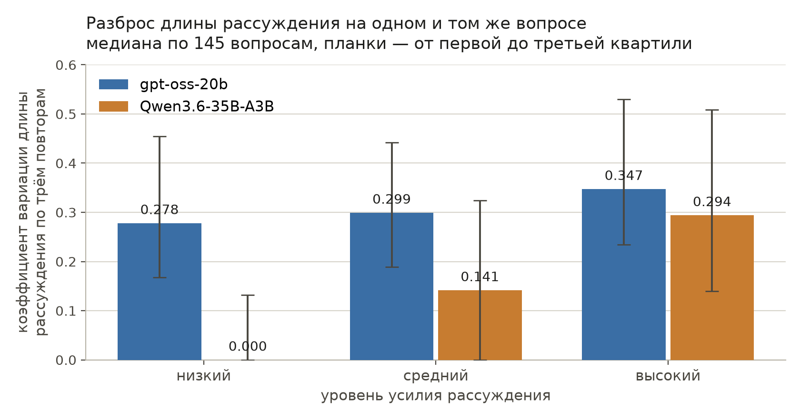
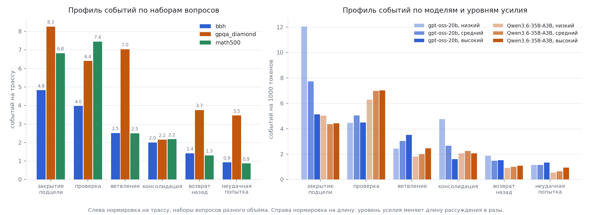
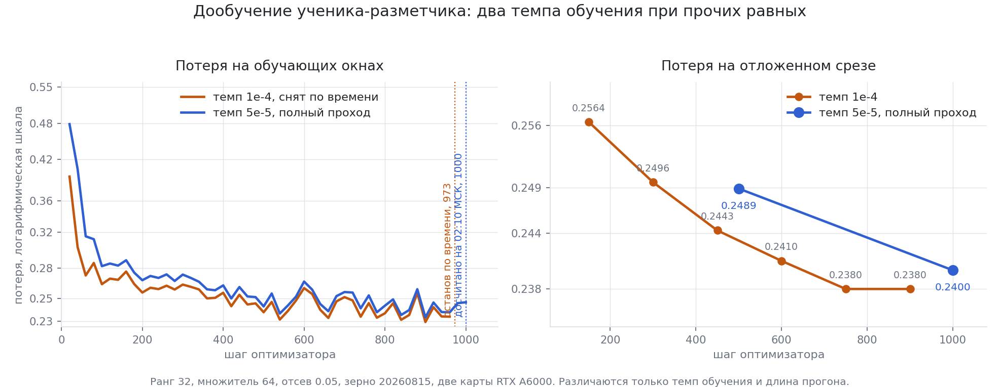

# Отчёт о работе: трассы, разметка, прогноз и управление расходом

Дата: 2026-08-18. Полный отчёт о работе с 6 августа; заменяет прежнюю редакцию от 17 августа, которая излагала работу перечнем заданий. Числа взяты из файлов; путь к источнику стоит рядом с каждой группой чисел. Источники в черновом рабочем репозитории названы от его корня.

## Термины, которые дальше используются

Трасса - текст рассуждения модели вместе с ответом. Разметка - слой аннотаций поверх готовой трассы, приписывающий к ней события рассуждения. Разметчик - тот, кто эту разметку ставит: большая модель в роли судьи, ученик или человек. Судья - сервисная модель DeepSeek, к которой мы обращаемся по программному интерфейсу; она размечает хорошо, но за деньги. Ученик - своя открытая модель, дообученная низкоранговым адаптером LoRA на разметке судьи, чтобы размечать те же трассы на своих картах и без оплаты за обращение.

Событие рассуждения - размеченный момент одного из шести типов: возврат назад, проверка, ветвление, закрытие подцели, признание неудачной попытки, консолидация. Консолидация - момент, которым модель закрывает найденное решение.

Хоуксовский цикл - участок трассы от первого события кластера до замыкающей его консолидации. Название взято от процесса Хоукса, в котором каждое событие поднимает вероятность следующих, а вклад со временем затухает: внутри цикла события порождают друг друга, консолидация гасит эту цепочку, и с неё начинается следующий цикл. Дальше в отчёте слово цикл всегда означает именно его. Остаток цикла - расстояние в токенах от текущей точки до ближайшей консолидации правее неё.

Бейзлайн - простейшая опорная модель или процедура, решающая ту же задачу: константный прогноз, линейная модель на одном очевидном признаке, готовый стандартный метод. Любой предложенный метод оценивается приростом над бейзлайном; нет прироста - сложность не оправдана.

Правило приёмки - количественный критерий успеха, зафиксированный в предрегистрации до запуска счёта: какая метрика, на каком срезе, какой порог или какое сравнение с бейзлайном. Фиксация до счёта исключает подгонку критерия под полученный результат.

Бюджет - число токенов, потраченное на размышление до окончательного ответа.

## 1. Собранные трассы и их разметка

Трассы рассуждения собирались отдельными прогонами. Опись лежит в data/registry.tsv, её копия в https://docs.google.com/spreadsheets/d/11W6D9bra0zlPyznQKxkHu0CobEVNAsN1Qg52JPfjAFs/edit?gid=1994224106#gid=1994224106. Таблица ведется в нормализованном формате - в одной строчке один срез трасс вместе с одним слоем разметки поверх него, поэтому строк больше, чем срезов потому что у одного среза бывает несколько разметчиков.

Что собрано: 13 прогонов, 295 наборов, 55263 трассы, 13 моделей-источников, 6 бенчмарков. Слой разметки ученика на низкоранговом адаптере LoRA покрывает 95 строк описи, слой платного судьи deepseek-v4-flash - 259 строк. В таблице ниже показан самый полный слой каждого собрания: сколько трасс размечено тем разметчиком, который покрыл их больше всех.

| Модель | math500 | gpqa_diamond | bbh | hle | hotpotqa | musique | Всего | Трасс с уровнями усилия |
|---|---|---|---|---|---|---|---|---|
| gpt-oss-20b | 4649 | 2093 | 1421 | 15580 | 1500 | 1500 | 26743 | низкий 681, средний 441, высокий 681 |
| Qwen3.6-35B-A3B | 3046 | 351 | 621 | 2000 | 1500 | 1500 | 9018 | низкий 435, средний 435, высокий 435 |
| deepseek-reasoner | 500 | - | - | 2158 | - | - | 2658 | - |
| gpt-oss-120b | 1300 | 518 | 800 | - | - | - | 2618 | низкий 240, высокий 240 |
| Qwen3-4B | 1000 | 400 | 1000 | - | - | - | 2400 | - |
| Qwen3-8B | 1000 | 400 | 1000 | - | - | - | 2400 | - |
| gemma-4-26B-A4B-it | 500 | 198 | - | 500 | 500 | 500 | 2198 | - |
| Qwen3.5-122B-A10B | 1100 | 438 | 600 | - | - | - | 2138 | - |
| DeepSeek-R1-Distill-Llama-8B | 700 | 280 | 700 | - | - | - | 1680 | - |
| DeepSeek-R1-Distill-Qwen-7B | 700 | 280 | 700 | - | - | - | 1680 | - |
| DeepSeek-R1-Distill-Llama-70B | 600 | 240 | 600 | - | - | - | 1440 | - |
| Qwen3-30B-A3B | 59 | 17 | 69 | - | - | - | 145 | - |
| Qwen3-32B | 59 | 17 | 69 | - | - | - | 145 | - |
| вместе | 15213 | 5232 | 7580 | 20238 | 3500 | 3500 | 55263 | |

Таблица 1. Трассы по моделям и наборам вопросов, и отдельно те трассы, где уровень усилия рассуждения задавался явно.

### 1.1. Проблематика оценки качества рассуждающих моделей

Чтобы оценить усредненное качество работы моделей на разных бенчмаркам, мы обработали каждый вопрос трижды, с разными seed, на трёх разных уровнях усилий модели (effort level) рассуждения, двумя моделями среднего размера: gpt-oss-20b и Qwen3.6-35B-A3B, по 145 вопросов в каждом сочетании модели, уровня усилия и зерна.

Разброс расхода между повторами при одном уровне усилий довольно высок: медианный коэффициент вариации длины рассуждения от 0.278 до 0.347 у gpt-oss и до 0.294 у Qwen на высоком уровне. Разброс точности ответа при этом сравнительно мал: у gpt-oss-20b размах доли верных по трём зёрнам равен 4.83, 1.38 и 3.45 процентного пункта на низком, среднем и высоком уровне, у Qwen3.6-35B-A3B 2.76, 4.14 и 3.45 пункта. То есть от повтора к повтору сильно варьируется расход токенов, а не результат.

Вопросы здесь - подвыборка, а не полные наборы: 59 вопросов из 500 у math500 и 86 заданий из 6511 у bbh, всего 145. Задач gpqa, hle и поисковых наборов здесь нет вовсе. Поэтому все числа этого подраздела описывают именно эту подвыборку, а не бенчмарк целиком, и переносить их на полный набор нельзя. Разброс расхода на них разный. У gpt-oss-20b он всюду выше на bbh: медианный коэффициент вариации 0.360 против 0.231 на низком уровне, 0.333 против 0.260 на среднем и 0.350 против 0.344 на высоком. У Qwen3.6-35B-A3B на среднем уровне выше bbh, 0.162 против 0.059, а на высоком наоборот выше math500, 0.319 против 0.257; на низком уровне у него нули на обоих наборах, потому что все три повтора упираются в один и тот же предел длины.

### 1.2. Разные модели работают лучше с разными промптами

Зависимость качества ответа от лучшей формулировки задания для моделей показана и раньше. У Воронова с соавторами, Findings of ACL 2024, лучшие шаблоны запроса не переносятся между постановками и даже между моделями одного семейства, проверено на 21 модели от 770 миллионов до 70 миллиардов параметров. У Склар с соавторами, ICLR 2024, качество форматов между моделями связано лишь слабо, а относительный порядок пары форматов сохраняется при смене модели менее чем в 62 процентах случаев. У Мизрахи с соавторами, TACL за 2024 год, семантически эквивалентные перефразировки инструкции меняют сам порядок моделей в таблице результатов. Мы измерили этот эффект на своих моделях. Мы собрали пять промптов задания, их тексты приведены в приложении, и прогнали каждый тремя моделями на подвыборке из 245 вопросов трёх бенчмарков: 117 вопросов gpqa_diamond, 69 заданий bbh и 59 задач math500. Пять промптов такие. Канонический - системное сообщение нашего конвейера, оно требует ответить кратко и выдать ровно один объект JSON с полями concise_answer и comment; этот же промпт стоит во всех остальных прогонах работы. Голый вопрос - системного сообщения нет вовсе, пользовательское сообщение равно тексту вопроса без единого добавленного слова, это точка отсчёта. Пошаговая инструкция - развёрнутое требование разбить решение на подцели, записывать промежуточные результаты, перепроверить ключевое вычисление и выдать ответ последней строкой. Строгий формат - требование закончить ровно одной строкой вида «Final answer: значение» и ничего после неё. Родной шаблон - рекомендация из карточки самой модели, для каждой модели своя.

Насколько велик разброс, видно по значениям точности для разных промптов.

| Модель | Точность: худший и лучший промпт | Размах | Средняя длина рассуждения: минимум и максимум | Во сколько раз |
|---|---|---|---|---|
| gpt-oss-20b | 0.420 и 0.678 | 25.7 пункта | 1202 и 1829 токенов | 1.52 |
| Qwen3.6-35B-A3B | 0.318 и 0.816 | 49.8 пункта | 3538 и 5294 токенов | 1.50 |
| Gemma-4-26B | 0.269 и 0.820 | 55.1 пункта | 2794 и 5281 токенов | 1.89 |

Таблица 2. Точность и длина рассуждения при худшем и лучшем из пяти промптов, по каждой модели.
Потери точности от смены формулировки у трёх моделей разные: 25.7, 49.8 и 55.1 пункта при переходе от канонического промпта к голому вопросу.  Часть разницы между формулировками создаётся тем, удалось ли прочитать ответ из текста, а часть - самим рассуждением. По потерям от голого вопроса модели расходятся: 25.7 пункта у gpt-oss-20b, 49.8 у Qwen3.6-35B-A3B, 55.1 у Gemma-4-26B; Для проверки значимости это расхождение сравнили с разбросом между самими вопросами на тех же 245 вопросах: расхождение точности при смене формулировки оказалось в 19.88 раза больше расхождения при смене вопроса, значимость ниже 0.0001.

Худшая формулировка у всех трёх моделей одна и та же: голый вопрос без единой инструкции. По Gemma есть оговорка: карточка этой модели не предъявляет требований к формату ответа, поэтому родной шаблон у неё по построению совпал с голым вопросом, и различимых формулировок в её строке четыре, а не пять. Деградация на нём тем сильнее, чем больше модель полагается на формат ответа, и доходит до 55.1 пункта у Gemma.

Формулировка, заточенная под задачу, оказывается важнее формулировки, заточенной под модель. Родной рекомендованный шаблон каждой модели, взятый из её карточки, проигрывает нашему каноническому промпту у всех трёх: на 24.9 пункта у gpt-oss-20b, на 16.3 у Qwen3.6-35B-A3B и на 53.5 у Gemma-4-26B. Строгий формат финального ответа, тоже написанный под задачу, а не под модель, стоит рядом с каноническим и обгоняет родной шаблон везде.

Канонический промпт ни у одной из трёх моделей не уступает значимо ни одной из четырёх альтернативных формулировок, и у всех трёх входит в группу лучших. Голый вопрос и родной шаблон модели он превосходит значимо у всех трёх: разница от 16.3 до 55.1 пункта, значимость ниже 0.001 после поправки.

По расходу он тоже не проигрывает: у gpt-oss и Qwen он самый дешёвый из пяти, 1202 и 3538 токенов. У Gemma дешевле него только голый вопрос и родной шаблон, 2830 и 2794 токена против 3782, но их дешевизна ложная: у обеих точность падает до 0.269 и 0.286, потому что ответ часто не читается.

Поэтому во всех остальных прогонах этой работы используется один и тот же канонический промпт. Отдельный прогон на 300 вопросах из шести бенчмарков проверил, не выигрывает ли промпт, подобранный под конкретную модель: по три кандидата на модель против общего канонического. Не выигрывает ни у одной из трёх моделей и ни на одном наборе вопросов. Три кандидата из девяти значимо проиграли: у gpt-oss-20b подгонка под параметр усилия −7.33 пункта и полная подгонка −5.67, у Qwen3.6-35B-A3B полная подгонка −15.67. Значимых выигрышей нет вовсе.

Механизм проигрыша виден в длине: смена промпта удлиняет рассуждение и упирает его в предел, а не улучшает решение. У gpt-oss-20b доля трасс, упёршихся в предел 8192, растёт с 0.060 до 0.370, у Qwen с 0.323 до 0.550. Отсюда оговорка: сравнение шло при том же пределе длины, что и прежний прогон, ради сопоставимости, поэтому часть проигрыша создана самим пределом. При снятом пределе вывод может измениться, и эту проверку ещё предстоит сделать.

Для решения прикладной задачи бюджетирования и дальнейшего policy optimization моделей необходимо учитывать вопросы, на которые модель не дала правильный ответ за отведенный бюджет, иначе оценка качества будет смещена в сторону короткого ответа на простые вопросы и отказ от ответа на сложные вопросы в ущерб длинному рассуждению на сложные вопросы.

Это задает эмпирическое правило измерения расхода. Обмен длины на точность мы предлагаем считать по шкале, в которой сокращение средней длины рассуждения вдвое оправдано потерей не более двух процентных пунктов точности: конфигурации сравниваются по величине «точность плюс два пункта за каждое удвоение средней длины». 

Источник: в черновом рабочем репозитории docs/session_prompts/2026_08_17/05_prompt_sensitivity/result.md, internal_signals_poc/prompt_sensitivity_2026_08_17/outputs/analysis.json и parse_artifact.json.

### 1.3. Структура разметки: события, циклы, спаны.

Разведочный разбор сделан для двух моделей с тремя уровнями усилия рассуждения и тремя повторами для каждого вопроса. Промпт во всех повторах один и тот же, канонический. У gpt-oss-20b уровень усилия задаётся встроенным параметром reasoning_effort со значениями low, medium и high, он подставляется в системный заголовок запроса. У Qwen3.6-35B-A3B такого параметра нет: её карточка и шаблон диалога знают только двоичное включение размышления enable_thinking, поэтому уровни имитируются ограничением длины размышления, и на низком уровне все три повтора упираются в один предел.

| Модель | Уровень усилия | Трасс | Токенов на трассу | Событий на трассу | Событий на 1000 токенов |
|---|---|---|---|---|---|
| gpt-oss-20b | низкий | 285 | 212.6 | 5.68 | 26.72 |
| gpt-oss-20b | средний | 430 | 466.7 | 9.85 | 21.10 |
| gpt-oss-20b | высокий | 435 | 1562.9 | 27.52 | 17.60 |
| Qwen3.6-35B-A3B | низкий | 435 | 850.1 | 14.16 | 16.66 |
| Qwen3.6-35B-A3B | средний | 435 | 1380.7 | 23.82 | 17.25 |
| Qwen3.6-35B-A3B | высокий | 435 | 2288.4 | 41.19 | 18.00 |

Таблица 3. Разведочный разбор: длина рассуждения и плотность событий по моделям и уровням усилия.
Число событий на трассу растёт с уровнем усилия у обеих моделей, и растёт не в среднем по всем вопросам, а почти у каждого вопроса по отдельности. При переходе с низкого уровня на средний оно выросло у 103 вопросов из 114 у gpt-oss-20b и у 129 из 145 у Qwen3.6-35B-A3B; при переходе со среднего на высокий у 139 из 144 и у 107 из 138. Все четыре доли значимо превышают половину, причём пороги значимости при этом ужесточены, как положено, когда восемь проверок делаются сразу.

Плотность событий на тысячу токенов ведёт себя у двух моделей по-разному, и это первое место, где семейства расходятся качественно. У gpt-oss-20b плотность падает: доля вопросов с ростом равна 0.147 и 0.262, то есть длинное рассуждение у неё не просто дольше, оно ещё и реже размечено событиями. У Qwen3.6-35B-A3B плотность растёт: 0.655 и 0.632. Опорные прогоны при жадной генерации подтверждают, что разница между семействами больше, чем между уровнями усилия внутри семейства: gpt-oss-120b даёт 6.98 события на трассу при 334.4 токена, а Qwen3.5-122B даёт 41.72 события при 2479.9 токена.

Разброс расхода на одном и том же вопросе показан на рисунке ниже.

Столбцы показывают медиану коэффициента вариации длины рассуждения по трём повторам одного вопроса, планки идут от первой до третьей квартили по 145 вопросам. Нулевая медиана у Qwen3.6-35B-A3B на низком уровне усилия означала не устойчивость модели, а то, что мерить там было нечего. У моделей без встроенного параметра уровень имитировался ограничением длины, и все три повтора упирались в один и тот же предел: доля упёршихся равна 0.802 на низком уровне, 0.414 на среднем и 0.060 на высоком, тогда как у gpt-oss-20b на всех трёх уровнях от 0.005 до 0.030.

Тройки для Qwen пересняты так, чтобы уровень задавался текстом запроса, а предел в 32768 токенов не действовал. Теперь в него упираются 3 трассы из 1305, то есть 0.0023, и разброс стало видно: медиана коэффициента вариации длины равна 0.349, 0.328 и 0.328 по трём уровням вместо прежних 0.0, 0.1415 и 0.2941. Разброс доли правильных ответов при этом остался малым, от 1.4 до 3.5 процентного пункта. Вывод о том, что от повтора к повтору сильно меняется расход, но не результат, после снятия обрыва не только устоял, но и перестал зависеть от одной ячейки из трёх.

Два побочных вывода этой перестановки. Первый: текстовый рычаг у Qwen имеет пол около 1130 токенов медианы, это 0.69 естественной длины, и объявленный в запросе бюджет от 32 до 4096 токенов длину почти не меняет, поэтому целевые медианы 916 и 1833 недостижимы в принципе; достигнуты 1090, 1319 и 1487, и упорядоченность уровней подтверждена знаковым критерием с вероятностями 2.5e-06 и 5.7e-06. Второй: прежнее утверждение, что у Qwen плотность событий значимо растёт с уровнем усилия, на честных уровнях не подтверждается, соседние переходы дают 0.211 и 0.0798. Значимость была свойством способа задать уровень, при котором короткие уровни оказывались префиксами длинных. Более общий вывод устоял: падение плотности с ростом уровня есть свойство встроенного параметра gpt-oss, а не длинного рассуждения вообще. У остальных пяти сочетаний разброс велик: медиана коэффициента вариации от 0.141 до 0.347, третья квартиль доходит до 0.53, и у gpt-oss-20b на высоком уровне 0.724 вопросов имеют разброс выше четверти средней длины. Для сравнения, разброс доли верных ответов между теми же повторами составляет от 1.4 до 4.8 процентного пункта. От повтора к повтору сильно меняется цена ответа, а не его правильность.

Матрица влияния между типами событий пересчитана на новых трассах дважды: 21 матрица на 1328 трассах и затем 39 матриц на 2455 трассах, всего 60. Матрица влияния - это таблица, где на пересечении строки типа A и столбца типа B стоит среднее число событий типа B, порождённых одним событием типа A; оценивается она по модели самовозбуждающегося точечного процесса, в которой каждое событие поднимает вероятность последующих, а вклад со временем затухает.

Инвариант в матрицах есть, но он уже, чем считалось раньше. Связь консолидации с последующей проверкой лежит в промежутке от 0.744 до 0.918 по пяти базовым моделям без параметра усилия. Через уровни усилия она не инвариантна: промежуток расширяется до 0.483-1.527 и монотонно падает с ростом усилия. Инвариантно другое: связь консолидации с проверкой - самая крупная во всех шести сочетаниях модели и уровня без исключения, связь консолидации с закрытием подцели ровно нулевая во всех шести, а знак торможения одинаков тоже во всех шести. Пятнадцать матриц для эксперимента с формулировками задания не посчитаны: код написан и залит, слой ждал окончания разметки.

Ветвящееся число, то есть среднее число событий, порождаемых одним событием, с ростом усилия падает: у gpt-oss-20b 1.177, 0.697 и 0.563 по трём уровням, у Qwen3.6-35B-A3B 0.909, 0.750 и 0.630. Ручка усилия удлиняет рассуждение, но не делает его более каскадным: модель дольше идёт вперёд, а не сильнее ветвится от каждого события.

Отсюда следует рабочая единица разбора, которой пользуются все дальнейшие разделы. Хоуксовский цикл - участок трассы от первого события кластера до замыкающей его консолидации. Ветвящееся число ниже единицы у пяти сочетаний из шести означает, что цепочка событий внутри цикла затухает сама, а консолидация её закрывает, поэтому цикл кончается не по внешнему пределу, а по устройству процесса. Числа посчитаны на 1242 отложенных трассах, которые завершились самостоятельно, без упора в предел длины; оборванные 313 трасс из 1555 исключены, потому что у них отсутствие консолидации справа означает настройку прогона, а не устройство рассуждения. Текущий цикл закрывается внутри трассы у 0.943 точек, следующий у 0.628. Медиана остатка текущего цикла 208.3 токена, следующего 392.7 токена. Событие стоит на 0.362 шагов разметки, конец цикла попадает в горизонт 256 токенов у 0.561 точек. То есть цикл - величина порядка двух сотен токенов, и внутри трассы их обычно несколько.

Для сравнения, на всех 1555 трассах, включая оборванные, те же величины равны 0.754 и 0.497 по закрытию и 310.9 и 523.4 токена по медианам. Исключение обрывов снимает 19 процентных пунктов незакрытости текущего цикла из 24.6 и укорачивает медианы на 33 и 25 процентов. Оставшаяся незакрытость текущего цикла - короткий хвост в конце рассуждения: медиана расстояния от такой точки до конца трассы 30.4 токена.

Источник: в черновом рабочем репозитории docs/session_prompts/2026_08_14/14_effort_repeats/result.md, internal_signals_poc/effort_repeats_2026_08_14/outputs/dispersion.json и events.json, docs/session_prompts/2026_08_14/15_hawkes_matrices_v2/result.md, internal_signals_poc/hawkes_matrices_2026_08_14/outputs/v2/matrices_v2.json; числа циклов из чистового репозитория, experiments/monitors/stop_controller_cycles_2026_08_17/outputs/main/main_metrics.json.

Каноническая разметка состоит из двух слоёв. Первый - шесть типов событий. Числа посчитаны по всем 6367 размеченным трассам, раздельно по трём бенчмаркам.

| Событие | bbh | gpqa_diamond | math500 | Вместе | Пример цитаты, на которой оно поставлено |
|---|---|---|---|---|---|
| закрытие подцели, subgoal_done | 13551 | 7024 | 18469 | 39044 | So position 2 is hummingbird. |
| проверка, verify | 11162 | 5445 | 20158 | 36765 | But wait, from clue 3, raven is at 4, so hawk can't be at 4. |
| ветвление, branch | 7070 | 5983 | 6763 | 19816 | In acidic solutions, the reaction of oxygen might be faster or slower. |
| консолидация, commit | 5629 | 1830 | 5901 | 13360 | Therefore, the correct combination is "weaker – slower". |
| возврат назад, backtrack | 3989 | 3187 | 3533 | 10709 | Wait, I need to check the exact wording of the options. |
| признание неудачной попытки, failed_attempt | 2609 | 2938 | 2364 | 7911 | increased temperature contradicts the observation of a slower rate |

Таблица 4. Шесть типов событий: сколько их размечено по каждому набору вопросов, с примером цитаты.
Второй слой делит трассу на непересекающиеся интервалы по тому, чем модель занята на участке.

| Интервал | bbh | gpqa_diamond | math500 | Вместе | Чем занята модель |
|---|---|---|---|---|---|
| завершение, CONCLUDING | 6448 | 2105 | 6705 | 15258 | собирает ответ, сверяет его с вариантами и выдаёт |
| проверка, VERIFYING | 4256 | 2010 | 6727 | 12993 | перечитывает условие и пересчитывает ключевой шаг |
| вывод, DERIVING | 4478 | 2359 | 5614 | 12451 | ведёт выкладку от известного к искомому |
| поиск, EXPLORING | 3506 | 2644 | 3577 | 9727 | перебирает варианты и сравнивает их между собой |
| постановка, SETUP | 3547 | 1339 | 3467 | 8353 | пересказывает условие и выписывает данные |
| переделка, REVISING | 2468 | 1760 | 2159 | 6387 | ловит ошибку и переделывает уже пройденный участок |

Таблица 5. Шесть операторных интервалов: сколько их размечено по каждому набору вопросов.
### 1.4. Построение серебрянной разметки

Профиль событий различает наборы вопросов сильнее, чем можно было ожидать. На естественнонаучных вопросах gpqa_diamond модель возвращается назад 3.7 раза на трассу и признаёт неудачную попытку 3.5 раза, тогда как на bbh и math500 обе величины около единицы. На математике наоборот больше всего проверок, 7.4 против 4.0 на bbh. Закрытие подцели чаще всего встречается на gpqa_diamond, 8.3 на трассу.

По моделям картина другая, и читать её надо на тысяче токенов, потому что уровень усилия меняет длину рассуждения в разы. У gpt-oss-20b на низком уровне плотность закрытия подцели равна 12.1 события на тысячу токенов и падает до 5.1 на высоком, то есть длинное рассуждение у неё не просто длиннее, оно ещё и реже размечено событиями. У Qwen3.6-35B-A3B плотность держится ровно: закрытие подцели от 5.0 до 4.4, проверка от 6.3 до 7.0. Разница между семействами больше, чем разница между уровнями усилия внутри семейства. Правая панель для Qwen построена на прежних трассах, где уровень задавался ограничением длины; на пересня́тых трассах с уровнем через текст запроса суммарная плотность равна 20.10, 21.59 и 22.19 события на тысячу токенов, то есть по уровням она значимо не растёт.

Чистовая разметка была произведена на подвыборке из 130 вопросов, по 26 на каждую из пяти моделей-источников вопросов моделями deepseek-v4-flash и, выборочно, более крупной deepseek-v4-pro с включённым режимом размышления и температурой 0.6 для проверки сравнения количества событий с моделью flash. Разметка была выполнена трижды по одним и тем же трассам, чтобы оценить её устройчивость к перезапускам.

Источник: в черновом рабочем репозитории docs/session_prompts/2026_08_15/01_judge_test_retest/result.md и internal_signals_poc/judge_test_retest_2026_08_15/outputs/retest_summary.json.

Согласие разметчика deepseek-v4-flash с самим собой равно 0.708 по микро-F1 событий, доверительный интервал от 0.689 до 0.726 по перевыборке трасс на 2000 повторов. По моделям, чьи трассы размечались, оно меняется от 0.670 на трассах Qwen3.6-35B-A3B до 0.757 на трассах gpt-oss-120b, но ни одна из десяти пар не различается значимо после поправки Холма на десять сравнений.

Расходятся при этом не все типы одинаково.

| Тип события | Каппа между проходами | Промежуток | Разброс счётчика |
|---|---|---|---|
| консолидация | 0.728 | 0.682-0.773 | 0.114 |
| проверка | 0.652 | 0.606-0.696 | 0.349 |
| ветвление | 0.629 | 0.565-0.689 | 0.428 |
| закрытие подцели | 0.625 | 0.584-0.666 | 0.282 |
| возврат назад | 0.588 | 0.511-0.666 | 0.610 |
| признание неудачной попытки | 0.530 | 0.430-0.634 | 0.618 |

Таблица 6. Устойчивость разметки по типам событий: согласие трёх проходов и разброс счётчика.
Устойчивее всех размечается консолидация, хуже всех - признание неудачной попытки; из шести типов только эти два значимо отклоняются от среднего согласия по типам, равного 0.677. Это прямо объясняет, почему цикл, то есть кластер событий между консолидациями, оказался самой воспроизводимой единицей разбора: он опирается на самый устойчивый тип.

Треть разметки не воспроизводится при повторе: из 3053 меток событий 1073, то есть 0.351, поставлены ровно одним проходом из трёх, и при повторной разметке того же текста их уже нет. Полное согласие трёх проходов есть у 1178 меток, то есть у 0.386.

Разметка операторных интервалов воспроизводится заметно лучше событий: согласие 0.8432 с доверительным интервалом от 0.8238 до 0.8618, каппа 0.7782 от 0.7529 до 0.8030 против 0.677 по событиям. Границы интервалов разметчик ставит устойчивее, чем точки событий.

Сколько событий в трассе, разметчик воспроизводит куда надёжнее, чем где именно они стоят. Число событий на трассу согласуется между проходами с ранговой корреляцией 0.954, минимум по моделям 0.854, тогда как совпадение самого места события даёт 0.708. Отсюда практическое следствие, которым дальше пользуются все линии: считать события можно, указывать точное место каждого - с оговоркой.

Наглядный пример ниже показывает почему разметка действительно может быть неоднозначной, несмотря на кажущуюся простоту видов событий. Трасса Qwen3.6-35B-A3B на задаче math500 test/intermediate_algebra/860, сегмент 22, текст сегмента: «Since $a^2 \neq b^2$ ($40 \neq 10$), it is an ellipse, not a circle.» Проход 1 ставит здесь закрытие подцели, проход 2 - возврат назад, проход 3 - проверку, проход 4 не ставит ничего, проход 5 снова закрытие подцели. Один и тот же текст прочитан как достижение подцели, как возврат и как проверка.

Отдельно измерено, что температура тут ни при чём: при нулевой температуре согласие 0.721 против 0.708, разность 0.013 с промежутком от −0.010 до 0.036, и даже при нуле полное совпадение разметки дают лишь 0.021 пар. Зато включение или выключение режима размышления меняет разметку сильно: согласие между режимами падает до 0.538.

Источник: в черновом рабочем репозитории docs/session_prompts/2026_08_15/01_judge_test_retest/result.md, docs/findings/2026_08_15_judge_noise_pilot_key_results_RU.md и internal_signals_poc/judge_noise_pilot_2026_08_15/outputs/pilot_examples.json.

### 1.5. Более крупная модель разметки стабильнее

Сравнивались два разметчика, deepseek-v4-flash и deepseek-v4-pro, на одних и тех же 130 трассах. Каждую трассу каждый разметчик разметил трижды, и мерилось, насколько его три разметки совпадают между собой. Это и есть устойчивость разметчика: сколько из его собственных решений выживает при повторном чтении того же текста.

Совпадение считалось двумя разными способами, потому что у разметки два слоя. Для событий совпадением считается одно и то же событие того же типа, поставленное в том же месте трассы, и доля таких совпадений от всех поставленных событий даёт первую строку таблицы. Для операторных интервалов, которые покрывают трассу целиком, считается доля сегментов, где оба прохода назвали один и тот же оператор.

| Что измерено | pro | flash | разность и её промежуток |
|---|---|---|---|
| доля совпавших событий между проходами | 0.7565 | 0.7084 | плюс 0.0481 от 0.0292 до 0.0681 |
| доля сегментов с одним и тем же оператором | 0.8647 | 0.8432 | плюс 0.0216 от 0.0054 до 0.0382 |

Таблица 7. Устойчивость двух разметчиков на одних и тех же 130 трассах.
Обе прибавки значимы, но невелики: pro устойчивее, однако не настолько, чтобы это меняло дело.

Разметчики отличаются устойчивостью, но не тем, где ставят метки. Если сравнивать разметки двух разметчиков между собой, совпадает 0.7008 событий и 0.8241 сегментов. Это столько же, сколько теряется при простом повторе того же flash, то есть смена разметчика двигает метки не сильнее, чем собственный шум одного из них.

По отдельным типам событий устойчивость pro идёт от 0.535 у признания неудачной попытки до 0.800 у консолидации, у flash те же типы дают от 0.530 до 0.728. Пять типов из шести стали устойчивее, самый шумный не починился вовсе, и порядок типов по устойчивости у обоих разметчиков один и тот же.

Пилотное наблюдение о том, что pro вовсе не ставит два типа, на полном материале не подтвердилось. Возвратов назад pro ставит даже чаще flash, 0.959 на проход против 0.915. Признаний неудачной попытки ставит реже на четверть, 0.462 против 0.633, и эта разница значима, но до нуля ей далеко. Полное отсутствие обоих типов оказалось особенностью единственной пилотной трассы, которая в эти 130 к тому же не входила.

Практический вывод об оплате. Переводить всю разметку на pro не стоит: покупается семь процентов устойчивости по событиям и два процента по интервалам, а платится девятикратная цена прохода. Полный прогон трёх проходов по 130 трассам стоил 23.81 доллара у pro против 2.53 у flash, то есть проход дороже в 9.4 раза. Дешевле сначала сравнить согласованную разметку по трём проходам flash с одиночным проходом pro. Точечно pro оправдан на опорной разметке и на разведке новых типов интервалов, где выигрыш самый большой.

Цена pro к тому же оказалась вдвое выше ожидаемой: тариф этой модели не объявлен, и восстановленная по расходу ставка равна 2.31 доллара за миллион токенов вывода против 0.24 у flash, то есть разница десятикратная, а не пятикратная, как считалось.

Источник: в черновом рабочем репозитории docs/session_prompts/2026_08_19/06_pro_judge_full/result.md и internal_signals_poc/pro_judge_full_2026_08_19/outputs/pro_summary.json.

### 1.6. Событийная разметка и уровни усилия

Исследование рыботы модели-генератора трассы с разным уровнем усилия показало что средняя длина рассуждения растёт со 154.9 до 1562.9 токена у gpt-oss, то есть в 10.1 раза, и с 850.1 до 2288.4 у Qwen, в 2.7 раза, тогда как точность прибавляет 5.6 и 4.4 процентного пункта.

События на трассу растут вместе с длиной: у gpt-oss 5.68, 9.85 и 27.52 по трём уровням, у Qwen 14.16, 23.82 и 41.19. Все восемь проверок монотонности значимы.

Ни один тип событий при росте усилия не исчезает: по числу на трассу растут все шесть у обеих моделей. Теряются они только в плотности на тысячу токенов, и теряются избирательно. У gpt-oss при переходе от низкого усилия к высокому плотность закрытия подцели падает в 2.3 раза, консолидации в 2.9 раза, тогда как проверка держится ровно, а ветвление растёт в 1.4 раза. У Qwen не падает ни один тип, консолидация держится ровно, сильнее всех растёт признание неудачной попытки, в 1.7 раза.

Главное следствие даёт разбор через процесс с самовозбуждением, то есть через матрицу влияния одних типов событий на другие. При росте усилия ветвящееся число, которое измеряет каскадность, не растёт, а падает: у gpt-oss 1.177, 0.697 и 0.563 по трём уровням, у Qwen 0.909, 0.750 и 0.630. Значит параметр усилия удлиняет рассуждение, но не делает его более каскадным: модель дольше идёт, а не сильнее ветвится от каждого события.

Источник: в черновом рабочем репозитории docs/session_prompts/2026_08_14/14_effort_repeats/result.md, internal_signals_poc/effort_repeats_2026_08_14/outputs/dispersion.json и events.json, internal_signals_poc/hawkes_matrices_2026_08_14/outputs/v2/matrices_v2.json.

### 1.7. Поиск новых событий

Разметчику отдельным блоком инструкции разрешили предлагать свои типы событий и режимов интервалов, если они помогают прогнозировать завершение или указывают место для управления дословный текст этого блока приведён в приложении. Предложения писались в отдельные поля, а канонические слои разметчик заполнял так, как будто дополнения нет.

Разметка с открытым словарём прошла на 6367 трассах, вопросы которых взяты из трёх бенчмарков: bbh, gpqa_diamond и math500. Что предложено сверх канона, показано ниже.

| Бенчмарк | Трасс | Канонических событий | Предложено событий, типов | Предложено интервалов, типов | Записей на трассу |
|---|---|---|---|---|---|
| bbh | 2810 | 44010 | 161, 71 | 61, 46 | 0.079 |
| gpqa_diamond | 850 | 26407 | 126, 60 | 51, 36 | 0.208 |
| math500 | 2707 | 57188 | 131, 87 | 69, 51 | 0.074 |
| вместе | 6367 | 127605 | 418, 194 | 181, 110 | 0.094 |

Таблица 8. Предложения разметчика при свободном именовании, по наборам вопросов.
Плотность предложений на трассу у gpqa_diamond втрое выше, чем у двух других бенчмарков: 0.208 против 0.079 и 0.074. Естественнонаучные вопросы дают разметчику больше поводов предложить свой тип.

Предложений мало: 418 записей против 127605 канонических событий, то есть 0.328 процента. Почти все предложенные типы редки: среди 120 типов событий ровно один раз встречается 45.8 процента, не больше двух раз 79.2 процента; среди 67 типов интервалов 52.2 и 79.1 процента.

Самые частые предложения: избыточная перепроверка 17 записей, неокончательный ответ 16, неуверенность 16, повторное подтверждение 9. Кружение на месте чаще предлагается как режим интервала, а не как тип события: в этом качестве оно собирает 20 записей и возглавляет список режимов, тогда как событием названо 6 раз.

Плотность предложений зависит и от того, какие трассы размечались. На трассах, где сравнивались обучение на разметке большой модели и самообучение, она равна 0.159 записи на трассу, а на трассах, где восемь замороженных моделей прогонялись по тринадцати способам сократить рассуждение, 0.069, то есть выше в 2.3 раза. Тринадцать способов - это пределы длины от 512 до 8192 токенов, требования отвечать кратко, объявленный модели бюджет, выключенное размышление и два уровня усилия. К типу looping это отношение не относится: как интервал он встречается на трассах перегонки в 14 раз чаще, чем на трассах решётки, а как событие на трассах решётки не встречается ни разу.

Частота предложений растёт с уровнем усилия: у gpt-oss 0.004, 0.002 и 0.053 записи на трассу, у Qwen 0.046, 0.039 и 0.161.

Свободное именование само по себе меры не даёт: за 390 проходов разметчик предложил 22 события своих типов на 7 трассах из 130, и ни одно имя не повторилось между проходами той же трассы. Поэтому проверка переведена в задачу классификации по закрытому списку имён.

Дальше разметчику дали готовый список из шести имён с определениями и примерами, а придумывать свои запретили. Проверка прошла на тех же 130 трассах по три прохода, приёмка записана до счёта: каппа не ниже 0.530 и не менее десяти трасс на тип.

| Кандидат | Каппа трёх проходов | Трасс из 130 | Вердикт |
|---|---|---|---|
| повторение уже зафиксированного ответа | 0.6925 от 0.6436 до 0.7399 | 113 | принят |
| рассуждение о форме ответа вместо его существа | 0.6898 от 0.6337 до 0.7403 | 90 | принят |
| предварительный ответ | 0.5304 от 0.4490 до 0.6136 | 79 | принят |
| избыточная перепроверка | 0.5076 от 0.4455 до 0.5696 | 81 | отклонён |
| неуверенность | 0.3564 от 0.2677 до 0.4452 | 53 | отклонён |
| повтор без продвижения | 0.2606 от 0.1921 до 0.3285 | 55 | отклонён |

Таблица 9. Кандидаты закрытого списка имён: согласие трёх проходов и вердикт приёмки.
Порог по числу трасс проходят все шесть, отклоняет их согласие. Первые два принятых стоят вровень с лучшим каноническим типом: у консолидации на тех же трассах 0.7279. Предварительный ответ прошёл на самой границе, с запасом в четыре десятитысячных, поэтому его вердикт надо считать неустойчивым.

Отдельным прогоном проверены ещё два имени, возобновление закрытой темы и переформулировка задания, и оба порог проходят: 0.5576 от 0.4610 до 0.6468 на 60 трассах и 0.6215 от 0.5431 до 0.7007 на 66. В списке из восьми имён порог проходят пять кандидатов, и предварительный ответ там держится уже уверенно, 0.5975.

Длина списка на вердикты не влияет. Парные разности капп шести прежних кандидатов при переходе от шести имён к восьми лежат от минус 0.051 до плюс 0.073, все промежутки накрывают ноль, число событий на трассу меняется в третьем знаке, изменившихся вердиктов ноль из шести.

Цена расширения платится один раз, при самом появлении новых имён, и от их числа дальше не растёт. Согласие по каноническим типам падает с 0.7084 до 0.6723, разность минус 0.0361 с промежутком от минус 0.0628 до минус 0.0087. Канонических событий на трассу становится с 15.93 до 10.37, и половина всей разметки уезжает в новые имена: 4001 событие из 8046. Сильнее всех страдает возврат назад, у него каппа падает с 0.5884 до 0.4024, разность минус 0.2910. Разбивка на операторные интервалы не страдает вовсе, плюс 0.0100. В списке из восьми имён падение то же по величине, минус 0.0284, но его промежуток уже накрывает ноль.

Расход прогона с кандидатами 2.98 доллара против 2.53 у той же разметки без них, то есть расширение словаря стоит на 18 процентов дороже по обращениям.

Тем же прогоном проверено, не портит ли блок открытого словаря основную разметку. Не портит: согласие по шести каноническим типам с включённым блоком 0.6929 при промежутке от 0.6718 до 0.7143 против 0.7084 от 0.6890 до 0.7256 без него, парная разность на одних и тех же трассах −0.0155 при промежутке от −0.0395 до +0.0089. Потолок возможного вреда 0.040, и оговорка нужна: пять точечных оценок из шести отрицательны, поэтому ухудшение порядка одной-двух сотых исключить нельзя. Числа канонических событий на трассу тоже не сдвинулись: 16.046 против 15.926 при промежутке разности от −0.256 до +0.500, а предложенные события составляют 0.0035 от канонических, то есть вытеснения нет. Измеритель проверен: пересчёт прежнего значения тем же кодом дал ровно 0.7084, совпадение до четвёртого знака.

Воспроизводимость между зёрнами генерации трасс одного вопроса в репозитории не посчитана. Прямой обход разметки повторов уровней усилия даёт ноль совпадений: во всех 72 ячейках «модель, уровень, вопрос, тип» новый тип принесён ровно одним зерном из трёх. Вывода отсюда делать нельзя: при плотности 0.054 записи на трассу совпадений не ожидалось бы и при полной независимости.

Ученик на адаптере LoRA новых типов не знает. Он обучен на промпте без дополнения, поля предложений в цель обучения не входят, словарь меток в коде - та же каноническая шестёрка. Это записанное допущение, а не незамеченный сдвиг.

Вердикт по включению в таксономию такой: три типа из шести проверенных проходят и порог мощности, и порог согласия, а в списке из восьми имён проходят пять, и вопрос об их включении сводится к цене - они покупаются падением согласия по каноническим типам на 0.036. Условие пересмотра записано числами: тип заслуживает места в словаре, если счётный признак кружения подвинет качество прогноза остатка выше 0.703 у событийного бейзлайна и 0.776 у признаков из распределения следующего токена. Эта проверка не проведена.

Отдельно стоит отметить, что настоящий пробел таксономии нашёлся не здесь, а в разделе 2.5.2: из 1208 границ интервалов, не покрытых каноническим событием, предложенный новый тип стоит в окне лишь у пяти, доля 0.004.

Источник закрытого списка: в черновом рабочем репозитории docs/session_prompts/2026_08_19/05_closed_vocab_extension/result.md и internal_signals_poc/closed_vocab_ext_2026_08_19/outputs/. Источник открытого словаря: docs/session_prompts/2026_08_14/07_r1_relabel_nativepo/result.md, docs/session_prompts/2026_08_14/13_relabel_remaining/result.md, internal_signals_poc/relabel_remaining_2026_08_14/outputs/manifest_r1.json, internal_signals_poc/lora_judge_2026_08_15/PREREGISTRATION.md, раздел про источник промпта. Сводок открытого словаря по повторам уровней усилия и по трассам моделей 30B в репозитории нет, их числа получены прямым обходом файлов разметки.

## 2. Постановка задачи бюджетирования модели

Задача, к которой сводится вся работа, состоит из двух частей сразу. Нужно ответить не на вопрос «сколько токенов потратит модель», а на вопрос «уложится ли она в отведённый бюджет, решив задачу правильно». Обе части проверяются одновременно: ответ, полученный дёшево и неверно, и ответ, полученный верно и с перерасходом не годятся.

### 2.1. Прогноз числа токенов и укладываемость в бюджет - разные задачи

Прогноз числа токенов есть задача восстановления величины, и обучается он на средней ошибке, поэтому подстраивается под основную массу трасс. Вопрос «уложимся ли в бюджет» есть задача о хвосте распределения: нужна калиброванная вероятность того, что расход не превысит заданный предел, и цена ошибки несимметрична, потому что недооценка обрывает рассуждение на полуслове, а переоценка тратит лишнее. Хвост в наших данных длинный: на 6151 трассе медиана расхода равна 775 токенам, 95-я процентиль 6760, максимум 60122, то есть в 78 раз больше медианы.

Расхождение измерено, а не выведено. Порядок моделей по средней квадратичной ошибке не совпадает с порядком по цене решения: на сетке бюджетов нашлось шесть сочетаний, где модель с меньшей ошибкой принимает более дорогие решения, и самый чистый случай на бюджете 16510 токенов, где ошибка ниже, 30361 против 31114, а цена решения выше, 4.52 против 4.44. Точечный прогноз, пересчитанный в вероятность уложиться, на хвосте мискалиброван: средняя ошибка калибровки около 0.58 при переборе бюджета в 59 процентах случаев. Калиброванный классификатор на тех же признаках даёт ошибку калибровки от 0.007 до 0.076 по всей сетке бюджетов и держит перебор не выше 3.7 процента при пороге решения 0.833, а интервалы длины покрывают истинное значение в 0.916-0.919 случаев при заявленном покрытии 0.90.

Источник: в черновом рабочем репозитории docs/task1_budget_fit_long_tail.md и reasoning_budget/predict_remaining_tokens/budget_fit/RESULTS_real.md.

### 2.2. Гипотеза: планировать циклами, а не всей трассой

Проверяемая гипотеза такая. Вместо прогноза на всю оставшуюся трассу работать хоуксовскими циклами: прогнозировать расход до конца текущего цикла, а в момент консолидации смотреть на две величины - сколько бюджета осталось и насколько модель уверена в полученном ответе - и по ним планировать следующий цикл: продолжать рассуждение, потребовать проверку или остановиться и выдать ответ.

Основания считать это правдоподобным уже измерены. Медиана остатка цикла равна 310.9 токена против медианы полной трассы 775 токенов и хвоста до 60122, то есть прогнозируемая величина не имеет длинного хвоста. Ветвящееся число ниже единицы у пяти сочетаний модели и уровня усилия из шести, значит цепочка событий внутри цикла затухает сама и конец цикла определён устройством процесса, а не внешним пределом. Прогноз остатка цикла уже обучен и даёт ранговую корреляцию 0.709 для текущего цикла и 0.733 для следующего при потолке задачи 0.8747, измеренном тремя проходами разметки. И обновляется этот прогноз скачками именно в точках событий, в 3.6 раза сильнее, чем на шагах без события.

Если гипотеза подтвердится, работа называется «Рассуждение языковых моделей: от оценки к управлению»: сначала измеряется остаток цикла, затем это измерение превращается в решение о следующем цикле.

### 2.3. Чего стоит обрыв в середине цикла

Полезность цикла проверена не предсказуемостью, а точностью ответа при обрыве, и здесь она видна прямо. При равном израсходованном бюджете обрыв в середине цикла стоит от 12.5 до 28.1 пункта точности против обрыва сразу после консолидации, и потеря растёт с удалением от границы: 3.4 пункта на расстоянии от 32 до 64 токенов, 12.5 на 64-128, 16.0 на 128-256, 28.1 на 256-512 и 49.7 дальше 512 токенов. Медианный обрыв отстоит от последней консолидации на 220 токенов при медианной длине цикла 490, поэтому типичная цена обрыва не на границе около 16 пунктов.

Три правила извлечения ответа разводят картину нагляднее всего. Промежуточный ответ внутри незавершённого цикла верен в 0.203 случаев, ответ предыдущего завершённого цикла в 0.669, ответ ровно на консолидации в 0.796. Ответ, взятый посреди цикла, втрое хуже взятого на границе.

Знание границ окупается и против правила, которое циклов не знает вовсе. Правило «взять ответ последнего завершённого цикла, а если его нет, последнее похожее на ответ место» даёт 0.284 против 0.240 у правила без циклов, прибавка 4.4 пункта с промежутком от 3.7 до 5.2. На обрывах глубже 128 токенов внутрь цикла прибавка от 16.3 до 34.5 пункта.

Внутритрассовая проверка на 184575 обрывах с поправкой на трассу и с явным бюджетом даёт те же знаки: −0.120, −0.175, −0.253 и −0.291 по полосам расстояния, и ни один промежуток не накрывает ноль. У правила с откатом на границу цикла полосы почти исчезают, значит потеря возникает именно от свежего промежуточного ответа, а не от глубины рассуждения.

Разрез по моделям важен для управления. У gpt-oss-20b медиана длины цикла 632 токена, 84 процента обрывов приходится дальше 128 токенов от консолидации, и потеря доходит до 40.4 пункта. У Qwen3.6-35B-A3B цикл короче, 376 токенов, доля таких обрывов 66 процентов, потеря до 21.7 пункта.

Опора для чтения этих чисел: точность полного ответа без обрыва равна 0.827, а если доставать ответ из полного рассуждения тем же способом, что и на обрыве, получается 0.667 при покрытии 0.990. Разница между ними - цена того, что при обрыве ответ приходится извлекать из текста рассуждения, потому что фаза краткой выдачи ответа не наступает.

Источник: в черновом рабочем репозитории docs/session_prompts/2026_08_19/02_cycle_cut_accuracy/result.md и internal_signals_poc/cycle_cut_accuracy_2026_08_19/outputs/.

### 2.4. Как отделить осмысленность разметки от частоты меток

Качество детектора росло с каждой волной разметки: около 0.68 у шаблонных правил, около 0.78 у разметки большой моделью и около 0.83 у разметки моделью с включённым размышлением на задаче «уложимся в бюджет или нет». С каждой волной росла и плотность меток, поэтому рост качества имеет два объяснения. Либо разметка стала осмысленнее, либо мы просто чаще спрашиваем прогноз, и выигрыш даёт частота обращений, а не то, где стоят метки. Три названных числа взяты из устного изложения владельца, в файлах проекта они не найдены; перед публикацией их надо поднять из источника или пересчитать.

Пять проверок, разделяющих эти два объяснения.

Первая: добавить между настоящими событиями случайные промежуточные и переобучить. Если качество выросло, дело в числе обращений; если не выросло, важно именно расположение меток.

Вторая: варьировать плотность меток и их классы независимо друг от друга, подставляя классы из равномерного распределения и из наблюдаемого. Наблюдаемое распределение ближе к делу, потому что сохраняет соотношение частых и редких типов.

Третья: разметить одну и ту же трассу несколько раз и измерить согласие разметок между собой. Частично сделано в разделе 1.5: согласие разметчика с самим собой равно 0.708, счётчики событий воспроизводятся с ранговой корреляцией 0.954.

Четвёртая: исключение типов событий и операторных интервалов из готовой разметки на одной архитектуре, в обе стороны - убирая по одному типу и оставляя по одному типу - с замером того, насколько точнее становится прогноз.

Пятая: замер каждые 50 токенов как предельно простой способ обращаться к прогнозу часто и без всякой разметки. Это нижняя граница: любая событийная схема обязана превзойти равномерную сетку при равном числе обращений.

Что из этих пяти проверок уже сделано.

Пятая сделана. Три расписания обращений к прогнозу сравнивались на одних и тех же трассах при удержании последнего значения между обращениями: обращение в каждом сегменте, обращение только в событиях, обращение по равномерной сетке с шагом, подобранным под каждую трассу так, чтобы число обращений совпало с событийным. Событийное расписание даёт 0.675 ранговой корреляции остатка при 25.44 обращения на трассу, равномерная сетка 0.686 при 26.26, обращение в каждом сегменте 0.709 при 67.78. Разность в пользу событий равна 0.017 с промежутком от 0.010 до 0.024, у градиентного бустинга 0.025 от 0.017 до 0.032. Самое важное там - контроль: у модели, читающей только прошедшее время и не видящей событий, знак разности обратный, минус 0.045. Для предсказателя, не знающего событий, событийные моменты хуже произвольных, значит выигрыш даёт содержание событий, а не сам факт неравномерного расписания.

Третья сделана частично: согласие разметчика с самим собой равно 0.7084, счётчики событий воспроизводятся с ранговой корреляцией 0.954 при минимуме 0.854 по моделям. Чего не хватает, так это того же замера на разных зёрнах генерации трасс одного вопроса.

Первая, вторая и четвёртая сделаны 19 августа на объёме в 20126 самостоятельно завершившихся трасс, и они отвечают на вопрос подраздела прямо: выигрыш даёт осмысленность разметки, а не частота меток. Числа ниже.

Источник: в черновом рабочем репозитории docs/session_prompts/2026_08_17/04_stop_controller_cycles/result.md, раздел 9, и docs/session_prompts/2026_08_19/11_label_meaning_checks/.

#### Первая проверка: случайные промежуточные метки

Плотность меток поднята с 0.3641 до 0.6085 события на сегмент. Множитель 1.683 не назначен, а измерен на настоящей паре волн разметки: те же трассы с той же сегментацией дали 10545 событий у одного разметчика против 17743 у другого. То есть прирост частоты воспроизведён ровно такой, какой давала настоящая волна, а осмысленность не воспроизведена вовсе.

Пять независимых розыгрышей дали 0.6806, 0.6843, 0.6831, 0.6788 и 0.6829 ранговой корреляции остатка текущего цикла при опоре 0.6890. Среднее 0.6819, разность к опоре минус 0.0071, размах по розыгрышам 0.0055. Роста нет ни в одном розыгрыше.

Значит частота обращений сама по себе качество не поднимает: 67 процентов лишних меток его слегка ухудшили.

#### Вторая проверка: плотность меток и их типы порознь

Здесь число меток и их места оставлены настоящими, а испорчены только типы. Когда типы разыграны равномерно, ранговая корреляция падает до 0.6705, разность к опоре минус 0.0185. Когда типы разыграны по наблюдаемому распределению частот, то есть с сохранением соотношения частых и редких, падение то же, 0.6671 и минус 0.0219, а разница между двумя способами розыгрыша лежит внутри порога.

Сопоставление с первой проверкой и даёт ответ на вопрос подраздела. Прибавка 67 процентов лишних меток стоит минус 0.0071, а порча смысла при неизменном числе меток стоит от минус 0.0185 до минус 0.0219, то есть втрое дороже. Работает то, что метки означают, а не то, как часто мы к ним обращаемся.

#### Четвёртая проверка: исключение типов событий и интервалов

Опора, полная настоящая разметка, даёт 0.6890 по остатку текущего цикла и 0.7304 по остатку следующего. Три повтора одной и той же команды на карте дали побитово одинаковые числа, поэтому порогом значимости остаётся прежний разброс повтора, 0.0049 ранговой корреляции.

Из разметки убирался по одному типу события. За порог выходит ровно один: консолидация, минус 0.0101. Дальше идут закрытие подцели минус 0.0051, ветвление минус 0.0018, возврат назад минус 0.0014, признание неудачной попытки минус 0.0002, а проверка даёт даже плюс 0.0008.

Затем наоборот, в разметке оставлялся один тип из шести. Лучший результат снова у консолидации, минус 0.0099, дальше закрытие подцели минус 0.0157, возврат назад минус 0.0213, ветвление минус 0.0223, проверка минус 0.0247, признание неудачной попытки минус 0.0254.

Обе картины сходятся на одном: консолидация одновременно незаменима и самодостаточна, а остальные пять типов взаимозаменяемы между собой.

С операторными интервалами картина другая. Стирание одного вида не выходит за порог ни разу: переделка плюс 0.0035, постановка плюс 0.0016, завершение минус 0.0005, поиск минус 0.0013, проверка минус 0.0018, вывод минус 0.0019. Незаменимых видов нет. Но оставление одного вида бьёт по качеству всегда, от минус 0.0104 у завершения до минус 0.0266 у переделки, и все шесть за порогом. Читается это так: слой операторов полезен целиком, но ни один его вид не держит слой в одиночку.

Источник трёх проверок: в черновом рабочем репозитории docs/session_prompts/2026_08_19/11_label_meaning_checks/result.md и internal_signals_poc/label_meaning_2026_08_19/outputs/summary.json.

### 2.5. Полезны ли события: проверки против случайности

Разметка есть, но сама по себе она ничего не доказывает. Прежде чем строить на событиях прогноз и управление, надо было убедиться, что типы событий несут информацию сверх простого расписания моментов.

Проверка - перестановочный контроль. Внутри каждой трассы типы событий случайно перемешиваются между собой, а моменты остаются на месте; если типы не значат ничего, правдоподобие не изменится. Оно изменилось: логарифм правдоподобия падает на величину от 0.0878 до 0.2900 ната на событие по пятнадцати ячейкам, отношение к разбросу перестановок от 13.8 до 159.4, ни одной ячейки без падения. Замер на 6151 трассе и 301562 событиях, по 20 перестановок на трассу.

Значит связь типов друг с другом не сводится к расписанию моментов, и внедиагональ матрицы влияния - настоящий сигнал данных.

Оговорка, которую проект делает сам и которую надо повторить: различимость типов не превращается автоматически в прогнозную ценность. Расход предсказывается в основном накопленной интенсивностью, а не тем, какого типа было каждое событие.

Отдельного замера, где события у детектора заменяются на случайные из распределения, в источниках нет - это не измерено. Ближайшее, что есть: перестановочный контроль в оценке правдоподобия у детектора silver, где реальный поток обыгрывает перемешанный на 3.35-5.21 ната на трассу у хоуковской модели и на 7.40-12.93 у рекуррентных.

Источник: в черновом рабочем репозитории reasoning_budget/theorem_empirics_2026_07_02/outputs/shuffle_results.json, docs/theorem_empirics_report.md, раздел 4; internal_signals_poc/tpp_results_local/detector_silver/.

#### 2.5.1. Матрицы влияния пересчитаны на новых трассах

Матрица влияния между типами событий пересчитана дважды: 21 матрица на 1328 трассах и затем 39 матриц на 2455 трассах, всего 60 матриц.

Инвариант есть, но он один, и это выяснилось только на расширенной решётке из 41 ячейки, где модели и наборы вопросов разведены. Держится нулевая связь консолидации с закрытием подцели: она равна нулю во всех 41 ячейке, максимум 0.00077. Три прежних инварианта не держатся. Связь консолидации с проверкой оказывается самой крупной в 19 ячейках из 21 при одном разметчике и ни в одной из 11 при другом, опускаясь до двадцать четвёртого места; прежний промежуток 0.744-0.918 расширяется до 0.359-1.798. Знак торможения противоречив в 17 клетках из 36: у трёх моделей из четырёх влияние консолидации на саму себя меняет знак при смене набора вопросов, например +2.454 на hle против −1.347 на math500. Ветвящееся число ниже единицы тоже перестаёт быть общим правилом: 1.216 у Qwen3-32B и 1.206 у дистиллята R1 на bbh.

Чьим свойством является матрица, теперь измерено прямо. Это смесь: из изменчивости тридцати клеток вне диагонали на модель приходится от 0.387 до 0.515 в трёх независимых семействах ячеек, на набор вопросов от 0.244 до 0.398, остальное шум. Предрегистрированное правило требовало для вердикта «свойство модели» доли не ниже 0.50 при двукратном превышении над набором вопросов, и оно выполнено лишь в одном семействе и на грани. Следствие практическое: переносить матрицу без перекалибровки нельзя ни между наборами вопросов, ни между моделями. Смена набора двигает клетки на 0.310-0.512, смена модели на 0.457-0.682 при собственном шуме измерения 0.189-0.239. За профилем событий матрица при этом не следует: связь доли проверок в ячейке с величиной влияния консолидации на проверку равна 0.386 в одном семействе и −0.150 в другом.

Пятнадцать матриц для эксперимента с формулировками задания не посчитаны: код написан и залит, слой ждал окончания разметки. Это не измерено.

Источник: в черновом рабочем репозитории docs/session_prompts/2026_08_14/15_hawkes_matrices_v2/result.md, internal_signals_poc/hawkes_matrices_2026_08_14/outputs/v2/matrices_v2.json.

#### 2.5.2. Связь между событиями и интервалами размышлений

Если разметка полна, то всякая граница между интервалами разных типов рассуждения должна совпадать с каким-нибудь событием. Проверено на 8570 границах в 1183 трассах: 14.1 процента границ, то есть 1208 штук, не покрыты ни одним каноническим событием.

Разбор причин перевзвешиванием ручного чтения: 0.665 непокрытых приходятся на переломы, для которых в шестёрке типа просто нет; 0.143 - пропуск разметчика; 0.113 - артефакт разметки интервалов; 0.080 - смещение на два-три сегмента.

Отсюда кандидат в таксономию: вход в режим рассуждения. Шесть канонических типов отмечают события внутри режима, а не переход к нему. Числа это подтверждают без чтения: переход от разбора условия к выкладке даёт 1104 границы из 8570 и покрыт лишь на 0.398, тогда как вход в проверку из выкладки покрыт на 0.987.

Переходы между режимами проверены прямо, тремя вариантами по три зерна каждый: контроль на шести канонических типах; один общий выход на шесть канонических плюс девять типов перехода; и двухголовая модель, где общий рекуррентный слой учится сразу двум задачам, канонической разметке и разметке переходов, с равным весом.

Результат зависит от того, что мерить, и оба ответа важны.

Считать события переходы не помогают и не мешают: ранговая корреляция суммарного счёта 0.9307 у контроля против 0.9267 у общего выхода и 0.9272 у двухголовой модели, разбросы по зёрнам перекрываются полностью.

А вот находить места событий переходы помогают, и заметно. У двухголовой модели посегментная площадь под кривой ошибок растёт сразу по всем шести каноническим типам: возврат назад с 0.6642 до 0.7539, ветвление с 0.7096 до 0.7459, и у этих двух разбросы по зёрнам даже не пересекаются; в среднем по шести типам с 0.7385 до 0.7718. Заодно резко падает зависимость от зерна: у контроля средняя площадь гуляет от 0.6904 до 0.7689, у двухголовой модели от 0.7667 до 0.7747.

Читать это надо так: вопрос «где сменился режим» служит модели полезной дополнительной опорой, места событий она находит увереннее и стабильнее, а счётная метрика этого просто не видит. Значит переходы полезны как вторая задача при обучении, а не как новые типы в общем словаре.

Управляющему контуру остановки - вредно, и причина в объёме данных, а не в самой идее. Доля случаев, когда тип ближайшего следующего события угадан с первой попытки, падает с 0.3735 до 0.3394, оценки времени до этого события тоже ухудшаются. Дело в том, что расширенный словарь из пятнадцати типов требует оценить матрицу влияния 15 на 15, то есть 225 коэффициентов вместо прежних 36, а трасс на это не прибавилось. Признак того, что оценка разваливается, виден прямо: ветвящееся число процесса, то есть среднее число событий, порождаемых одним событием, вылезает выше единицы у пяти прогонов из девяти против двух при канонической шестёрке, доходя до 2.70 и 42.95. Число выше единицы означает незатухающую лавину событий, чего в трассах не бывает. Поэтому расширенный словарь в живой управляющий контур не ставился.

Единственное место, где псевдособытие выигрывает - прогноз конца трассы: признак «вход в режим сведения к ответу случился и сколько токенов назад» даёт 3352.7 против 3449.6 у признака «консолидация случилась» и 3901.8 у голого времени. Прямое сравнение двух признаков - ничья.

Источник: в черновом рабочем репозитории docs/session_prompts/2026_08_14/09_span_boundary_events/result.md, internal_signals_poc/span_boundary_2026_08_14/outputs/b2_summary.json.

Размечать вход в режим решено обученным детектором границ, и заодно проверено, что именно размечать: вход в режим или упорядоченную пару, из какого режима в какой перешли. Обе разметки построены из одного и того же множества 58802 границ на 6367 трассах, в среднем 9.24 границы на трассу.

Вход в режим выигрывает у пары переходов в детекции: макро-F1 границ 0.5523, 0.5623 и 0.5608 по трём зёрнам против 0.5271, 0.5165 и 0.5277 у пары, разность в пользу входа 0.0125 с промежутком от 0.0060 до 0.0200. Опоры далеко ниже: случайные псевдо-границы 0.3496, шаблонные правила на консолидацию 0.1838. Тот самый переход от разбора условия к выкладке, который канонические события покрывают лишь на 0.3521, обученный детектор находит с правильной парой в 0.5106 случаев.

В прогнозе вход в режим окупается, но только по величине остатка: ранговая корреляция растёт с 0.5122 до 0.5362, прибавка от 0.0053 до 0.0434, ошибка падает на 5.82 токена. Пара переходов даёт 0.5502 по корреляции, но по ошибке её промежуток накрывает ноль, и прямого превосходства над входом у неё нет нигде. В решении об укладываемости в бюджет не окупается ни вход, ни пара: цена решения при бюджете 512 не двигается вовсе.

По наборам вопросов картина расходится: на bbh не окупается ничто, на math500 пара проходит обе меры, на gpqa выигрывает вход, а пара прямо хуже.

Попутно найдена и устранена утечка в прежнем наборе признаков: три вспомогательных признака из тринадцати требовали знать полную длину трассы, то есть косвенно сообщали модели, близок ли конец. Все признаки переопределены только по префиксу, полный список из 219 штук сохранён в файл и проверен на отсутствие запретных.

Источник: в черновом рабочем репозитории docs/session_prompts/2026_08_18/11_mode_entry_detector/result.md и internal_signals_poc/mode_entry_2026_08_18/.

#### 2.5.3. Событие вместе с интервалом на разброс длины не влияет

Проверялась гипотеза, что тип события вместе с типом интервала, в котором событие стоит, предсказывает разброс длины трассы при перезапуске: ветвление в начальном интервале должно означать задачу со многими решениями и потому больший разброс.

В дословном виде гипотеза не подтверждена, и не подтверждена дважды. Во-первых, носителей у контекстного признака почти нет: 5 вопросов из 293, то есть 1.7 процента. Во-вторых, объявленное заранее правило чтения требовало, чтобы контекстный признак превзошёл бесконтекстный; он не превзошёл: частная ранговая корреляция 0.100 против 0.144 у признака «ветвление есть где угодно в трассе».

Та же картина на полной матрице сцепки: длина первого прогона одна даёт 0.866, длина со спанами 0.877, а длина со сцепкой из 72 чисел - 0.843, то есть сцепка хуже каждого слоя по отдельности при потолке 0.882.

Отдельные ячейки сцепки сигнал всё же несут: возврат назад внутри переделки даёт 0.217, признание неудачной попытки внутри перебора 0.186, обе величины переживают поправку на множественность. Вывод отчёта: проигрывает не идея сцепки, а её воплощение семейством из 72 разреженных чисел.

Отсюда выросло продолжение, которое идёт сейчас: тот же контраст, но с позицией события в трассе - раннее ветвление против позднего, с порогами, замороженными до счёта. Предрегистрация написана 18 августа, счёт ещё не шёл, чисел нет.

Источник: в черновом рабочем репозитории docs/session_prompts/2026_08_14/10_event_span_dispersion/result.md; идущее продолжение - internal_signals_poc/event_span_position_2026_08_18/PREREGISTRATION.md.

#### 2.5.4. Прогноз длины следующего цикла

Практический смысл всей событийной линии - уметь сказать заранее, влезет ли следующий цикл в оставшийся бюджет. Для этого обучен регрессор двух горизонтов: остаток текущего цикла и остаток до конца следующего.

Правило приёмки пройдено: ранговая корреляция 0.709 для текущего цикла и 0.733 для следующего против 0.690 и 0.722 у градиентного бустинга на событийных признаках, нижние границы разностей 0.014 и 0.016.

Отдельно, на одном горизонте, дообученный адаптер LoRA даёт 0.748 и площадь под кривой ошибок 0.870 против 0.673 и 0.834 у бустинга и 0.297 и 0.653 у линейной модели на голом прошедшем времени; потолок задачи, измеренный тремя проходами разметки, равен 0.8747.

Здесь же измерена единственная неудача этой ветки: подача матрицы влияния между типами событий во вход прогнозиста значимо вредит по всем четырём метрикам сразу - ранговая корреляция −0.0314, ошибка +0.0480, площадь −0.0164, мера интервального качества +76.7 при разрешающей способности среза 0.0071, при том что запрос удлиняется в 1.66 раза. Динамику переходов между типами модель выучивает из самого текста, и подавать её отдельным входом нечего.

Источник: перенесено в чистовой репозиторий, experiments/monitors/stop_controller_cycles_2026_08_17/outputs/main/main_metrics.json, experiments/monitors/cycle_end_lora_2026_08_16/outputs/final_metrics.json.

### 2.6. Четыре прогноза, которые надо сравнить

Гипотеза цикла проверяется на одних и тех же вопросах и на одной сетке бюджетов четырьмя способами сразу.

Первый: число токенов до конца текущего цикла. Второй: число токенов до правильного ответа. Третий: уложимся ли в бюджет до конца цикла, причём содержательный интерес представляет последний цикл трассы, тот, за которым идёт ответ. Четвёртый: уложимся ли в бюджет до правильного ответа.

Первые два способа есть восстановление величины и меряются ранговой корреляцией и ошибкой, вторые два есть решение с калиброванной вероятностью и меряются ошибкой калибровки, долей перебора бюджета и ценой решения. Сравнение имеет смысл только при одинаковом числе обращений к прогнозу, иначе выигрыш даст частота обращений, а не устройство схемы.

## 3. Свой разметчик вместо платного и попытка разметить на ходу

Раздел 1 объясняет, зачем нужен свой разметчик: трасс 55 тысяч, платный судья тратит на трассу 6887 токенов входа и 34097 токенов вывода, причём 93 процента вывода уходит на собственное размышление судьи, в разметку не попадающее.

Ученик - низкоранговый адаптер LoRA поверх открытой модели, обученный на разметке платного судьи. Принята контрольная точка ckpt_003600, замер на 469 отложенных окнах и 160 трассах.

| Величина | Ученик | Потолок судьи |
|---|---|---|
| согласие по событиям | 0.6302 | 0.708 |
| согласие по счётчикам событий | 0.9636 | 0.954 |
| согласие по операторным спанам | 0.7137 | не измерено |
| доля разборчивого ответа | 0.9957 | не измерено |

Таблица 10. Ученик против потолка платного судьи на 469 отложенных окнах.
По событиям ученик забрал 89.0 процента потолка, по счётчикам потолок превзошёл. Прибавка над прежней версией ученика 0.0259 с промежутком от 0.0116 до 0.0407.

Про цену надо сказать точнее, чем «дешевле в двадцать раз». Платный судья стоит 0.47 доллара на тысячу трасс. Ученик на своих двух картах стоит около 0.02 доллара, то есть только электричество, и это действительно примерно двадцатикратная разница. Но на арендованной карте по половине доллара за час тот же ученик стоит 0.64 доллара на тысячу трасс, то есть паритет с платным судьёй. Выигрыш есть, пока карты свои.

Обучение шло на 31023 окнах после передискретизации редких типов, с множителем 3 на признание неудачной попытки и 2 на возврат назад.

Редкие типы поднялись: возврат назад 0.6177 против 0.5687 у прежней версии, признание неудачной попытки 0.6850 против 0.6548. Оговорка обязательна: вклад именно передискретизации от вклада объёма здесь не отделён, отдельной абляции не ставилось.

Источник: в черновом рабочем репозитории docs/session_prompts/2026_08_15/09_lora_judge/result.md, internal_signals_poc/lora_judge_2026_08_15/outputs/score_ki_ck3600_full.json, data/train_stats_full.json и outputs/train_meta.json.

### 3.1. Два темпа обучения и кривые потери

Дообучений ученика было два, и различаются они ровно двумя вещами: темпом обучения и тем, докуда прогон дошёл. Всё прочее дословно совпадает - ранг 32, множитель 64, отсев 0.05, накопление градиента 4, зерно 20260815, тот же список целевых слоёв, тот же обучающий набор после передискретизации редких типов, база Qwen3.6-35B-A3B в bf16 на двух картах RTX A6000 с разбиением по слоям, потеря считается только на токенах ответа.

Первый прогон шёл с темпом 1e-4 и был снят по пределу времени на 973 шаге, пройдя 3893 окна, то есть 12.5 процента плана. Именно он дал принятую контрольную точку ckpt_003600, на которой измерены все числа выше. Второй прогон идёт с темпом 5e-5, разогревом на 233 шага и косинусным затуханием до нуля, и рассчитан на полный проход по всем 31023 окнам, то есть 7755 шагов. Он начат 18 августа в 18:02 МСК, на 19 августа 18:29 МСК прошёл 3000 шагов из 7755, то есть 39 процентов плана. Завершение ожидается 21 августа между 08:55 и 11:05 МСК: первая оценка по среднему темпу за весь прогон, вторая по темпу последнего отрезка, который шёл на семь процентов медленнее из-за более длинных окон.

Обе панели даны в логарифмической шкале по потере: значения лежат в узкой полосе от 0.23 до 0.55, и на линейной оси вся поздняя часть кривой сливается в горизонталь.

На обучающих окнах медленный темп идёт выше быстрого на всём общем отрезке. Первая записанная потеря на двадцатом шаге равна 0.479 у медленного против 0.394 у быстрого, и это не случайность, а следствие разогрева: на двадцатом шаге медленного прогона фактический темп составляет всего 4.5e-06. Порога 0.26 медленный прогон достигает на 360 шаге через 2.88 часа, быстрый на 200 шаге через 1.61 часа; порога 0.25 - на 500 шаге через 4.0 часа против 420 шага через 3.36 часа. На общем отрезке с 500 по 960 шаг средняя потеря равна 0.2466 у медленного и 0.2414 у быстрого. Разброс потери между соседними записями при этом одинаков, стандартное отклонение 0.0083 в обоих прогонах, то есть медленный темп не сделал обучение спокойнее.

На отложенном срезе медленный темп сначала отставал, потом догнал и обошёл. У быстрого прогона снято шесть точек: 0.2564 на 150 шаге, дальше 0.2496, 0.2443, 0.2410, и на 750 и 900 шагах по 0.2380 - то есть последние 150 шагов не сдвинули потерю вовсе, и 0.2380 так и осталось лучшим, чего он достиг. У медленного снято шесть, и его кривая идёт монотонно вниз: 0.2489 на 500 шаге, 0.2400 на 1000, 0.2356 на 1500, 0.2326 на 2000, 0.2309 на 2500 и 0.2292 на 3000. Отставание сокращалось вдвое от точки к точке и на третьей точке сменилось преимуществом: 0.2380 у быстрого пройдено, и с тех пор разрыв растёт, к 3000 шагу он равен 0.0088. Приросты при этом затухают: минус 0.0089, минус 0.0044, минус 0.0030, минус 0.0017 и снова минус 0.0017 на последнем отрезке.

Читать это надо осторожно по двум причинам. Первая: потеря на срезе из 60 окон и порождающее согласие с судьёй на 469 отложенных окнах - разные меры, и принятая точка выбирается по второй, которая считается после конца обучения. Вторая: смысл медленного прогона не в том, чтобы обогнать быстрый на первой тысяче шагов, а в том, чтобы пройти оставшиеся 87.5 процента обучающих окон, которых быстрый прогон не видел вовсе; при темпе 1e-4 такой проход не проверялся. Точка на 1000 шаге и 4000 окнах стоит сразу за местом остановки быстрого прогона на 3893 окнах, поэтому её порождающая оценка прямо ответит, была ли та остановка потерей. Плато на 750 и 900 шагах у быстрого прогона согласуется с уже измеренным падением отдачи от объёма - последние 1800 примеров дали прибавку согласия 0.0101 с промежутком от −0.0179 до 0.0383, то есть неотличимую от нуля.

Числа кривых: в черновом рабочем репозитории internal_signals_poc/lora_judge_2026_08_15/outputs/train_log.jsonl, internal_signals_poc/lora_judge_full_2026_08_18/outputs/train/train_log.jsonl, свод сравнения internal_signals_poc/lora_judge_full_2026_08_18/outputs/lr_compare.json и точки среза internal_signals_poc/lora_judge_full_2026_08_18/outputs/val_loss_curve.json. Рисунок строится docs/assets/draw_fig_student_loss.py.

### 3.2. Особенности работы онлайн разметки

После построения офлайн разметчика резонно перейти к шагу онлайн разметки для того, чтобы обрабатывать трассу прямо во время генерации и по этой разметке прогнозировать, когда цикл кончится. Схема проверена многоголовой моделью: одна общая рекуррентная часть и три головы - остаток текущего цикла, остаток до конца следующего и вероятность того, что цикл кончится в пределах горизонта 256 токенов.

Правило приёмки пройдено, но узко: ранговая корреляция 0.709 и 0.733 против 0.690 и 0.722 у лучшего бейзлайна, площадь под кривой ошибок 0.852 против 0.849, нижние границы разностей 0.014, 0.016 и 0.002. Это сравнение с градиентным бустингом, то есть с другой архитектурой, и оно отвечает на вопрос, лучше ли наша сеть бустинга.

Дальше выяснилось главное, и оно меняет замысел. Прогнозировать конец цикла проще по готовой трассе, чем по недописанной: справочный адаптер, читающий текст целиком, даёт 0.769 против 0.676 у лёгкой головы на общих окнах, а на переносе на трассы с обращениями к инструментам качество головы падает с 0.709 до 0.533. Вдобавок сама онлайн-разметка систематически ошибается, см. заключение.

Зато онлайн-разметка нашла себе другое применение, и оно оказалось настоящим. Прогноз остатка меняется скачками, и скачки приходятся на точки событий: средний модуль обновления 0.248 против 0.086 на шагах без события, то есть в 3.6 раза больше, разность 0.162 с промежутком от 0.150 до 0.170 и перестановочным уровнем значимости 0.0005. Стратификация по длине сегмента разность не меняет, а модель-плацебо, не видящая событий, даёт 0.00004.

Отсюда расписание замера: спрашивать прогнозиста только в событийных сегментах. Это 25.4 вызова на трассу вместо 67.8, экономия 62.5 процента ценой 0.033 ранговой корреляции; при равном числе вызовов событийное расписание лучше равномерной сетки на 0.017 с промежутком от 0.010 до 0.024.

Итог раздела формулируется так: детектор событий нужен, чтобы знать, когда замерять, а не чтобы подавать признаки прогнозисту. Этот итог проверен на объёме в пять раз большем, 20126 трасс против 4072, и подтвердился.

Источник: перенесено в чистовой репозиторий, experiments/monitors/stop_controller_cycles_2026_08_17/outputs/main/main_metrics.json, events_analysis.json и lora_ref_compare.json.

### 3.3. Разметка по внутренним состояниям модели

Текстовый разметчик читает уже написанное. Есть и другой источник: состояния самой модели в момент генерации. Их сохранили при обычном прогоне и проверили, читаются ли по ним события.

Материал: 198 трасс gpt-oss-20b на gpqa_diamond, все 24 слоя, признаки распределения следующего токена на каждом токене. Сырые состояния занимают 67.53 гибибайта, после прореживания 35.87, то есть остаётся 53.1 процента точек. Правило прореживания задумывалось экономящим в пятьдесят раз, а экономит вдвое, потому что ученик помечает событием заметную долю сегментов, а правило хранит все токены помеченного сегмента; точечная разновидность того же правила даёт 8.27 процента. В предел длины не упёрлась ни одна трасса при медиане 1366 токенов и максимуме 28092.

Про воспроизводимость сначала вышло противоречие, и его разбор дал результат ценнее самого пилота. Замысел был такой: хранить прореженное, а выброшенное при нужде восстанавливать повторным прогоном. Две сверки из четырёх дали совпадение бит в бит, две разошлись полностью, причём расхождение оказалось не шумом: оно повторялось от прогона к прогону в одних и тех же местах, на тринадцатом шаге, с теми же длинами.

Причина в подсказке, а не в вычислении. Шаблон диалога модели подставляет в системное сообщение текущую дату машины. Трассы снимались 18 августа, совпавшие сверки шли в тот же день, разошедшиеся на следующий. Длина подсказки при этом не менялась, потому что дата всегда занимает десять знаков, и подмена ничем себя не выдавала.

Доказательство поставлено внутри одного запуска на одной карте, тремя прогонами подряд: с датой из часов совпадений ноль из трёх, с прибитой датой три из трёх, и это подтверждено дважды. На всех десяти трассах сошлись 491927040 чисел до последнего бита, наибольшее расхождение равно нулю.

Вывод сильнее исходного: пошаговый проход детерминирован, недетерминирован был наш сбор подсказки. Дефект починен, дата теперь передаётся аргументом и записывается вместе с отпечатком подсказки в каждую трассу, а сверка пересобирает подсказку по дате исходной трассы. Побочное следствие для этого набора: 132 трассы сняты 18 августа и 66 девятнадцатого, их подсказки отличаются одной датой, и при повторном прогоне надо брать ту дату, что стояла при съёме.

По этим состояниям обучен небольшой классификатор с двумя раздельными выходами: тип события и оператор интервала. Он бьёт текстового читателя с большим запасом. На типе события макро-F1 равен 0.7142 против 0.5536 у текста, разность плюс 0.1602 с промежутком от 0.1383 до 0.1806. На операторе интервала точность 0.5472 против 0.4408, разность плюс 0.1071. Слой, с которого сигнал читается лучше всего, лежит в середине стека: слой 15 даёт 0.7310 против 0.6564 у первого и 0.6693 у последнего.

Одну задачу на этом материале измерить нельзя. Правило отбора точек построено по разметке, поэтому сам факт наличия сохранённого состояния предсказывает наличие события с качеством 0.8597 при полноте 1.0. Значит выявление события по состояниям здесь неизмеримо, и мерить его надо на выгрузке, чьё правило отбора разметке не подчинено. Там, где скрытых состояний нет и остаются только признаки распределения следующего токена, внутренний сигнал тексту наоборот проигрывает, 0.2922 против 0.4793, но добавляется к нему, плюс 0.0374.

Право пересмотреть решение задним числом, когда пошёл следующий интервал, почти ничего не даёт. У сильнейшей модели согласие после пересмотра 0.7098 против 0.7142 до него, и это при том, что пересмотр меняет 20.79 процента меток. Кривая качества по задержке плоская: задержка в четыре сегмента не добавляет по событиям ничего, полный правый контекст добавляет не больше 0.8 пункта с промежутком, накрывающим ноль. Выигрывают от пересмотра только слабые входы, текст и текст с распределением, и то один-два пункта.

Завышение счёта событий при разметке префикса, которым страдает судья, воспроизводит ровно одна модель - та, что лишена текста: отношение 1.2803 с промежутком от 1.2097 до 1.3538 против 1.4281 от 1.233 до 1.636 у судьи. Модель, видящая текст сегмента, этим не страдает, и задержка решения болезнь не лечит.

Источник: в черновом рабочем репозитории docs/session_prompts/2026_08_18/12_states_capture_pilot/result.md и docs/session_prompts/2026_08_19/07_state_encoder_bio/result.md.

## 4. Сравнение с сильным бейзлайном: сообщение о заканчивающемся бюджете

Сильный бейзлайн управления расходом - не молчаливый обрыв на пределе, а сообщение модели о том, что бюджет заканчивается. Проверялось, что в нём работает: сам факт сообщения или выбор места, куда его вставить.

Сравнивались два способа подать одно и то же сообщение. Ванильная подача - по голому токенному порогу: настал заданный расход бюджета, сообщение вставляется, где бы модель ни находилась в рассуждении. Структурная подача - с учётом онлайн-разметки: ученик LoRA размечает недописанную трассу на ходу, и сообщение вставляется не ровно на пороге, а в ближайшей к порогу структурной точке - событии, границе интервала одного типа рассуждений или конце цикла - в двустороннем окне вокруг планового момента; если точки в окне нет, подача откатывается к порогу.

Информирование работает, и это подтверждено двумя контрастами. Против молчаливого обрыва: собственных токенов рассуждения меньше на 9.35 с промежутком от 5.17 до 13.89, доля доведённых до ответа выше на 0.0714 с промежутком от 0.0357 до 0.1095, точность не меняется. Против плацебо, то есть сообщения той же длины без содержания, в тех же точках: собственных токенов меньше на 11.77 с промежутком от 7.79 до 16.38, доля доведённых выше на 0.1000 с промежутком от 0.0619 до 0.1381. Значит действует содержание сообщения, а не механика вставки.

Выбор места подачи не даёт ничего. Три зерна, 140 вопросов, 1680 записей, бюджет 350: точность −0.0071 с промежутком от −0.0429 до 0.0262, всего токенов −1.60 с промежутком от −9.75 до 7.83. При бюджете 700 не обнаруживается ровно ничего. Единственный след места - скорость сворачивания после сообщения: структурная подача сворачивает рассуждение быстрее на 9.42 токена с промежутком от 6.19 до 12.99 при бюджете 350 и на 15.66 при бюджете 700.

Это согласуется с разделом 3, а не спорит с ним: точки событий важны, чтобы наблюдать, а не чтобы вмешиваться.

Источник: в черновом рабочем репозитории docs/session_prompts/2026_08_16/01_structured_terminator/result.md, дополнение от 17 августа 18:55 МСК.

### 4.1. Управлять в этот момент всё-таки можно: дозовое вмешательство

Раз момент известен, ничто не мешает не только сообщать, но и управлять. Проверено дозовое вмешательство вставками в поток рассуждения; заголовочная величина всегда разность со своим плацебо той же длины в той же точке. Два зерна, 59 вопросов math500, 1534 записи, кластерный бутстреп по вопросам.

Укорачивающая вставка - 21 токен с указанием, сколько бюджета израсходовано и сколько осталось. Она срезает среднюю длину цикла на 39.3, 47.3 и 32.4 токена при дозах один, два и четыре, а собственные токены рассуждения на 41.6, 54.4 и 51.7. Верность ответа при этом не страдает: −0.01, +0.04 и −0.01, все три промежутка накрывают ноль. Каскад событий вставка не трогает вовсе.

Удлиняющая вставка - два токена, побуждающие продолжить. Она наращивает самопроверки: плюс 0.56 события в цикле при дозе один с промежутком от 0.31 до 0.81, до плюс 1.25 самопроверки на трассу при дозе четыре. Цена - верность: −0.06, −0.04 и −0.04, то есть от четырёх до шести пунктов, причём два промежутка из трёх упираются верхним концом в ноль.

Практический вывод: укоротить цикл вставкой можно бесплатно по верности, удлинить его вставкой можно, но за верность приходится платить.

Источник: в черновом рабочем репозитории docs/session_prompts/2026_08_17/06_cycle_dose_tokens/result.md и internal_signals_poc/cycle_dose_tokens_2026_08_17/outputs/cdt_union_analysis_all.json.

### 4.2. Идеальная адресность подачи ничего не добавляет

Подача сообщения по голому токенному порогу выглядит грубой: сообщение уходит всем, кто дошёл до порога, а нужно оно только тем, кто в бюджет не уложится. Отсюда замысел живого советчика, который подсказывал бы, кому подавать. Верхняя граница выигрыша от такой идеальной адресности посчитана без единого нового обращения к моделям и равна нулю в пределах погрешности: при бюджете, равном медиане расхода, она лежит между минус 0.6 и плюс 0.9 пункта точности, а по самой чистой оценке нужды от минус 0.29 до плюс 0.29. По всей сетке бюджетов и всем наборам вопросов, а это 59 точек, граница не выходит за пределы от минус 1.3 до плюс 2.0 пункта.

Причина в том, что адресности нечего улучшать по охвату. Трасса, которая не укладывается в бюджет, обязательно доживает до половины бюджета, поэтому подача на пороге половины достаёт каждую нуждающуюся трассу: доля охвата в слое «никогда не укладывается» равна 1.000. Идеальный советчик не добавит ни одного адресата, он может только снять лишние подачи с тех, кто уложился бы сам, а таких при бюджете медианы 22.5 процента трасс, и отклик на этом слое неотличим от нуля.

Источник: в черновом рабочем репозитории docs/session_prompts/2026_08_18/10_oracle_intervention/result.md.

### 4.3. Когда подавать сообщение и что в нём говорить

Проверялись две вещи сразу: момент подачи и текст. Момент - половина бюджета против десятой доли. Текст - сообщение о заканчивающемся бюджете против сообщения с требованием перепроверить ответ, и оба против вставки той же длины без содержания.

Ранняя подача проигрывает у обеих моделей. Перенос того же сообщения с половины бюджета на десятую долю стоит 5.49 пункта точности у gpt-oss-20b с промежутком от 1.24 до 9.69 в минус и 10.11 пункта у Qwen3.6-35B-A3B с промежутком от 5.27 до 14.86 в минус. Экономию токенов, которую ранняя подача у Qwen действительно даёт, 242.8 токена, это не окупает: сокращение на 11.8 процента стоит по шкале обмена 0.36 пункта против потерянных 10.5.

Сообщение про перепроверку не работает. В точке, выбранной замороженным правилом, оно против вставки той же длины даёт у gpt-oss-20b минус 4.58 пункта, то есть значимо хуже бессодержательной вставки, а у Qwen плюс 1.73 пункта, то есть от неё неотличимо.

Третье важнее первых двух. Вредит сам момент вмешательства, а не текст: бессодержательная вставка на десятой доле бюджета стоит gpt-oss-20b 6.36 пункта против молчания, а на половине бюджета безвредна, 0.48 пункта с промежутком от минус 3.13 до плюс 4.27. Ранняя точка выбиралась как момент, когда исход уже предрешён, а оказалось, что рассуждение там ещё не устоялось и любая вставка его сбивает.

Источник: в черновом рабочем репозитории docs/session_prompts/2026_08_19/04_message_timing/result.md.

## Заключение: чем измеряли, тем и ошиблись

Сквозь всю работу проходит одна поправка, которую стоит держать в голове при чтении любого числа выше. Онлайн-разметка недописанной трассы завышает число событий в 2.87 раза против разметки той же трассы целиком. Прежняя оценка завышения 1.23 снята испорченным прибором и отозвана: у клиента разметчика не был выключен режим размышления, ответ упирался в предел токенов, разбор проваливался, и провал молча засчитывался как отсутствие события.

Почему так выходит. Разметчик читает префикс как законченное рассуждение. Обрыв на полуслове выглядит для него завершением мысли, и он ставит события завершения там, где модель ещё работает. Задержка приёма, то есть правило засчитывать событие только после того, как за точкой дописано несколько сегментов, ошибку не вымывает, а копит: завышение растёт с 2.87 до 2.89, 2.94, 3.02, 3.13 и 3.25 при задержках от одного до пяти. Согласуется с разделом 1.5, где обрезанная трасса получала в 1.428 раза больше меток при том же тексте.

Как исправлять. Три пути, из них два готовы к применению сразу.

Первый: калибровочный делитель. Счёт событий, снятый на ходу, делить примерно на три; точное значение делителя зависит от разметчика и от того, какие трассы размечаются, для ученика LoRA на трассах gpt-oss-20b оно равно 2.87, для платного судьи по программному интерфейсу на других трассах измерялось 1.43.

Второй: пользоваться величинами, устойчивыми к обрыву. Счётчики событий воспроизводятся с корреляцией 0.954 против 0.708 у локализации, а границы циклов опираются на консолидацию, самый твёрдый тип с каппой 0.728. Считать события и находить границы циклов можно; настаивать на точном месте каждой отдельной метки нельзя.

Третий, ещё не сделанный: дообучить ученика на префиксах с честными метками «трасса не закончена», чтобы он перестал принимать обрыв за финал. Это кандидат, а не результат, и он записан в незакрытое.

## Сделанное с 6 августа сверх разделов выше

Разделы выше идут по одной линии: трассы, разметчик, полезность событий, управление. Рядом с ней шла работа, в эту линию не укладывающаяся. Здесь она перечислена по результату, без повторов того, что уже сказано.

### Гейт с хоуковскими головами бьёт фиксированный предел, но не огибающую

Гейт - правило, решающее на ходу, каким уровнем усилия и с каким пределом длины продолжать. Против лучшего фиксированного предела длины при равном расходе он даёт прибавку точности 0.1131 при осторожной настройке и 0.1439 при средней, с промежутками от 0.0797 до 0.1506 и от 0.1089 до 0.1959; значимо выигрышны 11 точек сетки из 16. Лучшая отдельная точка: 0.736 за 269 токенов против 0.503 у фиксированного предела при том же расходе.

Против честной огибающей, то есть против лучшего, что вообще достижимо подбором двух конфигураций, прибавки почти нет: −0.0015 и +0.0243.

Разбор по головам объясняет, почему. Решает голова трудности вопроса: она переворачивает выбор у половины вопросов. Голова прогноза стоимости цикла, ради которой ветка и строилась, меняет решение только в 2.02 процента точек. Голова трудности - обычная гребневая регрессия на девяти признаках текста вопроса, к процессу с самовозбуждением отношения не имеющая. Заявка предрегистрации о росте доли проверенных ответов провалена: 0.0045 и 0.0030 при требуемых 0.05.

Источник: в черновом рабочем репозитории docs/session_prompts/2026_08_14/00_gate_v3_hawkes/result.md.

### Найден слой, на котором принимается решение остановиться

Каузальный патчинг состояния донора в точку решения показал: решение живёт на слое 21 из 24 у gpt-oss-20b. Восстановление поведения донора 0.960 на слое 21 против нуля до слоя 13. Три контроля дают ровно ноль на каждом слое: состояние другого продолжающего контекста, случайный вектор той же нормы, тот же донор в несмежную позицию. Дозовая кривая имеет порог около 0.30 от нормы состояния. Прежние гейты работали на слоях 11-13 с дозами 3-10 процентов, то есть мимо слоя и на порядок слабее нужного.

Подтверждающий прогон на 140 вопросах и 47 развилках дал два неудобных результата. Плацебо оказалось не безобидным: случайное направление той же длины само удлиняет рассуждение на 25.8 токена и роняет долю верных на 0.1489. Поэтому выигрыш против плацебо в 38.6 токена в основном есть вред плацебо: против ветки без вмешательства экономия только 12.7 токена с промежутком от −27.4 до +3.9, накрывающим ноль. Пилотный выигрыш точности 0.2222 снят: он целиком объясняется тем, что вмешательство чаще доводит ветку до ответа, а среди развилок, где ответ дали обе ветки, разность доли верных ровно ноль.

Твёрдый итог: найденное направление есть ось удлинения рассуждения, а не кнопка остановки. Средняя длина цикла по знаку добавки выстраивается в ряд 96.5, 113.2, 114.9 и 152.3 токена.

Источник: в черновом рабочем репозитории docs/findings/2026_08_14_decision_layer_21_found_RU.md, docs/session_prompts/2026_08_15/03_layer21_confirm/result.md.

### Разные типы событий читаются с разной глубины стека

Замер на 588 трассах gpt-oss-20b с судейской разметкой, 129573 сегмента, 145 трасс отложено. Согласие по типу события расходится между слоями в разы и в разные стороны. Последний слой, двадцать четвёртый, ловит проверку с качеством 0.187 против 0.006 у среднего, двенадцатого. Средний слой ловит фиксацию промежуточного ответа с качеством 0.175 против 0.058 у последнего.

Складывать признаки двух слоёв бесполезно: качество двух слоёв вместе равно качеству одного, разность по среднему типу +0.009 при промежутке от −0.013 до 0.032, а по суммарному счёту событий оно даже значимо хуже, −0.023 при промежутке от −0.044 до −0.004.

Отсюда следствие для устройства детектора: каждому типу события нужен свой слой чтения, а не все признаки в общую кучу. Это стыкуется с находкой про слой принятия решения об остановке: решение живёт на двадцать первом слое из двадцати четырёх, то есть тоже ближе к концу стека, где сидит проверка, а не в середине, где читается фиксация ответа.

Вывод предварительный: разбор по слоям под маршрутизацию по типам событий не поставлен.

Источник: в черновом рабочем репозитории docs/findings/2026_08_14_layer_specialization_by_event_type_RU.md и docs/session_prompts/2026_08_13/17_multilayer_features/result.md.

### Перенос умений между семействами моделей ломает момент остановки

Ученик, обученный на верных трассах учителя из чужого семейства, теряет способность останавливаться. Доля трасс, оборванных пределом длины, равна 0.711 при пределе 3072 и не меняется при подъёме предела до 8192, оставаясь 0.711, хотя расход при этом растёт в 2.46 раза. Медиана рассуждения при обоих пределах равна пределу. У базовой модели та же доля 0.157 и 0.036, у опоры сцепки 0.029 и 0.000.

Кандидат ответа при этом находится у 0.857 трасс, но валидный финальный ответ выдают лишь 0.307: послекандидатный хвост занимает 0.900 всей длины рассуждения. Модель находит ответ и не может закончить.

Источник: в черновом рабочем репозитории docs/findings/2026_08_14_crossfamily_distill_breaks_stopping_RU.md, docs/session_prompts/2026_08_13/07_distill_vs_self/result.md.

### Мультимодельный монитор остатка закрыт отрицательным итогом

Линия прогноза остатка по внутренним состояниям трёх разных моделей закрыта. Оба критерия приёмки провалены у всех трёх моделей: разность с бейзлайном на счётчиках 0.0316 у gpt-oss при непостоянном знаке по зёрнам, −0.0147 у Qwen, −0.0331 у Gemma.

Жёстче другое: линейная модель на одном голом прошедшем времени даёт 0.821, 0.799 и 0.793, а обученные мониторы 0.779, 0.767 и 0.831. Голое время не бьёт ни один собственный монитор и ни одна клетка матрицы переноса между моделями.

Источник: в черновом рабочем репозитории internal_signals_poc/latent_monitor_multimodel_2026_07_28/outputs/transfer_matrix.json.

### Подтверждающий пакет утверждений статьи досчитан

Утверждение о разделении вкладов награды подтверждено дважды на двух независимо обученных моделях: расход сокращён в 1.873 раза, точность выше на 7.12 пункта, нижняя граница парного промежутка 0.0373. Конкретно: 0.6869 за 529 токенов против 0.6686 за 1492 токена у базы.

Найдена настоящая причина невоспроизводимости оценки, и это не кэширование префиксов движком, как думали раньше, а смена типа карты: два прогона на A100 совпали по всем полям на 140 вопросах, тот же адаптер на H200 дал другое число токенов на 101 вопросе из 140.

Побочный результат, полезный практически: нормировка функции потерь на длину ответа тратит на 20.4 процента меньше при неотличимой точности, разность −1.57 пункта с промежутком от −3.73 до +0.59. Оговорка: разброс по повторам обучения у этого режима наибольший, 0.0333 против 0.0059 у канонической точки.

Источник: в черновом рабочем репозитории docs/session_prompts/2026_08_17/01_paper_claims_confirm/result.md.

### Направление обнаружения почти ортогонально направлению управления

Ступень 1 перезапущена так, чтобы числа сохранялись в файлы, а не оставались в выводе команд. Пол модуля косинуса в 128-мерной проекции 0.0697, площадь под кривой обученной пробы обнаружения 0.610, косинус между двумя обнаружителями 0.555. Направления вмешательства дают косинусы от −0.046 до 0.210 при углах от 79.2 до 89.5 градуса. То есть направление, по которому модель обнаруживает момент остановки, почти ортогонально направлению, которым на остановку можно повлиять.

Источник: в черновом рабочем репозитории internal_signals_poc/stop_controller/outputs/stage1_gap_metrics.json.

### Инструмент против смешивания с трудностью вопроса работает не там, где нужен

Впрыск вынужденной паузы как инструмент даёт интерпретируемую оценку: одно спровоцированное событие самопроверки стоит 0.573 логарифма бюджета с промежутком от 0.346 до 0.800. Но по возвратам инструмент мёртв: прирост на дозу 0.142 события целиком приходится на самопроверку, 0.140, а на возвраты 0.0025, то есть ноль. Проверить инструментом исходную посылку про возвраты нельзя.

Источник: в черновом рабочем репозитории docs/session_prompts/2026_08_17/02_iv_wait_pilot/result.md.

### Снята цензура длин на hle

Потолок размышления поднят с 8192 до 24576 токенов. Доля трасс, упёршихся в потолок, упала с 0.482 до 0.242 и 0.236 на двух новых зёрнах. Главное - верхний квартиль: при старом потолке он совпадал с медианой и с самим потолком, то есть верхняя половина распределения была срезана целиком; теперь он ушёл на 23.5 тысячи токенов при почти неизменной медиане около 8.2 тысячи.

Оговорка: четверти вопросов hle мало и нового потолка, цензура ослаблена, но не снята.

Источник: в черновом рабочем репозитории docs/session_prompts/2026_08_17/01_mid_complete/status.md, запись 14:15 МСК.

### Профиль событий различает задачу, а не наличие инструмента

Ранний замер по первым 2000 окнам показал сдвиг состава событий и был истолкован как влияние обращений к инструментам. Полные данные это опровергли. Трассы с вычислителем дают два условия сравнения на одних и тех же 500 вопросах: доля ветвления 0.172 без инструмента и 0.148 с настоящим инструментом, тогда как поисковые трассы дают 0.335. Различает задача. Артефакт склейки окон исключён проверкой по цитатам: из 17959 событий на служебных пометках сидят 100, доля 0.0056.

## Что осталось незакрытым

Перечислено фактами, без предложений.

Дообучение ученика на префиксах с честными метками «трасса не закончена» - кандидат на устранение завышения онлайн-счёта из заключения. Не начато.

Разбор по слоям под маршрутизацию по типам событий не поставлен: сама специализация слоёв измерена, а детектор с отдельным слоем чтения на каждый тип не строился.

Слой Б эксперимента с формулировками задания: пятнадцать матриц влияния по ячейкам «модель на формулировку» не посчитаны, код написан и залит.

Продолжение про позицию события в трассе: предрегистрация заморожена 18 августа, счёт не начат, чисел нет.

Вклад передискретизации редких типов при обучении ученика не отделён от вклада объёма: отдельной абляции не ставилось. Само обучение остановлено по пределу времени на 12.5 процента обучающих примеров, 973 шага из плановых 7755.

Ступень 2 разрыва между обнаружением и управлением не запускалась.

Утверждения C4b и C5 подтверждающего пакета не проверялись; C6 не подтверждён.

Открытый словарь новых типов событий как таксономия не принят: предложения единичны и в основном одиночны. Рекомендованный следующий шаг - свести кружение к одному счётному признаку на сегмент и прогнать через контур прогноза остатка.

Таблица согласия по шести операторным интервалам в отчёт не вынесена: числа по типам посчитаны, но приводить их решено после того, как досчитается разметка интервалов в идущих сейчас прогонах.

Порядок переноса остального в чистовой репозиторий не зафиксирован. Зависимость такая: разметка нужна всем остальным классам, общий протокол оценки нужен классу вмешательства в ход размышления.

Веса обученных адаптеров LoRA в объектное хранилище не заливались и лежат только на боксе с картами.

Чистка истории публичного репозитория числами не задокументирована.

## Приложение. Пять формулировок задания

Тексты заморожены предрегистрацией и лежат дословно в черновом рабочем репозитории, internal_signals_poc/prompt_sensitivity_2026_08_17/src/prompts_ps.py; правка любого из них означает новый эксперимент, а не продолжение этого.

Первая, канонический промпт конвейера. Системное сообщение: модель решает вопрос теста, отвечает кратко и по готовности выдаёт ровно один объект JSON с полями concise_answer и comment. Он импортируется из общего кода, а не копируется, поэтому расхождение с остальными прогонами исключено.

Вторая, голый вопрос. Системного сообщения нет вовсе, пользовательское сообщение равно тексту вопроса без единого добавленного слова.

Третья, развёрнутая пошаговая инструкция. Модель просят пересказать вопрос своими словами, перечислить данные, разбить решение на нумерованные подцели, пройти их по одной с записью промежуточного результата, затем перепроверить ключевое вычисление вторым способом, при неудаче вернуться к вызвавшей её подцели, и только после успешной проверки выдать финальный ответ отдельной последней строкой вида «Final answer: ответ».

Четвёртая, строгий формат финального ответа. Ответ обязан заканчиваться ровно одной строкой вида «Final answer: ответ», после которой не должно быть ничего: без пояснений, без повтора вопроса, без единиц измерения, если о них не спрашивали, и без окружающих слов; если в вопросе перечислены варианты, значение обязано быть одним из них, скопированным дословно.

Пятая, родной рекомендованный шаблон каждой модели. Для каждой модели свой, взят из карточки модели в её снапшоте на кластере; точные строки и их номера перечислены в предрегистрации.

